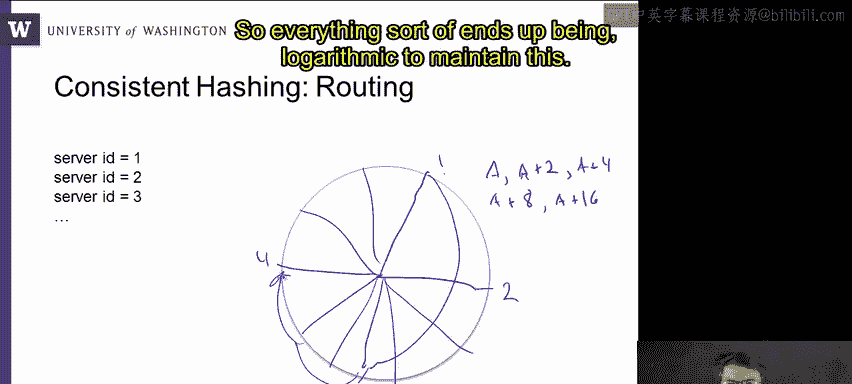

# 大规模数据科学（大数据操作，第1课/共3课） - P82：一致性哈希（续） 🔄

在本节课中，我们将继续深入探讨一致性哈希算法。上一节我们介绍了其基本概念，本节中我们将详细讲解其工作原理、如何高效处理服务器增减，以及如何优化请求路由。一致性哈希是构建可扩展分布式系统的关键技术。

---

## 工作原理详解 🛠️

一致性哈希的第一个核心思想是，将服务器标识符映射到与数据键值相同的空间中。

我们应用一个哈希函数（此处暂不具体指定），将服务器 `Server 1`、`Server 2` 和 `Server 3` 分别映射到一个环形空间上的某个点。

这样，整个环形空间就被划分成了三个区域。

接下来，对于每一个数据键，我们也使用相同的哈希函数将其映射到这个环形空间上。例如，我们得到 `Key 1`、`Key 2`、`Key 3`、`Key 4`、`Key 5`、`Key 6`、`Key 7` 等。

现在，每个服务器负责管理环形空间上从它自身位置开始，到顺时针方向下一个服务器位置之前的所有数据键。例如，`Server 1` 负责其所在区域的所有数据键，`Server 2` 和 `Server 3` 同理。

## 处理服务器增减 ➕➖

这种设计的好处在于，当需要添加一个新服务器时，例如 `Server 4`，我们只需将其哈希到环形空间上的某个位置（例如 `Server 3` 和 `Server 1` 之间）。

根据规则，新服务器 `Server 4` 将负责其所在区域的所有数据键。这意味着原本由 `Server 3` 负责的、现在落入 `Server 4` 区域的那部分数据键，需要被迁移到 `Server 4` 上。

你只需要移动这一小部分数据，而不是重新分配所有数据。这极大地减少了因服务器增减而导致的数据迁移量。

## 支持数据副本 📝

为了支持数据副本（即将同一份数据存储在多个地方以提高可靠性），我们可以对同一个数据键进行多次哈希。

例如，如果你想将数据存储在两个不同的位置，可以计算数据键 `D` 的哈希值 `H(D)`，然后将其存储到哈希环上对应的两个不同位置。如果需要三个副本，就存储到三个位置。

## 高效处理请求 🚀

在一致性哈希的架构中，键空间被划分到各个服务器上。当一个请求到达时（请求可能先到达一个被选举出的“领导者”服务器，或由系统自上而下指定，甚至是随机分配），需要被路由到正确的服务器。

以下是处理请求的两种方式：

### 朴素方式（低效）

服务器收到请求后，检查自己是否拥有请求的键。如果没有，就将请求转发给环上的下一个服务器。

这种方式效率低下，因为服务器数量可能非常多，每次读取请求都可能产生多次网络跳转，增加延迟。

### 优化方式（高效）

每个服务器除了知道自己的位置，还记忆环上其他一些特定服务器的位置。具体来说，每个服务器会记住距离自己位置为 `+2`、`+4`、`+8`、`+16`……（即2的幂次方）的服务器位置。

每个服务器都知道这些被记忆的服务器各自负责的键值范围。

因此，当服务器收到一个不属于自己负责范围的请求时，它可以将请求直接转发给负责的键值范围最接近目标键的那个服务器。

这种方式将请求路由的跳转次数控制在对数级别（`O(log N)`），即使服务器数量 `N` 很大，也能高效处理。

此外，当有新服务器加入时，每个服务器只需要更新对数数量的连接信息，整个系统的维护开销也保持在对数级别。

---

本节课中我们一起学习了**一致性哈希算法**的详细工作机制。我们了解了如何将服务器和数据映射到哈希环上，如何优雅地处理服务器的增加与移除，如何通过多哈希支持数据副本，以及如何使用对数跳转的策略来高效路由请求。这些特性使得一致性哈希成为构建大规模、可扩展分布式存储系统的基石。