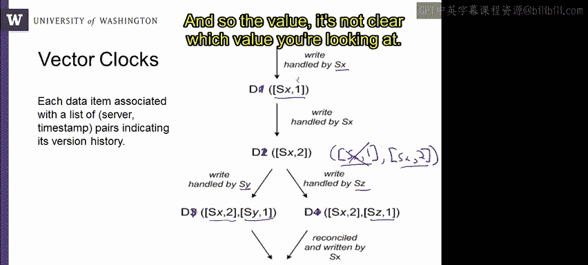

# 课程名称：大规模数据科学（大数据操作，第1课/共3课） - P83：DynamoDB向量时钟 🕰️

## 概述
在本节课中，我们将学习亚马逊DynamoDB系统的核心机制，特别是其用于实现最终一致性的关键技术——向量时钟。我们将了解DynamoDB的设计目标、关键特性，并深入探讨向量时钟如何帮助检测数据冲突。

---

## DynamoDB简介
亚马逊在2007年发表了一篇关于Dynamo的论文。几年后，它作为一项名为DynamoDB的云服务发布。

DynamoDB可以扩展到数千个节点。它基本上是一个键值存储，主要通过主键来查找数据，这与Memcached类似。

上一节我们介绍了DynamoDB的背景，本节中我们来看看它的一些关键特性。

以下是DynamoDB的一些关键特性：
*   它提供基于性能的服务水平协议。具体来说，它承诺在99.9%的请求中，响应时间在300毫秒以内。
*   它选择使用第99百分位数（99th percentile）来衡量性能，而不是平均值或中位数。这是因为如果使用平均值，可能会人为地惩罚重度用户。例如，只关注轻量级用户就很容易满足平均响应时间的要求。

---

## Dynamo系统架构
Dynamo系统是一个分布式哈希表（DHT）。每个键值对会存储在多个位置以实现数据复制，复制因子为N。

具体存储位置从节点K开始，一直到节点K+N-1。它通过向量时钟来实现最终一致性，我们将在接下来的幻灯片中描述这一点。

另一个有趣的特点是，Dynamo在读取时处理潜在的写入冲突。写入操作永远不会失败。论文中引用的理由是，失败的写入操作会带来糟糕的用户体验。

例如，如果你正在一个社交网络网站上更新状态，系统却返回错误消息说“提交失败”，这比读到错误的数据更具破坏性。对于许多应用来说，冲突解决策略可以是“最近写入者获胜”，或者在某些情况下，应用可以控制解决逻辑，甚至可以让用户手动解决冲突。

---

## 向量时钟详解
向量时钟的目标是检测冲突，以便应用程序能够解决它们，而不是自动解决所有冲突。我们只是试图检测问题。

在这个方案中，每个数据项都与一个（服务器，时间戳）对的列表相关联，该列表指示了它的版本历史。

在下面的图表中，与这些项目相关的数字可能有点令人困惑，我们先忽略它们。假设这都是同一个数据项。

以下是向量时钟的工作原理：
1.  一个写请求首先到达服务器Sx。服务器Sx附加向量时钟对 `(Sx, t1)`。这表示该数据项在时间戳t1由服务器Sx写入。
2.  稍后，同一个服务器Sx处理另一个写请求，会创建向量时钟 `(Sx, t1), (Sx, t2)`。然而，`(Sx, t2)` 完全包含了 `(Sx, t1)` 的信息（同一服务器，更晚的时间戳）。因此，我们不再需要关心 `(Sx, t1)`，可以将其垃圾回收，只保留 `(Sx, t2)`。
3.  接着，服务器Sy和服务器Sz独立地写入该数据项。向量时钟被扩展为 `(Sx, t2), (Sy, t1), (Sz, t1)`。
4.  最后，一个读请求到达。它看到向量时钟中存在冲突，因为有两个不同服务器在相同时间戳（t1）上进行了写入。因此，系统知道这两个写操作是独立发生的，当前看到的值存在歧义。

---

## 总结
本节课中我们一起学习了亚马逊DynamoDB的核心设计。我们了解到它是一个高可用的分布式键值存储，通过多副本和向量时钟机制来保证最终一致性。向量时钟的核心作用在于记录数据项的版本历史，从而能够检测出并发写入导致的数据冲突，为应用程序层解决冲突提供了必要的信息。