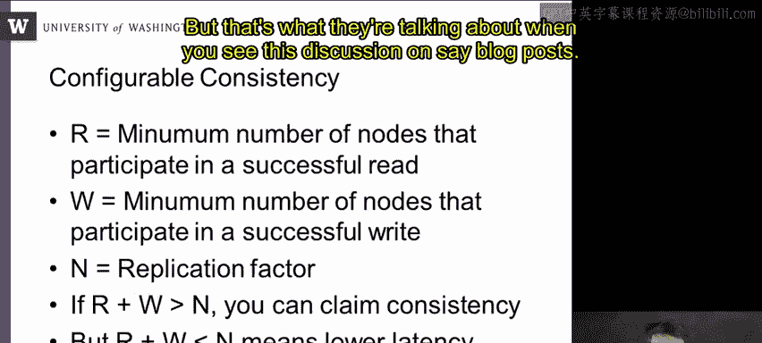

# 大规模数据科学（大数据操作，第1课/共3课） - P84：向量时钟（续）⏰

在本节课中，我们将继续学习向量时钟的概念，并通过具体示例来理解如何判断数据版本之间是否存在冲突。我们还将简要介绍Dynamo系统中用于参数化一致性级别的R和W参数。

---

## 向量时钟冲突判断练习

上一节我们介绍了向量时钟的基本原理，本节中我们来看看如何运用它来判断数据版本之间的冲突关系。以下是几个向量时钟的示例，我们需要判断它们是否代表冲突。

**示例一：**
*   `Sx:3, Sy:1`
*   `Sx:3, Sz:1`

**是否存在冲突？**
是的，存在冲突。因为在一条版本路径上，服务器Sy进行了一系列修改；而在另一条版本路径上，服务器Sz进行了一系列修改。这两个版本没有反映彼此的更改，说明它们之间没有通信。

**示例二：**
*   `Sx:3`
*   `Sx:5`

**是否存在冲突？**
不，不存在冲突。因为它们由同一台服务器处理，只是时间戳不同。版本`Sx:5`完全包含了版本`Sx:3`的信息。

**示例三：**
*   `Sx:3, Sy:6`
*   `Sx:3, Sy:6, Sz:2`

**是否存在冲突？**
不，不存在冲突。因为两个版本在Sx和Sy上的时间戳一致。第二个版本只是在第一个版本的基础上，在服务器Sz上多了一次更改。因此，第二个版本胜出。

**示例四：**
*   `Sx:3, Sy:10`
*   `Sx:3, Sy:6, Sz:1`

**是否存在冲突？**
是的，存在冲突。版本`Sy:10`在时间上比`Sy:6`更晚。如果只有Sy的差异，我们可以直接选择`Sy:10`的版本。但是，由于第二个版本在服务器Sz上也有更改，并且两个版本都从它们最后一致的点（`Sx:3`）开始向前发展，我们无法确定如何解决这个分歧。

**示例五：**
*   `Sx:3, Sy:10`
*   `Sx:3, Sy:20, Sz:1`

**是否存在冲突？**
不，不存在冲突。因为第二个版本在它们共有的所有服务器（Sx和Sy）上都具有更晚的时间戳（`Sy:20 > Sy:10`），它严格包含了第一个版本的信息。

---

## 一致性参数：R与W

除了向量时钟，Dynamo系统还讨论了一种参数化一致性级别的方法，这在相关论文和博客中时常出现。

其核心思想是定义两个参数：**R**和**W**。
*   **R** 代表一次成功读取操作所需参与的最小节点数。
*   **W** 代表一次成功写入操作所需参与的最小节点数。

在复制因子为**N**的系统中：
*   如果 **R + W > N**，则可以声称实现了强一致性。因为读写覆盖的节点集合必然存在交集，能确保读到最新写入的数据。
*   通常，为了获得更低的延迟，会设置 **R + W <= N**。这样就不需要在每次读写时都联系太多服务器。

**公式表示：**
`N` = 复制因子（数据副本总数）
`R` = 成功读取所需最小副本数
`W` = 成功写入所需最小副本数

一致性条件：当 `R + W > N` 时，系统可提供强一致性保证。

---

## 总结

本节课中我们一起学习了向量时钟的应用，通过多个例子练习了如何判断不同数据版本之间是否存在冲突。我们还简要了解了Dynamo系统中通过R和W参数来权衡一致性与延迟的机制。向量时钟和一致性哈希是在NoSQL及其他分布式系统中反复出现的重要概念。