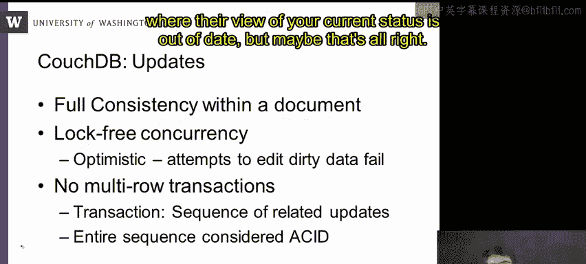

# 课程名称：大规模数据科学（大数据操作，第1课／共3课） - P85：CouchDB概述 📄


## 概述

在本节课中，我们将要学习CouchDB，这是一个始于2005年并持续更新至今的流行文档导向数据库系统。我们将探讨其核心特性、数据模型、更新机制以及独特的“视图”概念。

---

## CouchDB简介

上一节我们介绍了不同的数据存储系统，本节中我们来看看CouchDB。这是一个文档导向的存储系统，至今仍被广泛使用。

以下是CouchDB的一些关键特性：
*   **扩展性**：支持大规模数据存储。
*   **索引**：支持主键索引，并开始引入**二级索引**的需求。这意味着你不仅可以通过键（key）查找文档，还可以通过文档中的其他值进行查找。
*   **事务**：在单个文档内支持更好的事务性。这里的“记录”指的是你可以在一个文档对象（一组键值对）内更改多个值，而不仅仅是单个键值对。
*   **分析**：通过CouchDB特有的**视图**概念，提供一定的分析支持。你可以运行小的MapReduce脚本来从现有文档源计算或衍生出新值。

---

## 数据模型

CouchDB的数据模型是**文档导向**的。一个文档就是一组键值对。

例如，在一个博客应用中，一个文档可能代表一篇博客文章，其结构如下：
```json
{
  "subject": "大数据简介",
  "author": "张三",
  "date": "2023-10-27",
  "tags": ["大数据", "教程", "CouchDB"],
  "body": "这是博客文章的正文内容..."
}
```
*   `subject`、`author`、`date`、`body` 都是键值对。
*   `tags` 是一个值列表，这体现了文档模型的嵌套能力。

需要注意的是，CouchDB中的所有数据都使用**JSON**格式表示，所有请求和响应也使用JSON。这就是为什么之前在Twitter作业中熟悉JSON很重要。

---

## 更新机制

现在，我们来看看CouchDB中更新是如何工作的。

在单个文档内，CouchDB提供**完全的事务一致性**。这意味着你可以“锁定”一个文档（逻辑上），并对其做任意修改。它实际上并不使用传统的锁机制，而是采用**乐观并发控制**。系统乐观地假设冲突不会经常发生。

其工作流程是：当你检出（check out）一个文档并进行修改后尝试提交时，如果在此期间已有其他人提交了对同一文档的修改，那么你的提交将会失败。在这种情况下，你只需获取最新的文档版本，重新应用你的修改即可。

然而，CouchDB**不支持跨多个文档的事务**。例如，你不能保证在更新自己状态文档的同时，能同步更新所有好友状态列表中的信息。你只能分两步进行，这可能导致短暂的数据不一致，但在许多应用场景中这是可以接受的。

---

## 视图概念

最后，我们来探讨CouchDB中一个独特且重要的概念：**视图**。

视图的概念在关系型数据库中也非常基础，它提供了逻辑数据独立性。在CouchDB中，视图是其支持数据分析功能的核心。通过编写MapReduce函数来定义视图，你可以从原始文档中聚合、筛选或计算新的数据表示形式，这为数据查询和分析提供了强大的灵活性。

---

## 总结



本节课中我们一起学习了CouchDB。我们了解了它是一个基于JSON的文档数据库，支持在单个文档内的事务（通过乐观并发控制），但不支持跨文档事务。其数据模型灵活，允许嵌套结构。此外，CouchDB通过**视图**和MapReduce提供了数据分析能力，这是其一个显著特点。理解这些核心概念有助于我们在需要灵活、文档型数据存储的场景中评估和使用CouchDB。