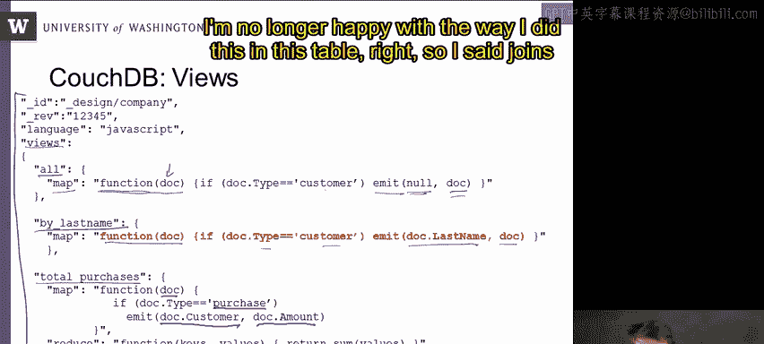

# 课程名称：大规模数据科学（大数据操作，第1课） - CouchDB视图 🗂️


## 概述

在本节课中，我们将要学习CouchDB中一个核心概念——**视图**。视图是CouchDB实现数据查询、建立二级索引以及进行计算（如聚合）的关键机制。我们将了解视图的规范结构、其实现方式（Map和Reduce函数），以及它在整个数据库系统中的作用。

---

## 视图规范 📄

上一节我们介绍了视图的概念，本节中我们来看看一个具体的视图规范是如何定义的。

视图规范本身是一个CouchDB文档，它包含一组键值对，是一种特殊的文档。其结构如下所示：

```json
{
  "_id": "_design/example",
  "views": {
    "all": { ... },
    "by_last_name": { ... },
    "total_purchases": { ... }
  }
}
```

这个规范包含了三个视图：`all`、`by_last_name` 和 `total_purchases`。每个视图都将实现为一组键值对，本质上是一个字典。

---

## 视图的实现：Map与Reduce函数 ⚙️

理解了视图的规范结构后，我们来看看这些视图是如何被具体实现的。这里涉及到两个重要的概念：**Map函数**和**Reduce函数**。

这些函数使用JavaScript编写（因为CouchDB中一切皆是JavaScript），其形式通常是匿名函数。以下是每个视图的具体实现：

### 1. `all` 视图

`all`视图仅包含一个Map函数，没有Reduce函数。它的目的是获取所有类型为“customer”的文档。

```javascript
function (doc) {
  if (doc.type === 'customer') {
    emit(null, doc);
  }
}
```
*   **函数逻辑**：检查文档的`type`字段是否为“customer”。如果是，则发射一个键值对。
*   **键**：`null`（在此查询中我们不关心键）。
*   **值**：整个文档`doc`。
*   **作用**：此视图用于获取所有客户文档。

### 2. `by_last_name` 视图

`by_last_name`视图也仅包含一个Map函数，用于建立以“last_name”为键的二级索引。

```javascript
function (doc) {
  if (doc.type === 'customer') {
    emit(doc.last_name, doc);
  }
}
```
*   **函数逻辑**：检查文档是否为客户，然后以客户的姓氏（`last_name`）为键发射文档。
*   **键**：`doc.last_name`。
*   **值**：整个客户文档`doc`。
*   **作用**：此视图允许客户端通过姓氏高效地查询客户信息。CouchDB会主动物化这些视图，并将其存储在分布式的B树索引结构中，以支持快速查找。

### 3. `total_purchases` 视图

`total_purchases`视图则更进一步，它同时包含了Map函数和Reduce函数，用于执行简单的聚合计算。

以下是它的Map函数：
```javascript
function (doc) {
  if (doc.type === 'purchase') {
    emit(doc.customer_id, doc.amount);
  }
}
```
*   **函数逻辑**：检查文档类型是否为“purchase”（购买记录）。如果是，则以`customer_id`为键，以购买`amount`为值发射键值对。

以下是它的Reduce函数：
```javascript
function (keys, values) {
  return sum(values);
}
```
*   **函数逻辑**：接收Map阶段输出的、属于同一个客户（相同`customer_id`）的所有金额（`amount`），并将它们求和。
*   **作用**：此视图可以快速计算出每个客户的总购买金额。

---

## 视图的维护与一致性 🔄

CouchDB会在数据发生变化时维护和更新所有这些视图。这种更新遵循**最终一致性**语义。这意味着，在文档更新后，相关的视图索引可能会稍后才更新完成，但最终所有副本都会达到一致状态。

通过视图，我们实际上在一个概念下整合了多个重要功能：**二级索引**、**逻辑数据独立性**以及**MapReduce计算**。

---

## 关于连接（Joins）的澄清 💡

需要特别指出的是，虽然可以在CouchDB中使用MapReduce风格进行计算，但它**无法直接执行类似关系型数据库中的表连接（Joins）操作**。这是一个重要的限制，在设计数据模型和查询时需要特别注意。

---

## 总结

本节课中我们一起学习了CouchDB的**视图**机制。我们了解到：
1.  视图规范是定义查询和索引的特殊文档。
2.  视图通过**Map函数**和可选的**Reduce函数**（使用JavaScript编写）来实现。
3.  Map函数用于过滤和发射键值对，建立索引（如`by_last_name`）或准备聚合数据（如`total_purchases`）。
4.  Reduce函数用于对Map阶段输出的值进行聚合计算（如求和）。
5.  视图由CouchDB主动维护，遵循最终一致性。
6.  视图提供了二级索引、逻辑数据独立性和计算能力，但**不支持直接的连接操作**。



掌握视图是有效使用CouchDB进行数据查询和分析的基础。