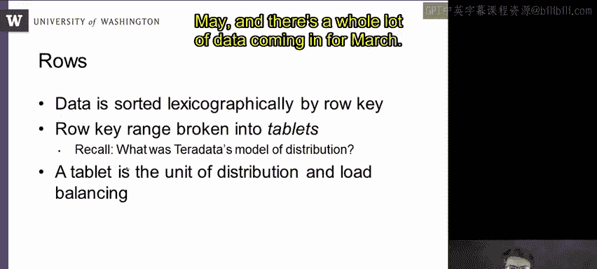
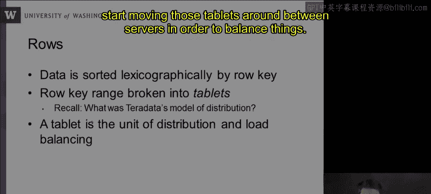

# 大规模数据科学（大数据操作，第1课／共3课） - P87：BigTable概述 🗃️

在本节课中，我们将学习Google BigTable系统。BigTable是Google在2006年提出的一种分布式存储系统，旨在为海量结构化数据提供快速、可靠的访问。它与MapReduce互补，解决了MapReduce无法进行低延迟、基于键值查找的问题。

---

## BigTable简介

Rick在论文中提到的第三个有影响力的系统是来自Google的BigTable。这是一篇2006年的论文。

BigTable支持基于主索引的查找和基于二级索引的查找。其事务处理也主要针对单个记录级别的操作。BigTable本身不直接支持连接（Join）和分析（Analytics）操作。

在HBase（其开源实现）以及Google自身的实现中，BigTable的设计初衷是与MapReduce兼容。因此，你可以在存储在BigTable上的同一份数据上运行MapReduce作业，两者是互补的关系。

BigTable中有一些关于完整性约束或模式（Schema）的概念，我们稍后会讨论其实现方式。它没有视图（View）功能，也没有用于操作数据的特定查询语言或代数。所有操作都是NoSQL风格的，即针对单个记录和单元格的微操作。

---

## BigTable的设计背景与数据模型

上一节我们介绍了BigTable的基本定位。本节中我们来看看它的设计背景和核心数据模型。

这篇论文发表在2006年的OSDI会议上，部分作者与MapReduce论文的作者重叠。它从一开始就被设计为MapReduce的补充。

回想一下，MapReduce主要缺失的功能之一（或者说几个功能）是无法通过索引快速查找数据，也无法进行低延迟的访问。例如，给定一个大数据集，如果你想找到所有与另一个数据集对应的记录，你无法执行连接操作。你只能处理整个数据集，无法直接定位到你想要的那部分特定记录。

BigTable则提供了基于键的快速查找功能。但你仍然可以将整个数据集视为一组键值记录，用MapReduce进行批量处理，这没有问题。

BigTable的数据模型是一个**稀疏的、分布式的、持久化的、多维有序映射**。这意味着，你可以通过提供行ID、列名和时间戳这三个参数，来访问BigTable中的任何一个单元格。此处的英文描述没有详细说明时间戳，它主要用于版本控制。在进行更新后，系统会保留同一单元格的过去版本。

因此，如果你提供了这三个参数，BigTable会快速返回一个字符串给你。

---

## 数据组织方式：行键与分片

了解了数据模型后，我们来看看数据是如何在集群中组织和分布的。

每一行数据都按照行键（即此处的行ID）进行字典序排序。在关系型数据库术语中，这类似于主键；在NoSQL框架中，这就是键。

连续的键值范围（例如一段连续的整数）会被分配给一个“Tablet”（分片）。这与我们之前讨论过的至少一个系统（例如并行数据库模型）的数据划分方式有所不同。

我们曾以Teradata为例。Teradata是如何分割数据的呢？它是通过哈希函数。每个独立的记录会根据一个哈希函数被发送到特定的服务器上，你可以大致将其理解为轮询分配。关键在于，在Teradata模型中，两个在键值空间上相邻的键（例如时间戳5:00和5:01）没有理由被分配到同一台服务器上。

但在BigTable中，相邻的键就在同一台服务器上。

这种设计有何利弊？

如果你通常需要一次性访问整个键值范围，那么这种设计非常有利。当你获取一个键时，可以近乎免费地获取相邻的其他键，因为它们都在同一个分片上。

然而，如果某个特定的键值范围比其他范围热门得多（再次以时间为例，最近的数据可能最受欢迎），那么所有请求都会涌向承载这个热门分片的服务器。而承载其他较旧时间分片的服务器则会闲置。

因此，Teradata选择哈希一切，这样每个请求都可能需要访问所有服务器，但这有利于可扩展性。所以，各有利弊。

在BigTable中，Tablet是数据分布和负载均衡的基本单位。当负载开始不平衡时（例如，如果你的键范围是1月到5月，而3月的数据量激增），系统会将这个分片拆分成多个更小的Tablet，并在服务器之间移动这些Tablet以实现负载均衡。

---

## 总结

本节课中，我们一起学习了Google BigTable系统。我们了解到BigTable是一种为海量数据设计的分布式存储系统，它使用基于行键的有序映射模型，通过Tablet进行数据分片和负载均衡。BigTable与MapReduce形成互补，提供了MapReduce所缺乏的低延迟、基于键的快速查找能力，同时保留了进行大规模批量处理的可能性。理解其数据组织方式（连续键值范围分配）及其与哈希分配方式的利弊，是掌握其设计思想的关键。