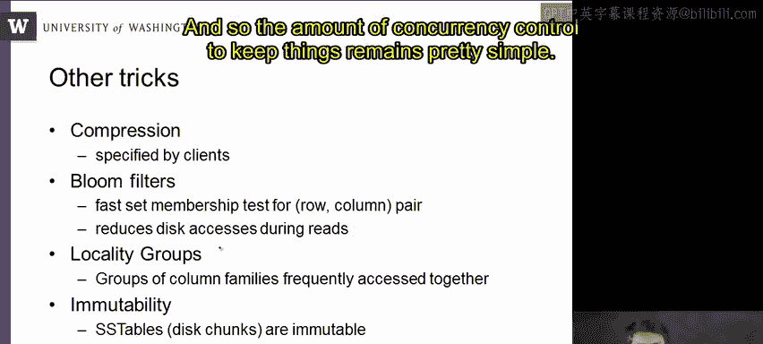

# 大规模数据科学（大数据操作，第1课／共3课） - P88：BigTable 实现详解 🗄️

在本节课中，我们将深入探讨 Google BigTable 的内部实现机制。BigTable 是一个用于管理海量结构化数据的分布式存储系统，理解其核心设计对于掌握大规模数据处理至关重要。

## 列族与访问控制

上一节我们介绍了 BigTable 的基本数据模型，本节中我们来看看其核心组织单元——列族。

在单个表中，可以存在被称为列族的分组。列名中包含族名作为限定符。列族是访问控制的基本单位，可以对一组列统一设置权限。

列族也是内存和磁盘存储计量的基本单位。它们通常在内存中作为一个单元进行分配，在磁盘上也作为一个单元进行移动。

需要指出的是，一个列族中的所有列通常是相同的数据类型。这一点有些特别，因为列族最初被描述为访问控制的基本单位，这暗示了逻辑上相关的数据（例如社会保险号和员工ID）会放在一起，而这些数据的数据类型可能并不相同。然而，要求同族同类型是出于技术原因，主要是为了便于压缩。例如，压缩一整组整数比压缩整数和字符串的混合数据要容易得多。这体现了设计上试图用单一结构满足多种需求的考量。

## 数据版本与键结构

每个数据单元都可以有多个版本，这是键值查找的第三部分。完整的键由行ID、列名和时间戳组成。每次写入新版本都会递增时间戳。

系统可以实施不同的版本保留策略，例如只保留最新的N个版本，或者只保留某个时间戳之后的版本。

## Tablet 管理与元数据组织

接下来，我们看看 BigTable 如何管理数据分片（Tablet）。

Tablet 的管理由一个主服务器负责。主服务器将 Tablet 分配给 Tablet 服务器，由 Tablet 服务器处理来自 Tablet 的读写请求。客户端直接与 Tablet 服务器通信，而不是每次都经过主服务器，这有助于提高系统的可扩展性。

当一个 Tablet 变得过大时，系统会将其分裂并进行负载均衡。

以下是追踪 Tablet 位置的元数据组织方式：
*   元数据本身被组织在另一个特殊的 Tablet 中，称为根 Tablet。
*   根 Tablet 中的每条记录描述了一组位置记录，这些记录位于一个更大的元数据表中。
*   而这些元数据表中的每一个 Tablet，则给出了一个特定用户表的位置信息。

通过这种层次化的结构，系统可以有效地追踪所有数据的位置。论文中提到的 Chubby 是一个分布式锁服务，用于控制对这些资源的访问。

## 读写操作处理

现在，我们来看看系统如何处理读写操作。

内存中有一个表（MemTable），用于按顺序存储发生的更新。一个写操作会向这个驻留内存的表中添加一条记录，同时为了容错，该操作也会被写入日志。这样，如果服务器宕机，可以通过读取 Tablet 日志来重建状态。

读操作则通过读取实际的 SSTable 文件，并动态地应用 MemTable 中的更新流来提供服务。可以将其理解为：先获取基础值，然后应用一系列更新操作来得到真实值。

## 压缩与维护机制

当 MemTable 变得越来越大时，系统通过两种压缩事件来进行簿记管理。

第一种是次要压缩。当 MemTable 变大时，其内容会被写入一个新的 SSTable 文件，并与现有数据合并。

第二种是主要压缩。这个过程会获取所有的 SSTable 文件，并将它们重写为一个可能被分割成多个文件的大文件。同时，它会清理所有已发生的删除操作。在 BigTable 中，删除操作只是作为指令被追加，并不会立即物理删除数据，它们会在压缩过程中像垃圾回收一样被清理。

通过这种方式，系统可以在后台持续运行，保持较高的读取吞吐量。

## 性能优化技巧

BigTable 还采用了多种其他优化技巧。

客户端可以指定压缩方式，系统支持多种不同的压缩方法。布隆过滤器被用来加速存在性测试。例如，当给定行ID、列ID和时间戳来查找某个值时，布隆过滤器可以非常快速地判断该值**不存在**于系统中，从而避免不必要的磁盘访问。布隆过滤器数据结构非常巧妙，我们将在后续课程中详细讲解。

此外，还可以在列族之上定义局部性群组，这是另一层组织结构，用于将经常被一起访问的列族分组。

另一个关键技巧是确保 SSTable 这些磁盘数据块是不可变的。它们永远不会被直接写入，唯一的写入时机发生在主要压缩期间，届时整个结构会被重组。这意味着系统中唯一可写的数据结构就是 MemTable，从而使得维持数据一致性的并发控制机制保持相对简单。

---

本节课中我们一起学习了 Google BigTable 的核心实现机制。我们探讨了其以列族为基础的数据组织方式、包含时间戳的键结构、通过主服务器和 Tablet 服务器进行的分片管理、以及层次化的元数据组织。我们还详细分析了读写操作的处理流程，特别是 MemTable 和 SSTable 的协同工作方式，以及通过次要压缩和主要压缩进行的数据维护。最后，我们了解了一系列性能优化技巧，如布隆过滤器、局部性群组和 SSTable 的不可变性设计，这些共同构成了 BigTable 高效、可扩展存储系统的基石。