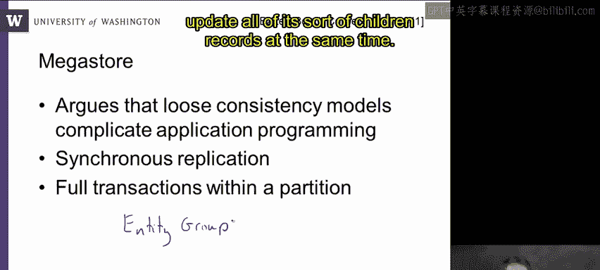

# 大规模数据科学（大数据操作，第1课／共3课） - P89：HBase与Megastore 🗄️

在本节课中，我们将要学习Google BigTable的两个重要衍生系统：开源项目HBase，以及Google为应对弱一致性模型挑战而设计的Megastore。我们将了解它们的设计理念、核心架构以及与MapReduce的兼容性。

## HBase：BigTable的开源实现 🐘

上一节我们介绍了Google BigTable，它对业界产生了巨大影响。本节中我们来看看其最重要的开源实现之一：HBase。

正如MapReduce催生了Hadoop，BigTable的理念也被采纳并实现为一个开源项目，即HBase。HBase被设计为与Hadoop生态系统兼容。

在架构层面，HBase与BigTable的核心概念相似，但术语和部分结构存在差异。以下是HBase的关键层级结构：

*   **表**：数据的顶层容器。
*   **区域**：HBase引入的一个额外抽象层，表被水平分割为多个区域。
*   **区域服务器**：负责管理一个或多个区域。
*   **MemStore**：内存中的写缓存。
*   **存储文件**：持久化到磁盘（HDFS）的数据文件。

HBase与MapReduce的兼容性体现在：每个Map函数通常会处理一个单独的“数据片”（在HBase语境下可对应一个区域），这与我们讨论MapReduce时提到的数据块处理方式是一一对应的。

## 混合系统下的挑战 ⚠️

现在，我们来看看一个开放性的问题。当我们混合使用这些系统时，可能会遇到一些挑战。

我们曾讨论过MapReduce中的“推测执行”机制：出于容错考虑，系统可能在两个不同的数据副本上启动相同的Map任务。这样，如果一个任务失败，另一个可以接替，无需完全从头开始。

然而，在HBase和BigTable所支持的数据被**主动更新**的环境中，情况变得不那么清晰。由于最终一致性，这两个处理相同数据片（Tablet）的任务可能无法瞬间就所有记录达成一致。它们最终会一致，但片内不同记录的状态在某一时刻可能不同。

当你混合使用这两种缺乏**系统范围事务保证**或**强一致性属性**的系统时，就可能遇到麻烦。我认为，包括Google设计的这些NoSQL系统在内，一个普遍的主题是：系统将部分责任转移给了应用程序和程序员，需要他们来处理和确保最终结果的正确性。

我们将在几分钟后回到这个话题。

## Megastore：寻求更强的保证 🛡️

在BigTable问世几年后，Google的一批研究人员发表了一篇关于名为Megastore的系统的论文。我们不会深入细节，但需要了解其核心动机。

他们发现，正如我刚才指出的，这些松散的**一致性模型**会使应用程序编程复杂化。因此，他们希望为某些类型的**安全更新**提供更多的系统级支持。

与BigTable仅在单个记录内保证事务安全不同，Megastore通过引入“实体组”的概念扩展了事务支持。

以下是实体组的关键特性：

*   **定义**：一个实体组是一组倾向于共同访问、共同更新的记录的集合。
*   **示例**：例如，一篇博客文章及其所有评论。每篇文章和每条评论都是一个独立的记录（因为这是合理的记录存储方式，可以有不同的模式），但它们通常作为一个整体被处理。
*   **事务范围**：Megastore将事务支持扩展到了整个实体组，即一组相关的记录。

通过这种方式，Megastore在不需要全局同步（从而保持了可扩展性）的同时，允许你规避以下问题：在需要同时更新一个主记录及其所有关联子记录时，无法以任何安全的方式进行操作。

## 总结 📝

本节课中我们一起学习了HBase和Megastore。HBase作为BigTable的开源实现，继承了其核心思想并与Hadoop集成，但在架构细节上有所不同。同时，我们探讨了在弱一致性、支持更新的存储系统上运行像MapReduce这样的批处理框架时可能面临的挑战。最后，我们看到了Google如何通过Megastore系统，引入“实体组”的概念，在保持可扩展性的前提下，为相关联的记录集提供更强的事务性保证，以简化应用开发。