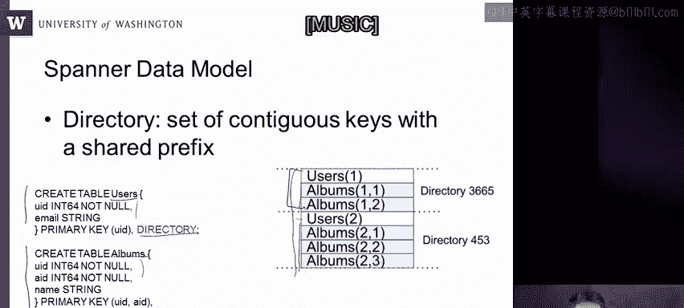

# 大规模数据科学（第1课/共3课） - P90：Spanner 🗄️


在本节课中，我们将学习谷歌开发的全球级分布式数据库系统——Spanner。我们将了解它诞生的背景、核心设计理念、数据模型特点，并探讨它如何尝试解决其前身BigTable的局限性。

---

## 概述

上一节我们介绍了BigTable等系统。本节中，我们来看看谷歌在2012年论文中提出的Spanner系统。Spanner旨在解决用户对BigTable的一些抱怨，特别是在复杂模式演变和需要跨地域强一致性场景下的使用困难。它代表了一种向更传统数据库特性（如事务和类SQL语言）回归的趋势，同时保持了大规模可扩展性。

## Spanner出现的背景

尽管许多项目成功地使用了BigTable，但用户也持续提出了一些抱怨。

以下是用户反馈的主要问题：
*   某些具有复杂、不断演变的模式的应用，使用BigTable会感到困难。
*   那些在广域复制场景下需要强一致性的应用，BigTable难以满足。

因此，Spanner的设计者认为，与其让应用程序员始终围绕“缺乏事务”进行编码，不如提供系统级的事务支持。即使初期可能因过度使用事务导致性能瓶颈，这也比在应用层弥补事务缺失更好。

数据库社区或许会认为这是显而易见的道理。系统提供的事务支持总是更优的，原因在于：
*   在应用层实现事务逻辑是困难、易出错且昂贵的。
*   更重要的是，在应用层做这件事在根本上是错误的，因为应用程序不具备系统所拥有的全局视角。

## Spanner的高层特点

现在，让我们看看Spanner在高层设计上的特点。

Spanner是一个行星级规模的数据库系统。以下是其关键特性：
*   **大规模主键访问**：支持通过其他属性进行访问。
*   **真正的事务**：提供真实的ACID事务，并且这次是全局范围的。
*   **模式支持**：提供某种模式概念，能防止不符合模式的数据写入。
*   **逻辑数据独立性**：具备逻辑数据独立性的概念，尽管论文中讨论不多。
*   **类SQL语言**：系统顶层有一个声明式的、类似SQL的语言。

关于连接（Join）操作是否被支持，文中未明确给出例子，但鉴于提到了SQL，推测很可能支持。同时，论文也指出其在复杂分析查询上性能不佳，但这可能是未来可以快速改进的方面。

## Spanner的数据模型

接下来，我们深入了解一下Spanner的数据模型细节。其核心是“目录”的概念。

目录是一组具有共享前缀的连续键，可以粗略地类比为BigTable中的“片”。但Spanner引入了新的概念：多个逻辑表可以“交错”在一起。

如果你不熟悉这种语法，不必过于担心。简单来说，Spanner有一种类似关系数据库DDL的建表语言。例如，你可以用以下方式创建表：

```sql
CREATE TABLE Users {
  user_id INT64,
  name STRING
} PRIMARY KEY (user_id), DIRECTORY;

CREATE TABLE Albums {
  user_id INT64,
  album_id INT64,
  title STRING
} PRIMARY KEY (user_id, album_id), INTERLEAVE IN PARENT Users;
```

这种“交错”设计的结果是，数据在物理存储上会像这样组织：一个用户记录后面紧跟着其所有的相册记录，然后是下一个用户及其相册。

我们可以看到，Spanner和其他许多现代系统一样，都在尝试实现这种嵌套的、层次化的数据结构。这与早在20世纪60年代就出现的数据模型动机相似：当你需要查询一个用户并立即获取其所有相册时，这种存储方式访问速度极快。

然而，关系模型最终取代了那些早期模型，原因可能在于性能并非总是第一优先级，很多时候“最小化开发者的麻烦”更为重要。因此，这种向大规模、可扩展的关系型数据库的渐进式回归是否成功，仍有待观察。但这并不意味着要全盘照搬旧数据库，它们是为不同的工作负载设计的，并且没有证据表明它们能扩展到Spanner所面对的级别。关键在于，我们不应抛弃过去数十年积累的所有知识。

---

## 总结



本节课中，我们一起学习了谷歌的Spanner系统。我们了解到它是对BigTable局限性的回应，旨在通过提供全局ACID事务、类SQL接口和更丰富的数据模型（如交错表），来构建一个兼具强一致性和全球规模可扩展性的数据库。Spanner的出现，标志着在大数据领域，系统设计正在重新审视并整合传统关系数据库中的经典概念与价值。