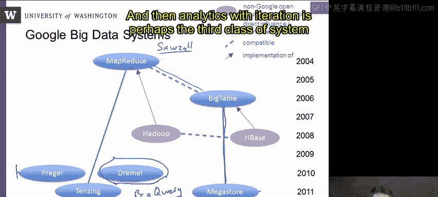

# 大规模数据科学（大数据操作，第1课／共3课） - P91：Spanner（续）与Google系统全景 🗺️

在本节课中，我们将继续深入了解Google的Spanner分布式数据库，并梳理Google内部一系列有影响力的大数据系统，理解它们的发展脉络、设计目标以及彼此之间的关系。

上一节我们介绍了Spanner的基本架构，本节中我们来看看其内部组件如何协同工作，以及它在Google庞大技术栈中的位置。

## Spanner架构详解 🔧

Spanner的顶层是一个**宇宙主节点**。这是一个单例部署，全局可能只有一到两个这样的部署（例如一个用于测试，一个用于生产）。许多不同的应用程序会共享同一个Spanner部署。宇宙主节点主要负责存储各个区域的状态信息，它不与客户端直接交互。

**放置驱动器**负责为了负载均衡的目的，在几分钟的时间尺度上移动记录目录集。

在每个区域内部，存在以下组件：
*   **区域主节点**：负责将数据分配给Spanner服务器。
*   **位置代理**：知晓所有数据的位置，并将请求路由到相应的Spanner服务器。
*   **Spanner服务器**：负责提供数据服务。

从区域层面看，其架构开始更类似于**Bigtable**，每个区域本质上是一个独立的Bigtable部署。

### Spanner服务器与事务支持

Spanner服务器是实现**完全一致性事务**支持的关键所在。其核心逻辑如下：

*   当事务访问的数据跨越多个副本组时，系统使用**两阶段提交**协议。
    *   `// 伪代码示例：跨副本组事务`
    *   `if (transaction_spans_multiple_replica_groups) {`
    *   `    execute_two_phase_commit();`
    *   `}`
*   如果事务仅包含在单个副本组内，则系统会降级使用**Paxos**算法来处理写入操作。
    *   `// 伪代码示例：单副本组内事务`
    *   `else {`
    *   `    execute_paxos_for_writes();`
    *   `}`

此外，Spanner底层使用名为**Colossus**的存储系统，它是Google文件系统的继任者。需要明确的概念对应关系是：
*   **GFS** 之于 **MapReduce**，正如 **HDFS** 之于 **Hadoop**。

## Google大数据系统演进时间线 📅

了解了Spanner的细节后，让我们退一步，纵观Google的一系列大数据系统。理解它们的发展历程有助于厘清这些术语之间的关系。

以下是按时间顺序和影响力梳理的主要系统：

*   **MapReduce**：2004年发表的论文，产生了巨大影响，专注于批处理分析。
*   **Bigtable**：几年后出现，专注于低延迟的微观操作（如单行读写）。它与MapReduce设计上互补。
*   **开源对应**：MapReduce和Bigtable后来分别有了开源实现**Hadoop**和**HBase**。
*   **Megastore与Spanner**：又几年后，两者接连出现。它们与Bigtable有直接的继承和发展关系（在论文和作者上有大量重叠）。
*   **Tenzing**：一个基于MapReduce的SQL层系统，类似于Hive。
*   **Dremel**：专为极低延迟的聚合查询设计，属于分析类系统，但不同于MapReduce的批处理模式。
*   **BigQuery**：Dremel的服务化版本，可通过Web直接使用，是一个重要的大规模数据分析云服务。
*   **Pregel**：该系统引入了**迭代**这一关键特性。许多数据科学和机器学习任务需要反复运行计算直至收敛，Pregel等系统正是为了弥补MapReduce在这方面的不足而设计的。

## 系统分类总结 🏷️

我们可以将这些系统大致分为几类：

1.  **低延迟微观更新系统**：如Bigtable、Spanner，服务于在线事务处理。
2.  **批处理分析系统**：如MapReduce、Tenzing，服务于离线数据分析。
3.  **支持迭代的分析系统**：如Pregel，服务于机器学习、图计算等需要反复迭代的任务。

本节课中我们一起学习了Spanner内部组件如何实现分布式事务，并梳理了Google大数据技术栈的发展脉络与核心系统分类。理解这些基础系统及其设计哲学，是掌握大规模数据处理的关键。