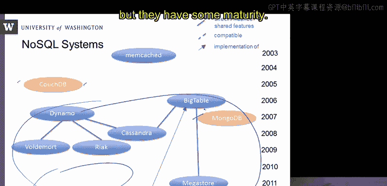

# 📊 大规模数据科学（大数据操作，第1课／共3课）｜基于MapReduce的系统

在本节课中，我们将学习基于MapReduce构建的系统及其发展历程。我们将探讨MapReduce如何催生出多种高层语言和NoSQL系统，并了解这些系统如何满足大规模数据处理的需求。

---

回到设计网格，我们可以突出那些基于MapReduce本身的系统。

2004年MapReduce论文发表，随后在2008年出现了构建在其之上的语言层，如Pig和Hive。

其中Hive使用SQL。Pig是一种类似关系代数的语言，我们将在后续章节详细讨论。

还有Tzing和Iala，它们也使用SQL。Tzing来自Google，Iala来自一家名为Cloudera的公司，该公司一直是MapReduce和Hadoop技术的积极推广者。

一个明显的趋势是，这些构建在MapReduce并行处理原语之上的声明式语言已经站稳脚跟。

过去可能有人反对这类语言，但现在情况已变。同时，企业普遍在SQL专业知识上投入了大量资源。

因此，即使他们被Hadoop的优势所吸引，也几乎都要求使用SQL。这可能是对过去SQL投资惯性的一种回应。

然而，对声明式语言的需求本身也是合理的，原因我们之前已经讨论过。

我们可以将这些系统放在时间线上。需要指出的是，2004年的论文与2008年这些系统之间有一段间隔。

但是，一旦Hadoop在雅虎开发出来并作为Apache开源项目发布，围绕它的扩展生态系统就迅速涌现，特别是增加了这些高层语言。

我认为，高层接口的需求从其迅速出现就可见一斑，并且这种发展并未停止，几年后出现了更多系统。

实际上，如果算上基于MapReduce扩展的研究项目，可能有数百个之多。这里列出的是其中一些最流行的。

---

接下来，我们来看看设计网格中的另一个子集：NoSQL系统。

虽然前几节都在讨论NoSQL，但我也将一些分析型系统包含在内，例如基于MapReduce的系统，以及Dremel、Spark和Shark等。

Dremel是来自Google的系统，是Google BigQuery查询即服务系统的后端。它非常出色，建议你了解一下。你可以上传数据，无论数据多大，都能以极低的延迟进行查询。

Spark和Shark来自伯克利的AMPLab，是伯克利数据分析栈（BDAS）的一部分。Spark本身不是一个MapReduce系统，而是构建在一个并行处理系统之上的语言层。Shark则是构建在Spark之上的SQL层。

Spark的几个显著特点是：它尽可能将所有数据加载到内存中处理，仅出于容错原因才会将数据写入磁盘，频率远低于MapReduce。它还支持迭代处理，这一点非常重要，我们将在课程后面再次讨论。而Shark，如前所述，是Spark之上的SQL层。

在这些NoSQL系统中，这个图表旨在指出曾出现过一次“寒武纪大爆发”。

最初有Memcached，它实际上只是一个缓存层，用于缓解后端一堆MySQL数据库的性能压力。它通过名称将数据存入内存进行查找，本质上是一种性能增强方案。

而彻底抛弃原有系统、用NoSQL系统替代的真正方法出现得稍晚一些。

我想指出的几点是：大约在这个时期，不同系统出现了爆发式增长，图表中的空白区域远非看起来那么空。我在这里只挑选了几个系统，但实际上，该领域新系统的涌现速度至今仍未显著放缓。

自2006年左右以来，设计空间被不断填充。我想指出的另一点是，这些非常流行的面向文档数据模型系统，如CouchDB和MongoDB，实际上已经存在相当长的时间了，它们分别于2005年和2007年发布。

有时它们看起来像是新系统，但它们已经具备了一定的成熟度。

---

本节课中，我们一起学习了基于MapReduce的系统生态。我们回顾了从MapReduce原语到高层声明式语言（如Hive、Pig）的发展，并探讨了NoSQL系统的兴起与多样化，包括像Spark这样支持内存计算和迭代处理的新架构。理解这些系统的演变和设计选择，是掌握大规模数据处理技术的基础。