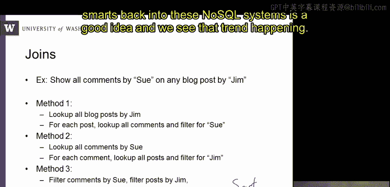

# 大规模数据科学（大数据操作，第1课／共3课） - P93：重新引入连接 🔗

在本节课中，我们将探讨NoSQL系统中的一个核心话题：**连接（Joins）**。我们将分析NoSQL系统为何通常不支持连接操作，并讨论这种设计背后的权衡，以及为何在某些场景下重新引入“智能”的连接处理机制是有益的。

---

## 关于“连接与分析”的论点

上一节我们讨论了数据模型，本节中我们来看看NoSQL系统的一个显著特征。这个特征体现在我称之为 **“连接与分析”** 的列上。NoSQL系统的一个显著区别性特征在于，它们通常不支持任何形式的连接操作。这些系统的支持者会辩称，这是可以接受的，因为连接并非真正必要。

关于为何可以摆脱连接的论证大致如下：

*   **数据共置替代连接**：当连接两个表时，通常是一个记录对应另一个表中的一系列相关记录。如果我将所有这些相关记录都**共置**在父记录旁边，那么我就可以一次性访问所有数据，而无需实际计算连接。

---

## 历史权衡：性能与灵活性

这个思路听起来应该有些熟悉，因为它正是我们之前在讨论关系型数据库动机时提到的**网络和层次数据模型**的一部分。

如果你还记得，这种方法的缺点在于，你只有一种**主导的数据访问路径**。任何其他访问路径要么完全不被支持，要么效率低下。

如果你想为了支持不同的访问路径或因需求变化而重组数据，那么你的大量代码可能会崩溃，需要重写。

因此，这里存在一种张力：

*   **性能**：通过以相当**刚性**的方式组织数据来换取一点性能提升。
*   **灵活性**：通过无需在每次重组数据时重写代码来节省开发时间。

在70年代初，这个等式以某种方式达到了平衡。我认为，现在这个等式依然以同样的方式平衡着。

这并非是说当今的商业关系型数据库必然能满足所有人的需求。显然，由于各种原因，它们并不能。

但是，为了前期的设计决策（即一种主导的数据组织方式），而抛弃我们所知的、从关系数据模型中获得的**灵活性**，我也不确定这是正确的选择。这是我想阐述的第一个要点。

---

## 连接评估：没有唯一正确的方法

另一个要点是，即使支持连接操作，也不一定存在唯一正确的**数据分解方式**或**连接评估方法**。

这一点可能在之前提到过，但我想在NoSQL的背景下再次提出。

在一个典型的Web应用场景中，如果你想显示用户名为“Sue”的所有评论，这些评论关联到用户名为“Jim”的任何博客文章，有几种不同的方法可以实现。

以下是几种可能的查询策略：

1.  **正向查找**：查找与“Jim”关联的所有博客文章，然后获取所有对应的评论，并从中筛选出“Sue”的评论。
2.  **反向查找**：查找“Sue”的所有评论，然后针对每条评论，查找“Jim”的所有博客文章。
3.  **合并排序连接**：独立筛选出“Sue”的所有评论和“Jim”的所有博客文章，按某种博客ID排序，然后从每个列表中提取数据进行匹配。这听起来可能有些奇特，但这正是你可能熟悉或不熟悉的**排序合并连接**。

即使这些方法都可用，也不清楚哪一种是最佳的。正确的选择取决于数据的**具体细节**，而这些细节作为应用程序员的你可能无法随时掌握，并且可能随时间变化。

因此，实际上只有**系统本身**才具备条件来做出这个决策。

所以，屈服于数据库构建或设计之初的**初始设计决策的“暴政”**是一个问题。另一个问题是，即使你有一定的灵活性，将选择正确数据访问方式的责任交给程序员，也是要求他们做出一个**他们不具备条件去做的决定**。

这些问题在关系型数据库中并不以同样的方式存在。

---

## 趋势：将“智能”重新注入系统

因此，我认为尝试将一些这种**智能**重新注入到这些NoSQL系统中是一个好主意，并且我们看到这种趋势正在发生。

---

## 总结

本节课中我们一起学习了：
1.  NoSQL系统通常**不支持连接**，其理念是通过**数据共置**来避免连接操作。
2.  这实质上是**网络/层次模型**的回归，需要在**查询性能**和**数据访问灵活性**之间做出历史性的权衡。
3.  即使实现连接，也存在多种评估策略（如**正向查找**、**反向查找**、**排序合并连接**），没有绝对最优解，最佳选择依赖于动态的数据状态。
4.  将连接策略的选择权完全交给程序员或固化在初始设计中是低效的，**数据库系统本身**应具备优化选择的智能。
5.  当前的一个积极趋势是，在NoSQL系统中**重新引入智能的连接处理机制**，以兼顾灵活性与效率。