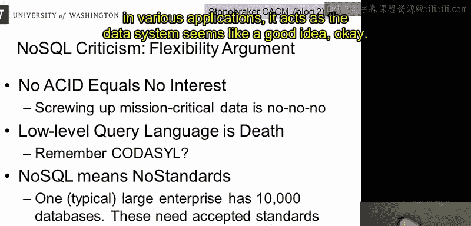
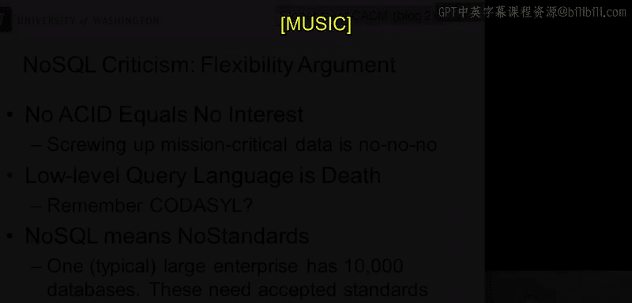

# 大规模数据科学（大数据操作，第1课/共3课） - P94：NoSQL反驳 💬

在本节课中，我们将学习Mike Stonebraker在《ACM通讯》中对NoSQL运动提出的反驳观点。我们将重点探讨NoSQL社区提出的两个主要价值主张，并分析其在实际企业应用中的挑战。

---

上一节我们介绍了NoSQL的基本概念，本节中我们来看看Mike Stonebraker对其提出的具体反驳论点。

Mike Stonebraker指出了NoSQL社区提出的两个核心价值主张：

1.  **性能**
2.  **灵活性**

关于性能论点，我们不会花费太多时间，因为我们已经讨论过不同系统在事务性保证方面所做的权衡。Mike提出的另一部分论点更多涉及我们未深入探讨的数据库内部原理。

因此，让我们聚焦于灵活性论点。

---

Mike提出了一个观察，我可能也同意这个观察：谁是这些NoSQL系统的客户？

以下是关于客户群体的分析：
*   很多初创公司，尤其是网络初创公司，是NoSQL的主要用户。
*   在企业级市场中的渗透率则不完全相同，至少目前如此。

为什么会出现这种情况？

以下是几个可能的原因：
*   企业中的大多数应用是传统的**OLTP**（在线事务处理）系统。例如银行记录，在这些场景中，事务的正确性至关重要。这些系统处理的是结构化、有组织的数据。
*   企业边缘可能有一些其他应用，但它们被认为不那么重要。对于这些非核心应用，或许可以接受使用高风险系统，因为应用本身对高管的吸引力较小。
*   因此，真正的情况是：没有资产合规性、没有事务支持，等同于对系统没有太大兴趣。搞砸关键任务数据是不可接受的，但对于一些边缘应用，或许可以尝试使用NoSQL系统。

---

Mike提出的第二个观点是：依赖这些低级别的查询接口是一个很难推销的方案。

他提到了CODASYL，这是一种早期的数据操作语言，早于我们讨论的声明式语言。我们已经走过那条路，它很艰难。这正是更高级语言被发明的原因。我们在MapReduce（公认的分析工具，而非纯NoSQL）中也看到了这一点，这些高级接口的价值得到了体现。

---

Mike提出的第三个观点是：NoSQL意味着所有规则都不复存在。

在不同的部署之间没有任何同质性。在一个典型的企业中，可能有一万个数据库。由于这些数据库内部模式的异构性，整合数据已经足够困难。但至少你知道你总是在处理行和列，并且至少有一种操作它们的标准接口。

以下是使用NoSQL系统时面临的设计决策复杂性：
*   必须做出许多设计决策来将数据编码到这些NoSQL系统中。
*   例如，什么成为键，什么成为值？博客帖子是嵌套在评论下，还是评论嵌套在博客帖子下？
*   用户是维护自己的信息墙，还是消息出现在他们的首页上？是写消息的人保留访问权限，还是双方都保留？
*   所有这些关于嵌套层级等的不同设计决策，使集成和标准化变得复杂。

因此，这是一个难以推销的方案。

---

我想提出一个与此第三点相关的观点：天下没有免费的午餐。

复杂性要么存在于你用来建模数据的系统中，要么在某种程度上转移给了应用程序。但在某种意义上，模式总是存在的。应用程序的业务模型总会在某个地方被编码。

因此，将其集中放在数据系统中，而不是隐藏在访问数据系统的各个应用程序里，似乎是一个好主意。

---

本节课中我们一起学习了Mike Stonebraker对NoSQL的批判性观点。我们探讨了NoSQL在性能和灵活性上的主张，并分析了其在企业级应用，特别是在事务处理、接口复杂性和数据建模标准化方面面临的挑战。核心在于，数据系统的复杂性与业务逻辑的清晰分离是需要权衡的关键问题。