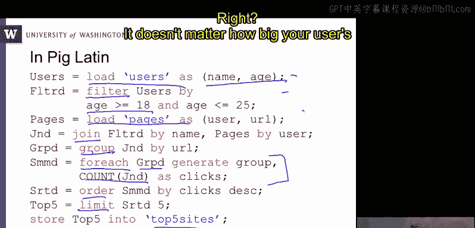
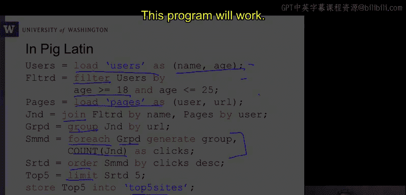

# 课程1：大规模数据科学 - 接近SQL的Pig 🐷


在本节课中，我们将学习Pig系统。Pig是构建在MapReduce之上的一个语言层，它更直接地体现了关系代数的思想。我们将探讨Pig是什么、为什么需要它，并通过一个具体例子来理解其优势。

## 什么是Pig？🤔

上一节我们介绍了课程概述，本节中我们来看看Pig的具体定义。

Pig是一个在Hadoop上执行程序的引擎。用户使用名为Pig Latin的语言编写Pig程序，该程序会生成一系列MapReduce作业来实现其功能。Pig是一个Apache开源项目。

## 为什么使用Pig？💡

如果你已经是MapReduce程序员，可能会问为何要使用Pig。本节将通过一个具体场景来说明其价值。

假设我们有两个文件：一个包含用户数据，另一个包含网站访问数据。我们的任务是找出特定年龄段的用户访问量最高的前5个网站。

如果用SQL思考，可以很容易地将此任务构思为一个查询。以下是一个描述此数据处理流程的图示：


该流程包括：加载用户数据、按年龄过滤、加载页面数据、按名称连接（join）、分组（group）、统计点击次数、按点击排序，最后取前5名。

如果用MapReduce实现此任务，需要约170行代码。根据相关论文中的例子，某人可能需要4小时来编写。虽然开发时间取决于个人背景和技能，但这仍然是一段可观的时间。

而用Pig Latin实现相同的程序，仅需9行代码。在同样案例中，只需约15分钟即可完成。并且，Pig Latin更贴近对此任务抽象描述。

## Pig Latin程序示例 📝

上一节我们了解了Pig的优势，现在来看看具体的Pig Latin代码是什么样子。

以下是实现上述任务的Pig Latin程序示例：

```
users = LOAD 'users.dat' USING PigStorage(',') AS (name:chararray, age:int);
filtered_users = FILTER users BY age >= 18 AND age <= 25;
pages = LOAD 'pages.dat' USING PigStorage(',') AS (user:chararray, url:chararray);
joined_data = JOIN filtered_users BY name, pages BY user;
grouped_data = GROUP joined_data BY url;
click_counts = FOREACH grouped_data GENERATE group AS url, COUNT(joined_data) AS clicks;
sorted_counts = ORDER click_counts BY clicks DESC;
top5 = LIMIT sorted_counts 5;
STORE top5 INTO 'top_sites.txt';
```

程序解读如下：

1.  **LOAD**: 按照特定模式加载用户数据。
2.  **FILTER**: 根据年龄范围过滤用户数据。
3.  **LOAD**: 加载页面访问数据。
4.  **JOIN**: 在过滤后的用户数据和页面数据之间执行连接操作。
5.  **GROUP**: 按URL对连接后的数据进行分组。
6.  **FOREACH...GENERATE**: 对每个分组，计算点击次数。这一步看起来可能最不像传统的关系代数操作，我们后续会讨论。
7.  **ORDER**: 按点击次数降序排序。
8.  **LIMIT**: 取前5条结果。
9.  **STORE**: 将最终结果存储到新文件中。

## Pig的核心价值 🚀

你可能会想，用Python写这些逻辑不是更简单吗？为何要用新语言？关键在于，Pig Latin中的这些操作（或操作组）对应着独立的MapReduce作业。

这意味着程序具备极佳的可扩展性。无论你的用户表或页面表有多大，这个程序都能有效运行，并利用Hadoop集群的分布式计算能力。



此程序将正常工作。



## 总结 📚


本节课中我们一起学习了Pig系统。Pig作为MapReduce之上的语言层，通过Pig Latin提供了更接近关系代数和人类思维模式的抽象，极大简化了大规模数据处理的编程。它将高级指令编译成可扩展的MapReduce作业，兼顾了开发效率与执行性能。理解Pig有助于我们运用关系代数思想来设计和推理可扩展的大数据算法。