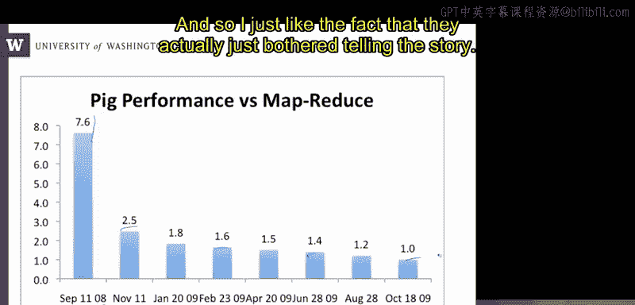

# 杜克大学《大规模数据科学》第1课：Pig架构与性能 🐷


在本节课中，我们将学习Apache Pig的架构原理及其性能特点。Pig是一种用于分析大型数据集的高级平台，它构建在Hadoop MapReduce之上，旨在简化复杂的数据处理任务。

---

## Pig系统工作原理

上一节我们提到了Pig Latin语言，本节中我们来看看Pig系统是如何执行这些程序的。

程序通过编写Pig Latin命令并**将结果赋值给变量**来运行。之后，可以在后续命令中引用这些变量。例如，我们先将数据加载到变量A和B中，然后可以基于A进行过滤、排序等操作。

需要强调的是，在尝试实际写出结果之前，**系统不会执行任何实际工作**。这种模式被称为**惰性求值**。

---

## 从程序到执行

那么，当你编写好程序后，系统内部发生了什么？

首先，Pig解析器会将程序的语法转换为一个称为**执行计划**的抽象表示。这个术语源自数据库领域，Pig项目的负责人Chris Olson正是一位杰出的数据库专家。

在这个抽象的执行计划中，操作（我们称之为**算子**）通常与Pig Latin命令一一对应，尽管并非总是如此。

---

## 编译为MapReduce任务

仅有执行计划还不够，我们无法直接执行它。下一步需要将执行计划**编译成MapReduce作业**。

编译的关键目标是**最小化所需的MapReduce作业数量**，因为启动每个作业都有不小的开销。例如，你不会希望仅仅为了过滤一个数据集就运行一个完整的MapReduce作业。理想情况下，应该将这项工作与其他正在进行的任务（如扫描和读取数据）合并处理，以最大化单次数据扫描的效用。

以下是一个示例，说明一个Pig程序如何被编译为单个MapReduce作业：

```pig
-- Pig Latin 示例
A = LOAD 'input1' USING PigStorage(',');
B = LOAD 'input2' USING PigStorage(',');
C = FILTER A BY $0 > 10;
D = JOIN C BY $0, B BY $1;
STORE D INTO 'output';
```

在这个案例中，整个程序可以编译为**一个MapReduce作业**：
*   **Map阶段**：加载数据A和B，并对A进行过滤。
*   **Reduce阶段**：执行连接操作。

最后，这些编译好的MapReduce作业会像往常一样被调度到Hadoop集群上运行。

---

## Pig性能演进 📈

接下来，我们看看Pig的性能表现。这里的对比有些特别，因为Pig本身就构建在MapReduce之上。

下图展示了Pig性能与手写MapReduce代码的对比：



从图中可以看到一个清晰的模式：
*   **2008年9月**发布的Pig初始版本，其速度远慢于直接手写的MapReduce代码。
*   随后，经过一系列改进，Pig的性能**随时间推移不断提升**。
*   最终，Pig的性能达到了与手写MapReduce代码**相当的水平**。

这个案例揭示了一个常见规律：**抽象化会带来一定的性能成本**。然而，通过持续优化，通常可以**恢复大部分手写代码的性能**。与此同时，通过提供更高级的接口，我们显著**提升了程序员的开发效率**。值得赞赏的是，Pig团队坦诚地展示了他们从起步较慢到逐步优化的完整历程。

---

## 总结


本节课中，我们一起学习了Apache Pig的核心工作机制。我们了解到Pig采用**惰性求值**模型，其执行流程是：先将Pig Latin程序解析为**抽象执行计划**，然后将其**编译优化为尽可能少的MapReduce作业**，最后在Hadoop集群上运行。通过回顾Pig的性能演进史，我们也认识到高级抽象工具在追求开发效率的同时，通过持续优化也能达到出色的运行时性能。