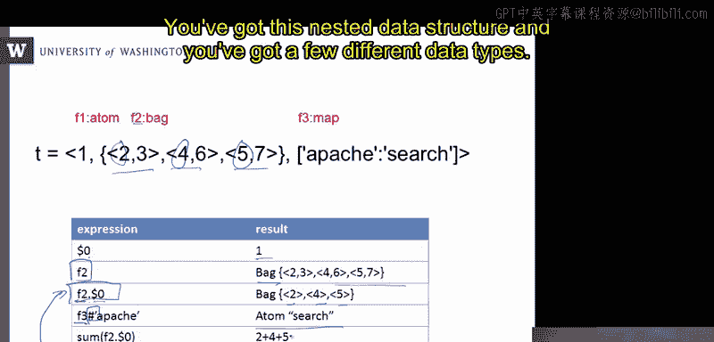

# 大规模数据科学（大数据操作，第1课／共3课） - P97：数据模型 🗄️


在本节课中，我们将要学习Pig Latin语言所使用的核心数据模型。理解这个数据模型是掌握后续数据处理操作的基础。

## 数据模型概述

Pig Latin的数据模型包含四种基本类型。其中一种是**原子类型**，另外三种是**集合类型**。

## 原子类型

原子类型是最基本的数据单元。它指的是一个原始值，例如一个整数或一个字符串。

## 集合类型

以下是三种主要的集合类型。

### 元组

元组是一个字段序列。每个字段可以是任何类型，不限于原子类型。

### 包

包是一个元组的集合。这些元组不必是相同的类型。这与关系数据库中的表或关系不同。包允许重复元素，而集合不允许。

### 映射

映射类似于Python中的字典。它由字符串字面量键映射到任何其他类型的值组成。

## 数据模型示例

上一节我们介绍了数据模型的基本类型，本节中我们来看看一个具体的例子。

假设我们有以下数据结构：
```
<1, {(2, 3), (4, 5)}, [Apache#search]>
```

在这个例子中，最外层的结构是一个元组。它包含三个字段：
*   第一个字段是整数 `1`，这是一个原子。
*   第二个字段是一个包，用花括号 `{}` 表示，其中包含两个元组 `(2, 3)` 和 `(4, 5)`。
*   第三个字段是一个映射，包含一个键值对，将键 `Apache` 映射到值 `search`。

我们可以为这些字段命名，例如 `F1`、`F2`、`F3`。字段名称可以来自不同的地方，我们稍后会讨论。

## 数据访问与操作

了解了数据结构后，我们来看看如何访问和操作其中的数据。

以下是几种访问和操作数据的方式：

*   **按位置访问**：使用 `$0` 可以获取元组的第一个字段。在我们的例子中，`$0` 将返回原子 `1`。
*   **按名称访问**：使用字段名称，例如 `F2`，可以获取对应的字段。这将返回我们之前定义的包 `{(2, 3), (4, 5)}`。
*   **投影操作**：表达式 `F2.$0` 表示对包 `F2` 中的每一个元组，提取其第一个元素（索引为0）。这将返回一个新的包 `{2, 4}`。
*   **映射查找**：表达式 `F3#Apache` 中的 `#` 符号表示在映射 `F3` 中查找键为 `Apache` 的值。如果 `F3` 不是映射类型，则会报错。在我们的例子中，它将返回原子 `search`。
*   **聚合函数**：我们可以使用函数对数据进行聚合。例如，`SUM(F2.$0)` 会对包 `{2, 4}` 中的所有值求和，结果为 `11`。

## 总结



本节课中我们一起学习了Pig Latin的核心数据模型。我们了解到该模型包含原子、元组、包和映射四种类型。这个模型是非关系型的，支持嵌套数据结构和多种数据类型，为灵活的大数据处理提供了基础。