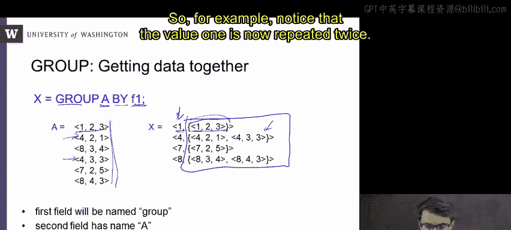

# 课程1：大规模数据科学（大数据操作） - P98：加载、过滤与分组 🐘📊


在本节课中，我们将学习Pig Latin语言中的三个核心操作：`LOAD`（加载）、`FILTER`（过滤）和`GROUP`（分组）。这些是处理大规模数据的基础，能帮助我们从原始数据中提取有价值的信息。

---

## 概述

我们将首先了解如何将数据从HDFS加载到系统中，然后学习如何根据条件过滤数据，最后探索如何将数据按特定字段分组。这些操作共同构成了数据预处理和分析的基石。

---

## 加载数据 (LOAD)

上一节我们介绍了课程背景，本节中我们来看看如何将数据导入系统。`LOAD`命令用于将数据从HDFS（Hadoop分布式文件系统）加载到Pig中。在Hadoop生态系统中，输入数据在逻辑上通常被视为一个“包”（bag），即一个元组（tuple）的序列。

你可以简单地使用`LOAD`命令，但也可以使用`USING`关键字指定解析数据的函数。这看似微不足道，但实际上触及了传统数据库产品的一个核心问题，也体现了基于MapReduce系统（如Hadoop）的优势。有时，你面对的是原始格式的数据，需要自己进行解析。

传统数据库的价值主张是：设计一个模式（schema），然后将所有数据加载到该模式中，之后你就能从查询中获益。但问题在于：谁来执行这个加载任务？如果我有20TB的文本文件，我必须管理这个庞大的并行计算任务。这正是Hadoop及其扩展（如Pig和Hive）发挥作用的地方。

在许多数据科学应用架构中，Hadoop及其扩展被用于初始的处理和解析（即加载数据），然后将结果加载到更传统的数据库中，以便进行即席查询。我们在最早的课程片段中讨论的奥巴马竞选团队就使用了类似的架构。他们使用Hadoop进行ETL（提取、转换、加载）工作负载，然后使用Vertica数据库进行数据切片和切块分析。这正逐渐成为设计大规模数据分析架构的最佳实践。

`LOAD`命令的优点是，你可以指定自己的解析函数，从而处理原始格式的数据。此外，如果你的解析函数能生成多种不同的输出，你还可以指定一个模式（schema），为列命名。这可以看作是一种“读时模式”（schema on read）：数据本身没有模式，但你在将其读入内存时可以强加一个模式。

以下是一个`LOAD`命令的示例，我们将以此作为后续的运行示例：
```pig
data = LOAD 'input/data.txt' USING PigStorage(',') AS (f1:int, f2:chararray, f3:float);
```
这个命令从`input/data.txt`文件加载数据，使用逗号作为分隔符，并指定了三个字段的名称和类型。

---

## 过滤数据 (FILTER)

在将数据加载到系统后，我们常常需要筛选出感兴趣的部分。`FILTER`命令用于根据布尔条件从数据集中移除某些元组。

由于Hadoop生态系统很大程度上基于文本，你可以在条件中使用正则表达式等功能，尽管这在某些情况下可能是一种限制。其语法是：`FILTER`某个大数据集`BY`某个条件。

以下是一个示例：
```pig
filtered_data = FILTER data BY f1 == 8;
```
这个命令会找出所有`f1`字段（我们在`LOAD`命令中命名的第一个列）等于8的元组。它非常简单直接。

---

## 分组数据 (GROUP)

上一节我们学习了如何过滤数据，本节中我们来看看如何将数据聚合。`GROUP`命令用于将数据按某些列聚集在一起。

它有几种不同的形式，但我们现在只关注基本的`GROUP`命令（稍后会讨论`COGROUP`）。`GROUP`命令表示：按某些列序列对这个大数据集进行分组。

这看起来很像SQL中的`GROUP BY`子句，有相似的味道，但它的行为相当不同。如果你有一个数据集`A`，并按`f1`分组，那么你得到的输出是元组，但现在第一个字段（因为我们按`f1`分组）是分组键。第二个字段现在是一个“包”（bag），它是与该特定键关联的所有元组的一个小集合表示。

例如，如果原始数据中只有一个`f1`等于1的元组，那么该元组会出现在分组中。如果有两个`f1`等于4的元组，那么这个“包”里就会有两个元组。这样，你就可以从一个扁平的结构开始，构建出一个嵌套的结构，出于各种原因（我们马上会看到）。

另一个需要注意的点是（这也是我对Pig不太满意的地方之一，因为它有些操作是隐式而非显式的），这些字段的名称会被默认设置。分组后的第一个字段默认命名为`group`，第二个字段默认命名为原始数据集的名称。当你编写Pig代码时，可能会觉得有点困惑，但你可以理解他们为什么这么做：原因是，这些“包”总体上包含了与原始数据集相同的信息，只是以某种方式嵌套了。所以，用原始数据集的名字来命名它是有道理的。

以下是一个`GROUP`命令的示例：
```pig
grouped_data = GROUP data BY f1;
```
这个命令会按`f1`字段对`data`进行分组。结果中的每个元组将包含分组键（`f1`的值）和属于该组的所有原始元组构成的“包”。

---

## 总结

本节课中我们一起学习了Pig Latin中三个基础且强大的操作：
1.  **`LOAD`**： 用于从HDFS将原始数据加载到系统中，支持自定义解析和读时模式。
2.  **`FILTER`**： 用于根据条件筛选数据，是数据清洗和聚焦的关键步骤。
3.  **`GROUP`**： 用于按指定字段对数据进行聚合，将扁平数据转换为嵌套结构，为后续的聚合分析（如求和、计数）做准备。



掌握这些操作是构建大规模数据处理流程的第一步。它们允许你灵活地处理原始数据，并将其转换为更适合分析的形式，这正是Hadoop生态系统中数据科学工作负载的常见模式。