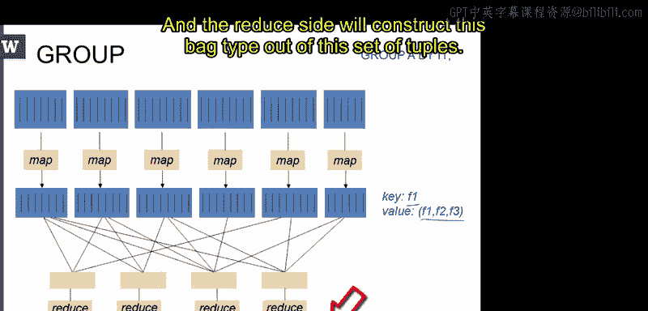
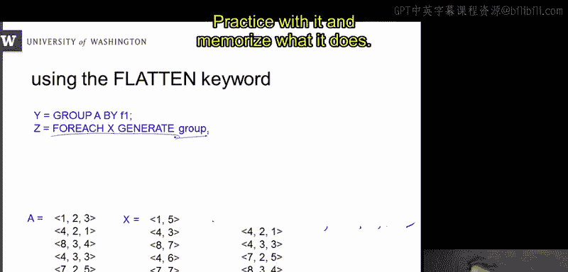

# 大规模数据科学（大数据操作，第1课／共3课） - P99：分组、去重、遍历、展平 🧮


在本节课中，我们将要学习Pig Latin语言中的几个核心操作：`DISTINCT`、`GROUP BY`、`FOREACH`和`FLATTEN`。这些操作是处理和分析大规模数据集的基础，理解它们的工作原理对于编写高效的数据流水线至关重要。

---

## `DISTINCT` 操作符 🗑️

`DISTINCT`命令的功能正如其名：它用于移除数据集中的所有重复项。

对于一个简单的例子，如果你的数据包中有两个值相同的元素，`DISTINCT`的输出将只保留其中一个。

```
-- 假设关系 A 包含重复数据
A = LOAD 'data' AS (f0, f1, f2);
UNIQUE_A = DISTINCT A;
```

---

## `GROUP BY` 与 `DISTINCT` 的关系 🔗

上一节我们介绍了`DISTINCT`，本节中我们来看看它与`GROUP BY`的关系。

我可能会提出一个观点：`DISTINCT A` 等同于 `GROUP A BY (f0, f1, f2)`。

首先，为什么这么说？请记住，`GROUP`操作符会为分组列的每一个唯一组合输出一个单独的元组，这听起来很合理。

如果你了解SQL，你可能会想到，在SQL中这在一定程度上也是成立的。你可以在SQL中使用`DISTINCT`关键字，也可以通过`GROUP BY`所有列来达到类似的效果，最终得到相同的结果。

那么，这两个表达式完全一样吗？它们会产生相同的输出吗？

并不完全一样。因为`GROUP`命令会产生一个分组结构。具体来说，它会生成一个`group`字段（即分组键）和一个包字段（包含所有属于该组的元组）。因此，你会得到一种信息的重复。相比之下，`DISTINCT`的输出则简洁得多。

所以你需要小心，并确保理解这些操作会产生什么结果。

---



## `GROUP BY` 的工作原理 ⚙️

我们已经看到过`GROUP BY`是如何工作的。

回顾我们的MapReduce处理示意图或并行处理示意图：我们将数据分成若干部分，应用一个映射函数，该函数为每个元组分配一个键（分组依据），并将该元组作为值。例如，如果我们按`f1`分组，那么`f1`就成为键，值则是元组中的所有三个元素。

这些键值对通过网络被混洗到Reduce端，Reduce端会为每个键构造一个包含所有对应元组的包类型。

这是一个单一的MapReduce作业。

---

## `FOREACH` 操作符 🔄

`FOREACH`命令可能是最复杂的操作符之一。它用于处理数据包中的每一个元组。

其基本写法如下：

```
-- 对关系A中的每个元组进行操作
B = FOREACH A GENERATE f0, (f1 + f2) AS sum;
```

在这里，我们生成了一个包含两个字段的新元组：一个是`f0`，另一个是`f1`和`f2`的和。你可以在`GENERATE`子句中调用用户自定义函数、编写算术表达式或进行多种操作。

以下是另一个例子：

```
-- 首先按f1分组
Y = GROUP A BY f1;
-- 然后对每个分组进行操作
Z = FOREACH Y GENERATE group, A.(f1, f2);
```

`group`是分组操作后自动赋予分组键的魔术名称。`A`是包含该组所有元组的包的魔术名称。`A.(f1, f2)`表示从包`A`的每个元组中投影出`f1`和`f2`字段。

这个操作的结果是：`X`（即分组键，也就是`f1`的值），以及该组中所有元组的`f1`和`f2`字段的列表。

这里的要点是，你可以通过编写这类表达式来操作这些嵌套对象。但需要思考的是，由于嵌套数据模型带来的额外灵活性，理解其内部过程会稍微复杂一些。

在作业中，你将有机会尝试这些操作，并确保理解它们的功能。

---

## `FLATTEN` 操作符 📤

`FLATTEN`不是一个独立的操作符，它用在`FOREACH`的上下文中。

由于嵌套结构的复杂性，有时你可能希望恢复其扁平化的版本。例如，如果你想从存储在变量`Z`中的嵌套结构恢复成扁平关系，可以这样做：

```
-- Z是一个包含嵌套包的关系
FLAT_Z = FOREACH Z GENERATE group, FLATTEN(A);
```

`FLATTEN`的作用是“展开”包，为包中的每个元素生成一个独立的输出元组。

我个人不太喜欢这种设计，因为仅仅使用`FLATTEN`这个关键字就改变了`FOREACH...GENERATE`的语义，我认为这是一种非常令人困惑的实现方式。这里的原理很难解释清楚，最好是记住它的功能，通过练习来掌握它的用法。

---

## 总结 📝

本节课中我们一起学习了Pig Latin中四个关键的数据操作：
1.  **`DISTINCT`**：用于移除关系中的重复元组。
2.  **`GROUP BY`**：根据指定字段对元组进行分组，形成嵌套结构。
3.  **`FOREACH`**：对数据包中的每个元组或每个分组进行迭代和转换，是进行复杂计算的核心。
4.  **`FLATTEN`**：在`FOREACH`中使用，用于将嵌套的包结构展平为扁平的元组流。




理解这些操作符的输入、输出和语义，是构建有效大数据处理流程的基础。`GROUP BY`会创建嵌套，而`FOREACH`和`FLATTEN`则用于在这些嵌套结构内部或之间进行转换和计算。