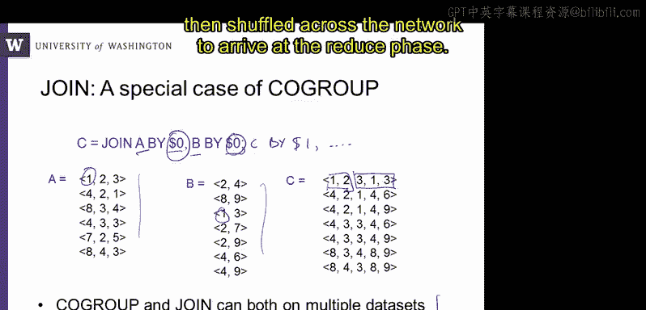
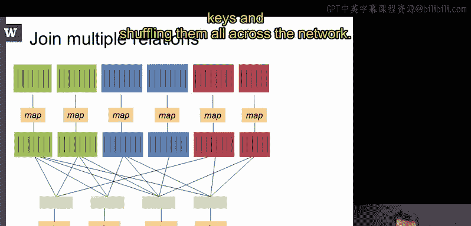

# 大规模数据科学（大数据操作，第1课／共3课） - P100：协同分组与连接 🧩


在本节课中，我们将要学习Pig Latin中的两个核心操作：**协同分组**与**连接**。我们将了解它们如何对多个数据集进行分组和关联，以及它们在大规模数据处理中的工作原理。

---

## 协同分组操作

上一节我们介绍了`GROUP`命令，它用于对单个数据集进行分组。本节中我们来看看`COGROUP`命令，它可以在多个数据集上执行类似的分组操作。

我们之前在讨论MapReduce时见过这种机制，但在Pig中，我们使这个操作变得明确，并赋予它一个特定的命令。接下来我们将探讨其原因。

`COGROUP`的语法如下所示：
```
COGROUP datasetA BY field_reference, datasetB BY field_reference;
```
这里，我们可以通过字段名或位置来引用分组键。如果`datasetA`和`datasetB`都是元组包，那么对它们进行协同分组的结果结构如下：

*   **分组键**：所有数据集共用的分组依据。
*   **数据集A组**：来自`datasetA`的、与该键匹配的所有元组。
*   **数据集B组**：来自`datasetB`的、与该键匹配的所有元组。

以下是关于`COGROUP`的两个要点：
*   如果某个数据集中没有与分组键匹配的元组，那么对应的组将为空。
*   这与MapReduce中的连接操作略有不同。在MapReduce中，所有匹配的元组会出现在同一个Reducer组中。而在Pig的`COGROUP`中，来自不同数据集的元组被明确地分到不同的组中。

---

## 连接操作

在了解了协同分组之后，让我们来讨论另一个操作符：**连接**。它的功能正如其名。

`JOIN`的语法如下：
```
JOIN datasetA BY join_key, datasetB BY join_key;
```
给定`datasetA`和`datasetB`，连接操作的结果与我们过去讨论过的连接概念一致。它会查找`datasetA`中每个元组的连接键（例如`$0`），并找到`datasetB`中所有具有相同连接键的对应元组，然后进行组合。

连接操作并不局限于两个数据集。你可以连接任意数量的数据集，它们可以一起被处理。在底层，这通常对应一个MapReduce作业：
*   **Map阶段**：来自所有数据集的每个元组都与由语法中字段引用所表示的连接键相关联。
*   **Shuffle阶段**：这些键值对被混洗并跨网络传输。
*   **Reduce阶段**：具有相同键的所有元组汇聚到同一个Reducer，最终生成连接后的元组。



因此，这个操作符本质上并非二元操作。它只是处理与各自连接键相关联的元组，并将它们全部通过网络进行混洗。

---

## 总结



本节课中我们一起学习了Pig Latin中的两个重要操作。我们首先探讨了`COGROUP`，它能够将多个数据集按相同的键进行分组，并保持各组独立。接着，我们学习了`JOIN`操作，它用于根据连接键合并多个数据集中的元组，并且可以处理两个以上的数据集。理解这些操作是掌握大规模数据关联与整合的关键。