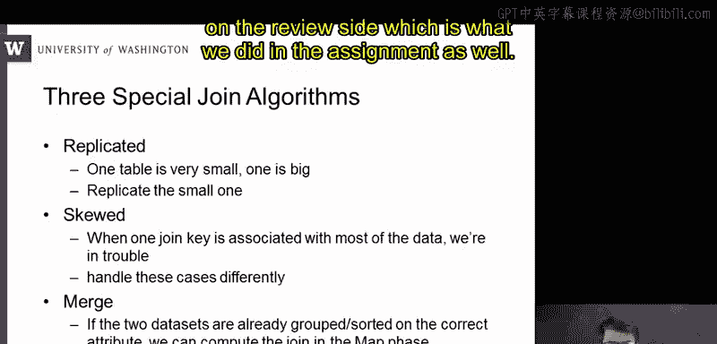
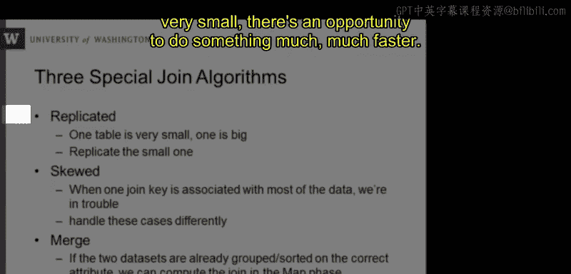
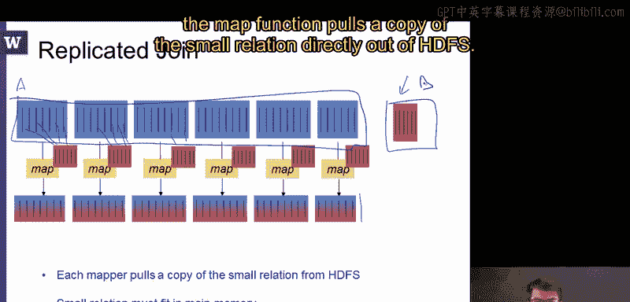
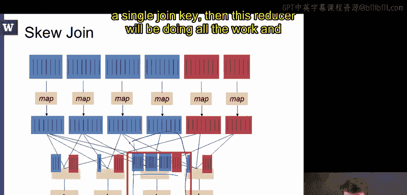

# 大规模数据科学（大数据操作，第1课／共3课） - P101：连接算法 🧩

在本节课中，我们将要学习在大规模数据处理中，几种针对不同场景优化的连接算法。我们将探讨基础连接机制可能遇到的问题，并介绍三种特殊的连接算法：复制连接、倾斜连接和合并连接。

---

## 基础连接机制的问题

上一节我们介绍了基础的MapReduce连接机制。本节中我们来看看这种机制可能存在的问题。

基础连接机制通常为每个元组关联一个连接键，通过网络进行混洗，然后在Reduce端计算连接结果。然而，在某些情况下，这种机制效率不高。

以下是基础连接机制可能遇到的三种主要问题：

1.  **表大小差异巨大**：如果一个表非常大，而另一个表非常小，将所有数据通过网络混洗会产生不必要的开销。
2.  **数据倾斜**：如果连接键的分布极不均匀，例如一个键关联了海量数据，会导致单个Reducer承担绝大部分工作，从而削弱并行处理的优势。
3.  **已排序数据未被利用**：如果两个关系已经按照相同的方式分组，确保单台机器上已包含来自两个关系的所有必要元组，则存在更高效的连接方式。

---

## 复制连接（广播连接）🚀

针对表大小差异巨大的情况，有一种更快的优化方法：复制连接。

其核心思想是，将小表复制到大表的所有分区中，从而所有连接工作都可以在Map阶段完成。

假设我们有一个被分成若干部分的大表，以及一个非常小的表。通常的做法是将所有元组通过网络混洗，在Reduce端进行连接。

但这里存在一个优化机会：如果小表足够小，可以放入单台机器的内存中，我们为什么不直接复制它呢？

我们可以将小表发送给每个Map函数。每个启动的Map函数会直接从HDFS中拉取小表的副本。这样，在Map端我们就拥有了所需的全部信息。

*   大表分区1中的每个元组都可以与小表中的对应元组进行连接。
*   大表分区2中的每个元组也可以与小表中的对应元组进行连接。
*   以此类推。

在Map阶段结束时，我们就得到了正确的答案，即所有连接后的元组。

这种方法之所以更高效，是因为我们无需将所有数据通过网络混洗。所有工作都在Map阶段完成，这带来了巨大的性能提升。这种算法也可能被称为**广播连接**。

**核心条件**：小关系必须能放入内存。
**实现思路**：每个Map函数中的Mapper直接从HDFS中拉取小关系的一个副本。

---

## 倾斜连接 ⚖️

现在，让我们看看如何处理数据倾斜的问题。这是基础连接机制的另一个特殊案例。

通常，我们有两个关系（例如一个蓝色关系和一个红色关系）。在Map阶段，每个元组与其连接键关联。但问题在于，大部分数据最终可能都汇聚到单个Reducer上。

原因可能是大部分数据都与单个连接键相关联。例如，如果你在`订单ID`和`订单明细`上进行连接，试图将所有明细项与其对应的订单关联起来，可能会出现一个订单包含数百万个零件，而其他订单只包含五个零件的情况。

**公式描述问题**：如果数据集中有显著比例的数据与单个连接键 `K_skew` 关联，即 `count(tuples where key = K_skew) / total_tuples` 的值很大，那么这个Reducer将承担绝大部分工作，并行化的优势就会大打折扣。

---

## 合并连接 🔄

第三种特殊连接算法是合并连接。这种算法利用了数据可能已预先排序或分组的特点。

它基于这样一个事实：你可能已经以相同的方式对两个关系进行了分组，从而确保在单台机器上，你已经拥有了来自一个关系的所有所需元组，以及来自另一个关系的所有所需元组。

这种方法避免了不必要的网络混洗，直接在本地的、已排序的数据块上进行合并操作，效率很高。它要求两个输入数据集都按照连接键排序，并且MapReduce作业的分区方式与排序方式一致。

---

## 总结

本节课中我们一起学习了大规模数据连接中的三种优化算法。

*   **复制连接**适用于小表可以完全放入内存的场景，通过广播小表到所有Map任务，在Map阶段完成连接，避免了大量的网络数据传输。
*   **倾斜连接**关注于解决因连接键分布极度不均而导致的任务负载不平衡问题，防止单个Reducer成为性能瓶颈。
*   **合并连接**则利用了数据已预先按连接键排序的特性，直接在本地进行高效合并，是处理已排序大数据集的理想选择。

理解这些算法的适用场景，对于设计和优化高效的大规模数据处理流程至关重要。