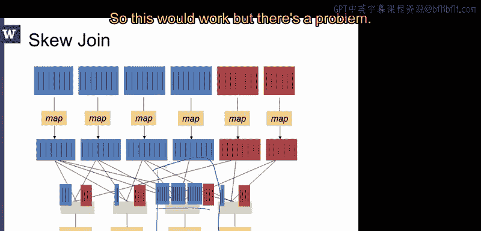
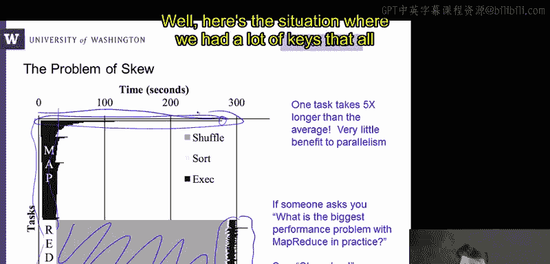
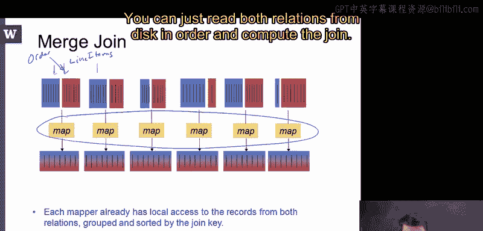

# 大规模数据科学（大数据操作，第1课／共3课） - P102：数据倾斜 🐌

在本节课中，我们将要学习MapReduce框架中一个常见的性能瓶颈——**数据倾斜**。我们将了解它如何产生、为何会严重影响作业执行时间，并探讨几种应对策略，特别是“倾斜连接”和“合并连接”。

---

## 数据倾斜问题

上一节我们介绍了MapReduce的基本工作原理。本节中我们来看看一个具体问题：**数据倾斜**。

在理想情况下，MapReduce作业中的各个任务（Task）应该在大致相同的时间内完成。然而，当数据分布不均匀时，某些任务可能会处理远超平均数量的数据，导致其执行时间异常长。这些运行缓慢的任务被称为 **“掉队者”** 或 **“拖尾任务”**。

下图展示了一个实际作业的任务执行时间线：

从图中可以看到，大多数Map任务在约20秒内完成，但有一两个Map任务却需要长达270秒。由于Reduce阶段必须等待所有Map任务完成后才能开始，图中Reduce任务开始前的大片空白区域实际上就是**被浪费的并行计算资源**。

这带来了几个问题：
1.  **并行性被破坏**：一个缓慢的任务会拖慢整个作业。
2.  **性能损失严重**：一个本可能只需50秒的作业，因为数据倾斜最终可能耗时350秒，丧失了并行计算的优势。

所以，当被问及MapReduce最大的性能瓶颈之一时，答案应该是 **“掉队者”**。

---

## 倾斜连接：一种解决方案

那么，我们能为此做些什么呢？本节我们来看一种针对连接操作中数据倾斜的解决方案。

考虑一个常见场景：在执行Reduce端连接时，某个连接键（例如一个热门商品ID）对应的记录数量异常庞大，导致处理该键的单个Reducer任务负载过重，成为“掉队者”。

以下是解决此问题的一种思路，称为 **“倾斜连接”**：

1.  **识别与拆分**：首先识别出导致倾斜的大数据集（例如上图中的“蓝色”关系）。将其从原本的Reducer中移除。
2.  **广播小表**：如果另一个关系（“红色”关系）足够小，可以将其**广播**到所有工作节点。
3.  **重新分配与并行计算**：将那个庞大的数据集（蓝色）拆分成多个部分，分配给**多个新增的Reducer**。每个新增的Reducer都持有一份完整的广播数据（红色）副本。
4.  **执行连接**：每个Reducer在本地将分配到的蓝色数据分片与完整的红色广播数据进行连接计算。

这个过程结合了**广播连接**和**常规Reduce端哈希连接**的思想。通过将倾斜数据分摊到多个Reducer上处理，我们实现了更均衡的负载，从而加速了整个连接操作。

在Pig等工具中，你可以通过指定`skewed join`来启用这种连接方式，但它通常不会自动执行。

---

## 合并连接：另一种优化策略

上一节我们介绍了处理数据倾斜的特殊连接。本节中我们来看看另一种优化策略——**合并连接**。如果说倾斜连接是解决“问题”的技巧，那么合并连接则是在条件满足时，可以显著提升性能的“机会”。

合并连接的应用有一个关键前提：参与连接的两个关系**已经按照连接键进行了协同分区和排序**。

这意味着，对于任意一个连接键值，来自两个关系的所有相关记录都已经被预先分配到了**同一台物理机器**上，并且各自内部已按连接键排序。

当这个条件成立时，会发生什么？

由于每个Mapper本地已经拥有了两个关系中对应分区的全部数据（且已排序），因此连接操作可以完全在Map阶段完成，无需经过Shuffle和Reduce阶段。Mapper可以像在传统数据库中一样，通过归并排序的方式，顺序读取两个已排序的数据流，直接输出连接结果。

**核心优势**：
*   **避免网络传输**：消除了Shuffle阶段巨大的网络开销。
*   **本地化计算**：所有计算在本地完成，效率极高。

那么，何时这个条件会成立呢？通常，这发生在前面的Pig操作（如`COGROUP`）已经按照连接键对数据进行了分区和排序之后。在Pig中，你可以通过显式指定`merge join`来利用这种情况，系统会检查条件是否满足并选择最优执行计划。

---

## 总结

本节课中我们一起学习了MapReduce中的**数据倾斜**问题及其解决方案。

*   我们首先了解了**掉队者任务**如何严重损害作业的并行性能。
*   接着，我们探讨了**倾斜连接**，这是一种通过识别倾斜键、广播小表、并拆分倾斜数据到多个Reducer来缓解负载不均的特殊连接策略。
*   最后，我们学习了**合并连接**，这是一种在数据已按连接键协同分区和排序的前提下，可以完全在Map阶段完成的高效连接算法，能极大减少网络开销。

理解这些概念和技巧，对于设计和优化大规模数据处理作业至关重要。