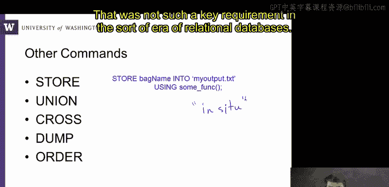

# 大规模数据科学（大数据操作，第1课／共3课） - P103：其他命令 🐘

在本节课中，我们将学习Pig Latin中除`JOIN`和`COGROUP`之外的其他重要命令。我们将了解这些命令的功能，并探讨为何在“大数据时代”下，能够处理多种格式的“原位数据”变得至关重要。

---

## 为何需要`COGROUP`和`JOIN`？🤔

上一节我们介绍了`COGROUP`和`JOIN`操作。本节中我们来看看为什么两者都需要存在。

`COGROUP`操作被明确设计出来的原因是，`JOIN`本质上是一个两步过程。第一步是基于连接键创建分组，第二步才是实际生成连接后的元组。而这个分组创建步骤，对于许多应用场景都非常有用，而不仅仅是用于生成连接结果。

例如，如果你想对每个关系中的贡献进行求和，你可以通过`COGROUP`一步完成。你不需要先进行连接，然后再进行另一次分组——而这在关系型数据库中通常是必须的。因此，`COGROUP`提供了一个机会，将原本需要两个MapReduce作业完成的任务合并为一个。

这里需要指出的是，`JOIN`本质上只是一种语法糖。你可以用`COGROUP`来表达`JOIN`：第一步是在相同的连接列上进行`COGROUP`，第二步是对每个分组运行一个命令来生成扁平的连接结果视图。

---

## 其他Pig Latin命令 📚

除了分组和连接，Pig Latin还提供了一系列其他命令来处理数据。

以下是几个我们不会深入讨论但非常重要的命令：

*   **`STORE`**：将数据写入HDFS，供未来的命令使用。
*   **`UNION`**：合并两个数据集并移除重复项。
*   **`CROSS`**：计算两个数据集之间所有可能的配对。这在需要计算某种相似度函数时非常有用。
*   **`DUMP`**：将输出打印到屏幕。
*   **`ORDER`**：对输出进行排序。

---

## `STORE`命令与自定义函数 💾

让我们以`STORE`命令为例进行更深入的了解。就像你可以使用自定义函数来解析数据一样，你也可以使用自定义函数来写出数据。

这意味着数据可以更好地与你正在使用的其他系统兼容，例如MapReduce本身，或者其他期望特定数据格式的应用程序。

这一点与`LOAD`命令类似，但它实际上非常强大，并且与关系型数据库采取的“封闭花园”式方法有显著不同。在关系型数据库中，一切数据进入后都完全受数据库控制。而Pig的边界更具渗透性，你可以让数据以任何格式存放，仍然能用Pig处理它，同时也能用其他系统处理它。

---

## 处理“原位数据”的重要性 🌍

这种能力之所以至关重要，并不仅仅是为了优化性能或减少加载时间，更是因为如今的数据太大了，你无法移动它们。

你无法将所有数据都放入数据库，然后再全部提取出来转移到其他系统进行处理。数据量太大了，你无法移动一个PB级别的数据集。你必须将计算带到数据所在的地方，而不是将数据带到计算所在的地方。

因此，这种处理“原位数据”的能力，已经成为大数据时代的一个关键需求，而这在传统的关系型数据库时代并非如此关键。

---

## 总结 ✨

本节课中我们一起学习了Pig Latin中的其他命令，重点探讨了`COGROUP`与`JOIN`的关系，以及`STORE`等命令的用途。我们理解了Pig能够灵活处理多种格式“原位数据”的设计哲学，并认识到这在大数据场景下是比传统数据库“封闭花园”模式更适应现实需求的关键优势。核心在于，当数据规模巨大时，将计算移至数据所在处比移动数据本身更为可行和高效。