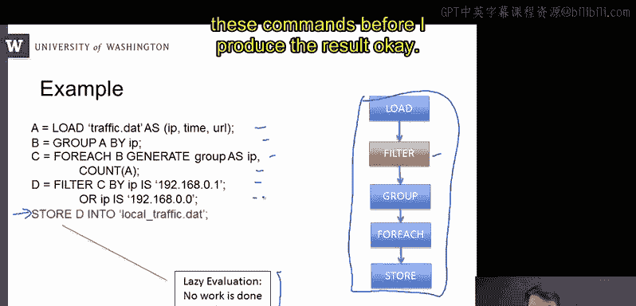

# 大规模数据科学（大数据操作，第1课／共3课）🚀：P104 评估与优化演练


在本节课中，我们将通过一个具体的Pig程序示例，来学习高级操作如何为系统提供自动优化的机会。我们将看到，系统如何在不需程序员明确指定的情况下，通过调整执行计划来提升效率。

---

上一节我们介绍了Pig Latin的高级操作概念，本节中我们来看看一个具体的程序示例及其优化过程。

我们考虑一个处理网络流量日志数据的Pig程序。数据包含三列：**IP地址**、**时间戳**和**访问的URL**。程序的目标是统计我们本地网络中两个特定网关的IP地址的访问次数。

以下是该程序的原始步骤：

1.  **加载数据**：我们使用 `LOAD` 命令读取数据。由于数据是Pig原生支持的简单分隔格式（如CSV），因此无需使用 `USING` 子句指定自定义解析函数。
    ```pig
    traffic_data = LOAD 'weblog.txt' AS (ip:chararray, time:chararray, url:chararray);
    ```

2.  **按IP分组**：使用 `GROUP` 命令，根据IP地址对数据进行分组。
    ```pig
    grouped_by_ip = GROUP traffic_data BY ip;
    ```

3.  **计算访问次数**：对每个分组，我们生成IP地址及其对应的日志条目数量（即访问次数）。
    ```pig
    access_counts = FOREACH grouped_by_ip GENERATE group AS ip, COUNT(traffic_data) AS count;
    ```

4.  **过滤特定IP**：我们只关心来自两个特定网关IP的流量，因此使用 `FILTER` 命令进行筛选。
    ```pig
    filtered_ips = FILTER access_counts BY (ip == '192.168.1.1' OR ip == '192.168.1.2');
    ```

5.  **存储结果**：最后，将过滤后的结果存储到HDFS上的文件中。
    ```pig
    STORE filtered_ips INTO 'output_path';
    ```

---

### 🔍 发现优化机会

观察这个程序流程，我们可以发现一个潜在的效率问题。程序首先对整个庞大的数据集进行分组和计数操作，但最终只对其中两个IP地址的结果感兴趣。这意味着大量针对无关IP地址的计算是冗余的。

理想的执行顺序是**先过滤，再分组和计数**。这样，后续昂贵的分组操作就只在两个IP地址对应的少量数据上进行，从而大幅减少计算量。

---

### ⚙️ Pig系统的自动优化

在更复杂的程序中，手动发现并重写所有优化机会可能很困难。这就是Pig系统发挥价值的地方。

Pig采用**惰性求值**策略。当你输入一系列Pig Latin语句时，系统并不会立即执行它们，而是首先构建一个逻辑执行计划。只有在遇到 `STORE` 或 `DUMP` 这类输出命令时，系统才会开始优化并执行这个计划。

在优化阶段，Pig的优化器会分析整个逻辑计划。对于我们的示例，优化器能够安全地判断出将 `FILTER` 操作移动到 `GROUP` 操作之前不会改变最终结果。因此，它会自动重排执行顺序，生成一个更高效的物理执行计划。

**优化后的逻辑执行顺序**变为：
1.  `LOAD` 数据。
2.  `FILTER` 出目标IP地址。
3.  `GROUP` 过滤后的数据。
4.  `FOREACH ... GENERATE` 计算计数。
5.  `STORE` 结果。

这种优化之所以可能，是因为我们使用了Pig Latin提供的高级、声明式操作符（如 `GROUP`、`FILTER`）。系统理解这些操作符的语义，从而能够进行等价变换。如果使用像Java这样的低级语言编写MapReduce任务，系统将很难进行此类全局性优化。

---

### 📝 本节总结

本节课中我们一起学习了Pig程序优化的重要概念。通过一个网络日志分析的例子，我们看到了：
*   程序原始写法可能存在的效率问题。
*   **Pig的惰性求值**机制如何为优化创造时机。
*   系统如何**自动重排操作顺序**（如将过滤提前）来提升性能，而无需程序员干预。
*   使用高级、声明式操作符的核心优势在于，将“做什么”的逻辑与“如何做”的优化分离开，让系统能够智能地寻找最佳执行路径。



理解这些原理，有助于我们更好地利用Pig这类工具，编写出既清晰又高效的大数据处理程序。