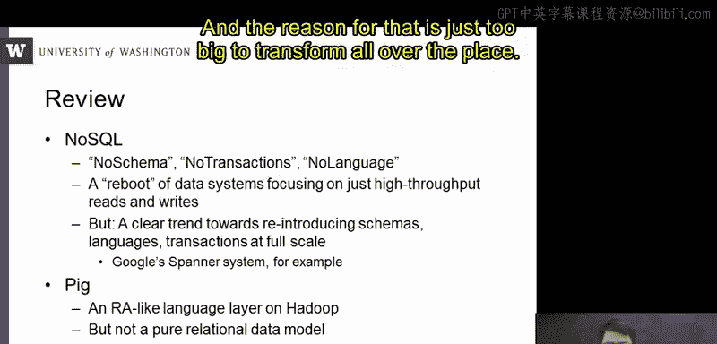
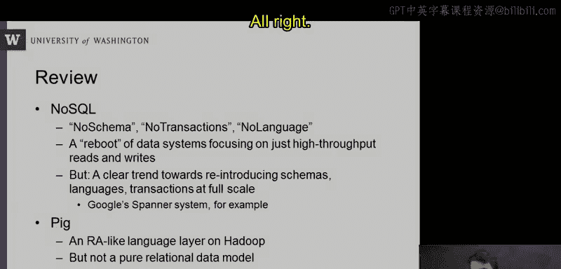

# 课程1：大规模数据科学 - 从抽象执行计划到MapReduce作业 🚀


在本节课中，我们将学习如何将一个抽象的查询执行计划，编译并优化成一系列高效的MapReduce作业。我们将重点了解Pig编译器如何通过操作符融合和作业合并来减少昂贵的MapReduce作业数量，从而提升大数据处理的性能。

---

上一节我们介绍了Pig如何将高级查询语言转换为抽象执行计划。本节中，我们来看看编译器如何将这个计划映射到具体的MapReduce作业序列。

编译器首先会识别执行计划中所有的`GROUP`和`COGROUP`操作符。这些操作符是执行数据分组的关键，通常需要网络间的数据混洗（shuffle）。

因此，编译器会为每一个`GROUP`或`COGROUP`操作符分配一个独立的MapReduce作业。

---

接下来，编译器会尝试向前和向后遍历执行计划，尽可能多地将其他操作合并到同一个MapReduce作业中。其核心目标是减少需要执行的MapReduce作业总数，因为启动和运行每个作业的开销都很大。

以下是编译器进行优化的几个关键策略：

*   **合并过滤操作**：`FILTER`操作（例如，筛选特定IP地址）可以在从磁盘加载数据时，或在处理每条元组时立即应用。因此，它完全可以被合并到负责`GROUP`操作的同一个MapReduce作业的Map阶段中，无需独立的作业。
*   **合并加载操作**：`LOAD`操作仅仅是读取磁盘数据，计算成本极低，同样可以合并到同一个MapReduce作业中。
*   **优化Reduce阶段**：对于`GROUP`操作后紧跟的`FOREACH ... COUNT`（计数）操作，编译器足够智能，能识别出我们并不需要实际构造出完整的分组对象。它可以直接在Reduce阶段输出类似 `(IP, count)` 的键值对，而不是 `(IP, [list_of_all_records])` 再计数。这避免了构造和传递大型分组对象的开销，带来了显著的性能提升。

---

通过上述优化，一个包含加载、过滤、分组和计数的复杂查询，最终可能被编译成**仅仅一个MapReduce作业**。

这个作业的Map函数可能类似以下伪代码：
```python
def map(record):
    parsed_data = parse(record)
    if parsed_data.ip in target_ips:
        emit(parsed_data.ip, 1)
```
而在Reduce端，则直接对每个IP的计数进行求和，无需构造中间分组列表。

当然，并非所有操作都能合并。某些命令，例如`SORT`（排序），由于其特性，总是需要一个独立的MapReduce作业。

---

## 回顾：NoSQL系统与Pig的启示 🔄

在之前的几个小节中，我们讨论了NoSQL系统。我们认为数据科学家有必要理解它们，一方面你可能直接使用它们，另一方面你可能需要评估它们与其他系统（如关系型数据库）相比的优缺点。

我们谈到，“NoSQL”通常意味着**无固定模式（No Schema）**、**无（或弱）事务（No Transactions）** 以及**无声明式查询语言（No Language）**。它更像是对数据系统的一次“重启”，专注于实现高吞吐量的读写。

如今，大规模数据系统的设计空间被更充分地探索，出现了各种不同特性的排列组合。一个明显的趋势是，系统又开始重新引入模式、事务和查询语言等特性（例如Google的Spanner系统）。

因此，“NoSQL”是一个不断演进的概念。关键在于认识到，整个大规模数据系统的可能性空间正在被探索：NoSQL代表一个方向，关系型数据库代表另一个，同时还有新的方向在涌现，比如试图兼顾两者的“NewSQL”。

---

我们特别以**Pig**为例进行了讨论。Pig本身不是一个NoSQL存储系统，而是一个构建在MapReduce之上的分析层。

我们选择Pig，是因为它在Hadoop之上提供了一个类似**关系代数**的抽象层。这说明了关系代数的思想在很多不同场景下都会出现。

有趣的是，虽然Pig有清晰的关系代数风格，但它并非纯粹的关系数据模型（它支持嵌套数据结构）。这揭示了一个要点：我们可以从数据库领域“ cherry-pick ”（精选）一些概念和技术，而不必非要在传统数据库的语境下使用它们。当数据库似乎无法满足需求时，我们不必“把洗澡水和婴儿一起倒掉”。Pig这类系统正是这么做的。

作为数据科学家，在评估各种新兴系统时，你可以开始理解它们提供的特定功能集，并追溯这些功能的来源、历史以及其中的利弊权衡。

Pig的一个关键特点是 **“读时模式”（Schema-on-Read）** ，这与传统数据库的 **“写时模式”（Schema-on-Write）** 不同。“读时模式”允许你直接处理原始格式的数据（in situ data）。这是NoSQL乃至许多现代数据系统的一个新要求，因为数据量太大，无法到处进行格式转换。

---





本节课中我们一起学习了Pig编译器如何将抽象执行计划优化并编译成高效的MapReduce作业序列，其核心是通过操作符融合来最小化作业数量。同时，我们也回顾了NoSQL系统的特点和发展趋势，并通过Pig的例子，看到了如何借鉴数据库的经典思想（如关系代数）来构建适应大数据场景的新工具，特别是“读时模式”在处理海量原始数据时的重要性。