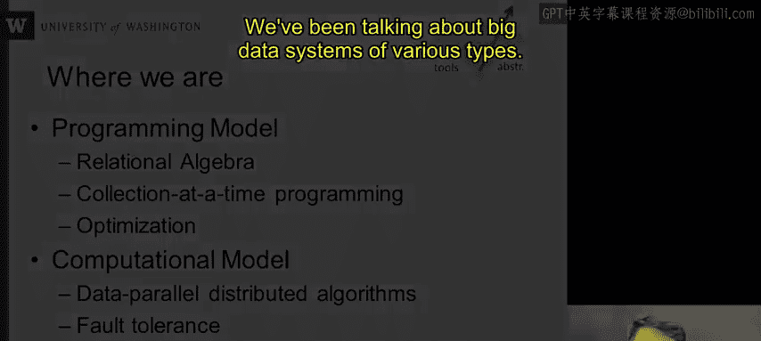
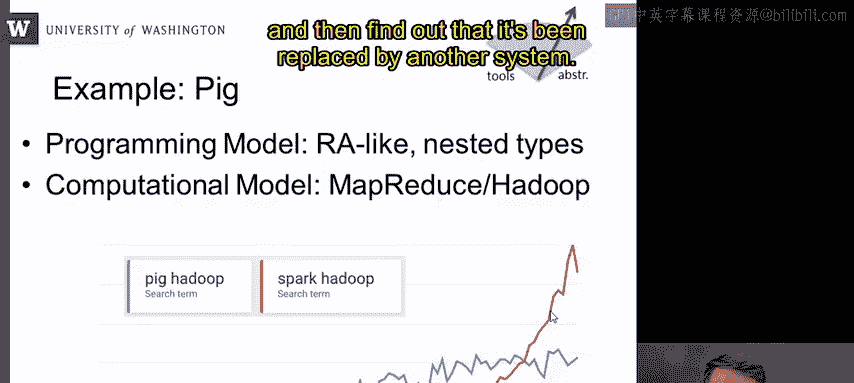

# 大规模数据科学（第1课/共3课）🚀：核心抽象与系统演进

在本节课中，我们将学习大规模数据系统的核心抽象概念，并了解这些概念如何在不同工具（如Pig和Spark）中体现。我们将重点探讨编程模型和计算模型，理解它们如何帮助开发者高效处理大数据，而无需深入底层细节。

---

## 背景与核心抽象 🧠

上一节我们介绍了多种大数据系统，包括数据库、MapReduce系统、NoSQL系统等。本节中，我们来看看这些系统背后共有的核心抽象。

本课程的重点在于**抽象**而非具体工具。我们已识别出一些关键抽象，它们与编程模型密切相关。

### 编程模型：集合级操作

我们反复看到关系代数的例子，即使在其最初设计的数据库系统之外也是如此。这是一个**集合级编程**的示例。

**集合级编程**允许你通过单次调用转换整个数据集，而无需编写操作单个记录和管理并行计算的底层代码。

**公式示例**：`Result = π_{name}(σ_{age>30}(People))` （这是一个关系代数表达式，表示选择年龄大于30的人并投影其姓名）

### 计算模型：数据并行与分布式算法

在编程模型之下是计算模型。我们一直在讨论如何从**数据并行分布式算法**的角度思考。

这意味着要理解如何让大量机器同时处理单个数据集，并考虑由此产生的问题，例如**容错性**。

如果你有1000台机器，其中一台在计算过程中出错的概率变得非常高。你必须设计能够容忍这种情况的系统，有时甚至需要设计代码来容忍它。

此外，还有各种性能问题，例如使用磁盘与内存索引来加速搜索、事务处理或其缺失情况下的应对策略等。

---

## 案例分析：Pig系统 🐷

我们研究过一个具体系统：**Pig**。

Pig的编程模型非常类似于关系代数，但它支持嵌套类型和其他一些扩展功能。你可以在其中识别出关系代数的影子。

它有一个优化器，负责接收这些关系代数表达式，将其转换为其他表达式，然后映射到计算模型中。Pig的计算模型就是**MapReduce**（Hadoop）。

因此，开发者无需直接针对MapReduce层编程，而是在这个更高级别进行编程，让系统完成向下转换。这个主题我们将反复看到。

---

## 系统演进趋势：从Pig到Spark 📈

当我首次开设这门课程时，Pig比另一个更多还是研究平台的系统——**Spark**——更流行。

但从那时起，我们看到了这样的趋势（数据来自Google Trends）：

以下是搜索词“Pig Hadoop”与“Spark Hadoop”的对比趋势图。

可以看到，Pig仍处于上升轨迹，它仍然是一个非常相关且值得学习的系统。但最近，它被一个名为**Spark**的系统显著超越。

我们再次强调，重点应放在**抽象**而非具体工具上。因为你会遇到这样的情况：你可能学会了某个系统的所有细节，却发现它已被另一个系统取代。但这没关系，因为你学习的是底层概念。

---

## 总结 ✨

本节课中我们一起学习了大规模数据科学的核心基础。我们探讨了**集合级编程**的抽象如何简化数据处理，以及**数据并行计算模型**如何解决分布式环境下的容错与性能挑战。通过分析Pig和Spark的演进，我们理解了专注于底层抽象概念的重要性，这能让我们在技术快速变迁中保持知识的持久性与适应性。在接下来的课程中，我们将深入这些抽象在具体系统中的实现与应用。