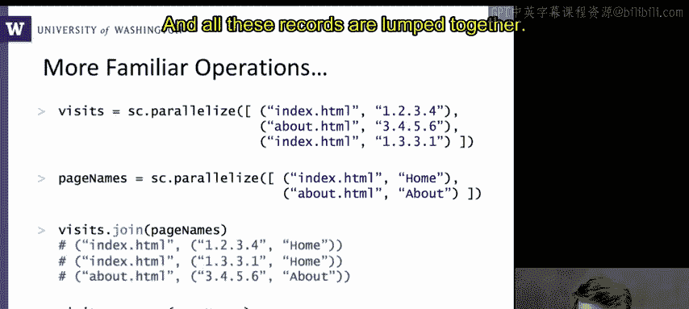
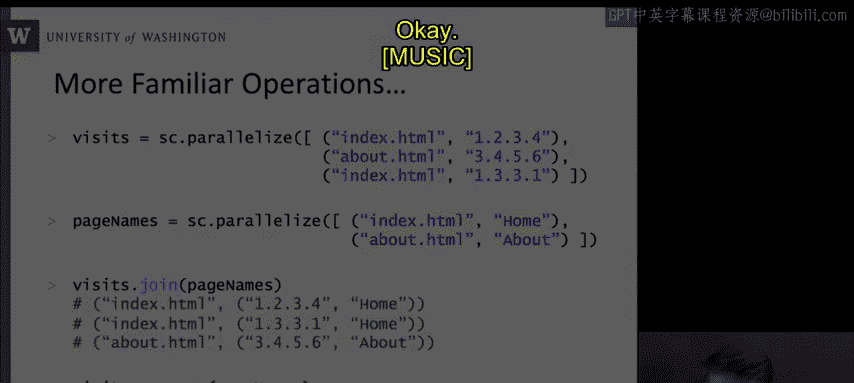

# 课程名称：大规模数据科学（大数据操作，第1课／共3课） - Spark示例 🚀

## 概述

在本节课中，我们将要学习一个使用Spark框架编写的程序示例。我们将详细解析这段代码的功能，理解其核心操作，并将其与之前学过的概念（如MapReduce）联系起来。通过这个具体的例子，我们将看到Spark如何以一种简洁、高效的方式处理分布式数据计算任务，特别是经典的“词频统计”问题。

---

## Spark程序解析

这里是一个用Spark编写的程序。问题是，这段代码是做什么的？

第一行代码定义了一个变量，它通过Spark上下文从某个路径读取一个文件，并将其赋值给名为 `textFile` 的变量。

下一行代码调用了 `textFile` 对象的一个方法。这个方法就是 `flatMap`。

我们过去简要提到过 `flatMap`，但你可能对它不熟悉。不过我们马上就会看到它的作用。传递给这个 `flatMap` 的参数是一个有趣的表达式，它实际上是一个函数，一个匿名函数，或者如果你熟悉这个术语的话，也可以称为 **lambda函数**。这个函数接受一个我们称之为 `line` 的参数，然后对这个 `line` 执行一些操作。

在这个例子中，它对每一行的操作是：**根据空白字符将其分割**。因此，这个函数接收一行文本，并生成该行中的所有单词（或标记）。

`flatMap` 操作的结果随后被传递给 `map` 操作。`map` 操作听起来应该很熟悉。

`map` 操作同样接收一个函数作为参数。这个函数接收一个 `word`，并生成一个键值对：`(word, 1)`。

`map` 操作的结果接着被传递给 `reduceByKey` 操作。这个操作也应该开始变得熟悉起来。它接收一个函数，这里就是加法运算。加法运算接收一个左参数和一个右参数，并将它们相加。`reduceByKey` 会通过反复应用这个加法运算来进行归约。

最后，这个归约的结果被传递给变量 `counts`，然后 `counts` 可以保存为一个文本文件。

那么，整个计算过程是做什么的呢？我希望你已经认出来了，它就是 **词频统计**。

---

## 词频统计示例详解

以下是它的实际运作过程。我们已经见过一个详细分解的例子。

输入的文本行包含三个标记：“2”, “B”, “or”。`flatMap` 操作将这一行分割成三个独立的标记。

`map` 操作给每个标记附加上数字 `1`。

然后，`reduce` 操作根据键（即单词）将所有条目分组，并将数字 `1` 的实例相加，得到总计数。因此，在所有行中，“B”出现了两次，“2”出现了两次，“or”出现了一次，“not”出现了一次。

好的，我们已经反复看到这个过程了。这就是你在Spark中编写这个计算的方式。

---

## Spark与Hadoop MapReduce的对比

既然我们理解了 `map` 和 `reduce`，我们就理解了在Spark中编程的一种方式。你可能会问，为什么这里的写法与Hadoop中的 `map` 不同？

在概念上其实只有一个 `map`，它允许接收一条记录，并一次性地输出任意数量的记录。本质上，这里他们称之为 `flatMap`。`map` 只产生单个输出项，而 `flatMap` 产生一个列表（或集合）的输出项。所以，`flatMap` 必须接收一行文本，并产生一个标记的列表（或集合）。而 `map` 接收单个记录（单个项）并产生单个项。这里并没有真正的概念差异，他们这样命名主要是出于**类型安全**的考虑。

---

## Spark中的其他熟悉操作

太棒了，我们已经知道了在Spark中编程的一种方式。但这里还有其他熟悉的操作。你可以看到 `join` 这个词，因为我们已经详细研究过它，所以你知道什么是连接操作。

你可能也知道什么是 `coGroup`，因为我们在Pig中见过它。之所以需要 `coGroup`，并且在关系代数和数据库中看不到这个词，是因为**只有当讨论嵌套类型时，它才有意义**。让我们来看看这个。

这是一个Spark函数，叫做 `parallelize`。它接收宿主编程语言（在这个例子中是Python）中的一个集合类型（顺便说一下，我们刚刚切换了代码；上一张幻灯片的代码是Scala，而这张幻灯片的代码是Python）。

这只是一个常规的Python元组列表，`parallelize` 方法将其转换为一个分布式数据集。它在你的本地客户端上是一个列表，但这个方法使其在集群上可用（它不会变成一个巨大的数据集，大小和原来一样，只是使其在集群上可用）。

我们对两个不同的字面量列表执行了这个操作。然后，如果你将它们连接起来，`join` 会假设你根据键（在这个例子中是URL）进行连接。它生成的结果是关系型连接，索引为HTML，同时包含来自 `pageNames` 的记录。你可能注意到，这并不完全是关系型连接，因为这是一个元组，而不是扁平化的版本。

好的，这就是 `join`。而 `coGroup` 做的事情几乎相同，只是在这里，`index.html` 在 `join` 中出现了两次，而在 `coGroup` 中只出现一次，所有相关的记录都被归集在一起。这正是Pig中的 `COGROUP` 操作所做的。

---

## 总结

本节课中，我们一起学习了Spark框架的一个核心编程示例——词频统计。我们逐步解析了代码，理解了 `flatMap`、`map` 和 `reduceByKey` 等关键操作在Spark中的具体应用。我们还对比了Spark与Hadoop MapReduce在概念实现上的异同，并简要介绍了Spark中其他重要的数据操作，如 `join` 和 `coGroup`。通过这个具体案例，我们看到了Spark如何以简洁、强大的方式表达复杂的数据处理逻辑。