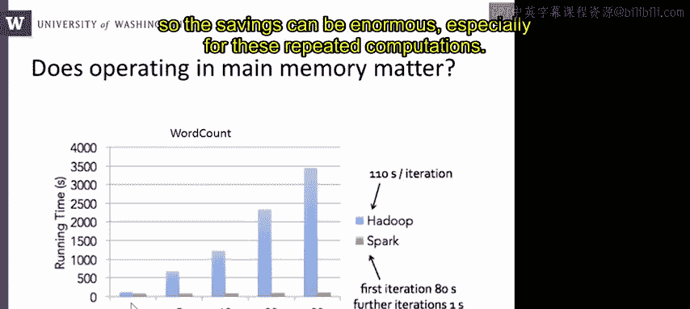

# 大规模数据科学（大数据操作，第1课／共3课） - P108：RDD的优势 🚀


在本节课中，我们将学习Spark的核心概念——弹性分布式数据集（RDD），了解其设计原理、操作方式以及它如何解决传统MapReduce框架的性能瓶颈。

---

Spark中使用的概念与你在其他系统中学习过的概念完全相同。你可以运用所有已学的知识来理解Spark的内部运作。然而，有一些与Spark特别相关的术语你需要熟悉，其中一个关键术语就是**弹性分布式数据集**。

## 什么是RDD？💡

**RDD**是一个分布式的键值对集合。这听起来应该很熟悉，因为它与MapReduce和Hadoop使用的数据模型完全相同，甚至与定义了主键的关系数据库记录模型也非常相似。键值对和记录之间的区别并不十分显著。

RDD的另一个关键区别在于，它可以**跨任务持久化在内存中**。这与MapReduce不同，在MapReduce中，出于容错原因，每个任务后所有数据都要写入磁盘。而RDD可以驻留在内存中，你可以在多次迭代甚至多个作业中对它们应用多个任务。这种**内存缓存**是Spark的关键特性，我们稍后会再次讨论。

## RDD的操作：转换与行动 ⚙️

处理这些RDD时，主要有两种操作，这是Spark的术语：**转换**和**行动**。

*   **转换**是我们一直在讨论的算子，例如 `map`、`reduce`、`filter`、`join` 和 `groupByKey` 等。它们接收一个或多个RDD，并**生成另一个RDD**。
*   **行动**则接收一个RDD，并**生成一个值**，将值从RDD提取到宿主语言（如Python、Scala或Java）中，然后可以使用该编程语言进行操作。

让我们看一个例子。

以下是Python代码示例：

```python
# 从某个路径读取文本文件，创建一个RDD
textFile = sc.textFile("hdfs://...")

# 应用一个转换：filter
linesWithSpark = textFile.filter(lambda line: "Spark" in line)

# 应用一个行动：count
count = linesWithSpark.count()
# 或者应用另一个行动：first
firstLine = linesWithSpark.first()
```

在这个例子中：
1.  `sc.textFile` 从路径读取文件并创建RDD。
2.  `filter` 是一个转换，它接收一个函数（这里是一个Python lambda匿名函数）。该函数对每一行进行评估，只保留包含单词“Spark”的行，结果保存到新的RDD `linesWithSpark` 中。
3.  `count()` 和 `first()` 是行动，它们分别返回RDD中的记录总数（例如74）和第一条记录。

Spark使用的一个评估原则是**惰性求值**。这意味着转换操作并不会在代码行被遇到时立即执行。相反，它会一直等待，直到必须向宿主语言返回一个实际的值。在此之前，它会堆叠所有计算该值所需的转换，可能对它们进行优化，然后一并运行并提取值。

## RDD操作与已有知识的联系 🔗

有一系列RDD操作。你可以像在MapReduce中一样直接编程，使用行为方式相同的 `map` 和 `reduce` 调用。但你也可以使用其他算子，这些算子看起来更像基于关系代数的系统（如Pig）甚至更一般的数据库系统中的操作。因此，你可以用多种不同的方式针对Spark进行编程，但所有这些概念你都已学过。

## MapReduce的弱点与Spark的解决方案 🎯

现在，让我们回顾一下MapReduce/Hadoop的一些重要弱点，以及Spark如何解决它们。

上一节我们介绍了RDD的基本操作，本节我们来看看Spark旨在解决的核心问题。

以下是MapReduce的主要弱点：

1.  **手动编写Map和Reduce函数**：这可能会变得繁琐且容易出错。这个问题很早就被认识到，并催生了像Hive和Pig这样的系统来部分解决它，允许用户在更高层次的模型（Hive用SQL，Pig用关系代数语言）上编程，由系统生成底层的MapReduce计算。

2.  **缺乏高效查找的索引**：如果想在一个非常大的MapReduce数据集中查找特定记录，除了扫描整个数据集外别无选择。这个问题也较早被认识到，并通过在Hadoop生态系统中引入键值存储（如基于Google BigTable的HBase）来解决。

3.  **每一步都将完整输出写入磁盘**：出于容错原因，MapReduce工作流的每一步都会将其完整输出写入磁盘。这对容错有好处，但对性能绝对是灾难性的。**这第三个问题正是Spark设计要解决的**。前两个问题已被其他系统解决，但Hadoop由于（尽管可能不完全是）将所有内容写入磁盘而导致的原始性能问题被认为是致命的。

因此，**将所有数据放入内存并在内存中对大型数据集进行操作**，是Spark自身的关键设计目标。

## 内存优化的重要性 ⚡️

那么，这种优化重要吗？答案是：绝对重要。

通过一个迭代计算任务的性能对比可以清楚地看到：
*   在第一次迭代时，Spark（约80秒）和Hadoop（约110秒）的时间大致相同。
*   但随着计算继续进行，Hadoop的**每一次后续迭代**都必须一遍又一遍地重新读取相同的数据集，因此时间线性增长。
*   而Spark只需要在第一次时读取数据，所有后续迭代都能够直接在内存中对其操作，**不占用任何额外时间**。

因此，对于这类重复计算，性能提升是巨大的。

---



**总结**：本节课我们一起学习了Spark的核心抽象——弹性分布式数据集（RDD）。我们了解了RDD是分布在内存中的键值对集合，支持**转换**（生成新RDD）和**行动**（返回值）两种操作，并采用**惰性求值**策略。更重要的是，我们探讨了Spark如何通过**内存缓存**机制，有效解决了传统MapReduce框架因每一步都需落盘而导致的严重性能瓶颈，从而特别适用于需要多次访问同一数据集的迭代式算法和交互式数据分析任务。