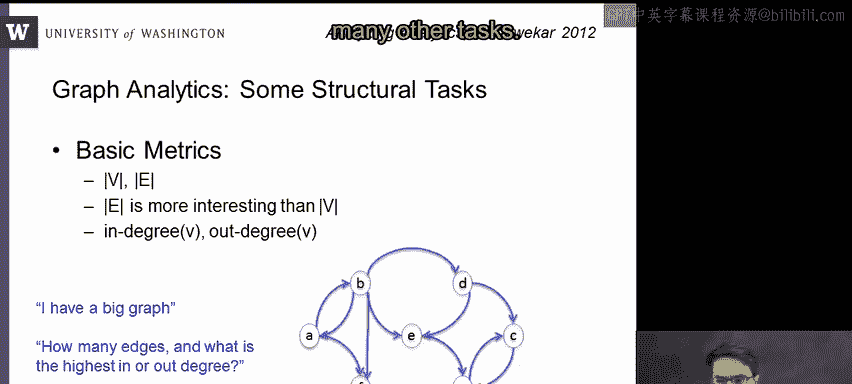

# 大规模数据科学（大数据操作，第1课／共3课）📊：图概述


在本节课中，我们将要学习图的基本概念及其在大规模数据科学中的重要性。图是一种强大的数据结构，用于表示实体（顶点）及其之间的关系（边）。我们将探讨图是什么、为什么它们无处不在，以及如何对图进行基本的分析。

---

## 什么是图？🔍

上一节我们介绍了课程概述，本节中我们来看看图的基本定义。

图由一对集合构成：一个顶点集合和一个边集合。顶点有时也被称为节点，但为了避免与计算机集群中的“节点”混淆，我们将统一使用“顶点”这一术语。

**公式**：一个图 `G` 可以定义为 `G = (V, E)`，其中：
*   `V` 是顶点的集合。
*   `E` 是边的集合，每条边是顶点的一个对 `(u, v)`。

边可以是有向的（从源顶点指向目标顶点），也可以是无向的（顶点对之间的连接，顺序无关）。

---

## 为什么图无处不在？🌐

了解了图的基本定义后，我们来看看图在现实世界中如此常见的原因。

图能够非常直接地捕捉许多系统的本质：一组参与者（顶点）以及他们之间的任何互动（边）。这是一种非常通用的建模范式。

以下是图的一些常见应用场景：

*   **万维网**：每个网页是一个顶点，页面间的超链接是一条边。
*   **互联网**：每台计算机是一个顶点，计算机间的路由或数据包传输是边。
*   **社交网络**：每个人是一个顶点，人与人之间的好友或关注关系是边。社交网络作为政治和社会变革的驱动力，其影响力难以估量。
*   **通信日志**：例如，每次电话通话可以建模为通话双方之间的一条边。

从数据建模的角度看，图将数据分解为“对象”和“对象间的关系”，这几乎是最基础的数据模型。虽然这种简化可能会丢失一些信息，但它提供了极大的灵活性。

---

## 图分析任务分类 📈

我们已经知道图是什么以及为何重要，现在我们来探讨可以对图进行哪些分析。

Bör of Wihar 在2012年的一篇论文中将分析任务分类，其中一类是图分析。他将图分析任务进一步分为以下三种模式：

*   **结构算法**：分析图本身的拓扑性质。
*   **遍历算法**：探索图中的路径和连通性。
*   **模式匹配算法**：在图中寻找特定的子图结构。

这个分类非常清晰，我们将在接下来的内容中沿用。

---

## 结构算法：理解图的基本度量 📏

上一节我们介绍了图分析的任务分类，本节我们重点看看第一类：结构算法。

当面对一个需要处理或理解的图时，首先要做的就是收集一些基本度量指标。

**核心问题**：
1.  图有多大？即，有多少个顶点和多少条边？
2.  图中顶点的度数分布如何？

**关键见解**：在理解图的规模时，**边的数量比顶点的数量更重要**。原因在于，对于一个有 `n` 个顶点的图，其可能的最大边数是 `n²`（对于有向图）或 `n(n-1)/2`（对于无向图）。这个数字可能非常巨大。例如，一个拥有20亿用户的社交网络，其潜在的好友关系数量是天文数字。

**代码**：获取顶点 `v` 的度数（以有向图为例）：
```python
in_degree = len(graph.in_edges(v))  # 入度：指向顶点v的边数
out_degree = len(graph.out_edges(v)) # 出度：从顶点v出发的边数
```

因此，在评估图规模时，第一个问题应该是“有多少条边？”，而不是“有多少字节？”或“有多少个顶点？”。字节数可能包含大量与图结构无关的附加信息，而顶点数无法反映关系的稠密程度。

紧接着的第二个关键问题是“最高入度或出度是多少？”。这反映了图的**度数分布**是否倾斜。

在现实世界的图中，度数分布几乎总是高度倾斜的（即遵循幂律分布）。例如，社交网络中有极受欢迎的用户（拥有大量好友），万维网中有被大量链接的页面。这种不平衡性是处理超大规模图的主要挑战之一。

**总结**：通过边的总数可以了解图的总体规模，而通过最高度数可以了解数据分布的倾斜程度。能够计算这些基本度量（如统计顶点/边数、获取任意顶点的度数）是进行更复杂图分析的基础。

---



本节课中我们一起学习了图的基本概念，了解了其作为对象与关系模型的重要性，并掌握了评估图规模的两个核心度量：边的总数和顶点的度数分布。这些基础知识是后续进行更复杂的图遍历和模式匹配分析的起点。