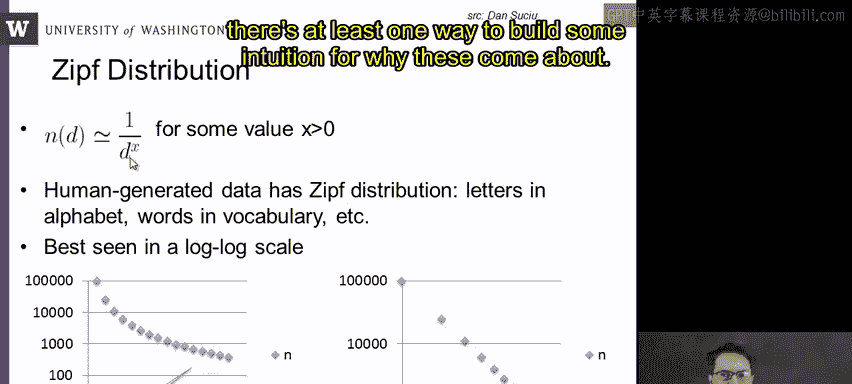

# 大规模数据科学（第1课）📊：图的结构分析

在本节课中，我们将学习如何通过分析图的“出度”分布来理解其结构。我们将介绍出度直方图的概念，并探讨两种典型的分布模式：指数分布和幂律分布。

---

## 构建出度直方图

上一节我们介绍了图的基本概念，本节中我们来看看如何量化图中节点的连接情况。一个更详细的结构分析任务是构建图的出度直方图。

一个顶点的**出度**，即从该顶点出发的边的数量。我们用数学符号来定义：对于每个整数 `D`，令 `n(D)` 表示出度恰好为 `D` 的顶点数量。

例如，在下图中：
*   顶点 A 的出度为 0（没有出边）。
*   顶点 B 的出度为 2（有两条出边）。
*   顶点 C 的出度为 4（有四条出边）。

通过统计，我们可以得到：
*   出度为 0 的顶点有 1 个（A）。
*   出度为 1 的顶点有 3 个。
*   出度为 2 的顶点有 2 个，依此类推。

最后，我们将 `D` 与对应的 `n(D)` 绘制成图，就得到了出度直方图。

---

## 直方图揭示的模式

以下是直方图可能展现的几种模式及其含义：

*   **模式一：多数低连接**
    在这种模式中，图中**非常多**的顶点具有非常小的出度，随着出度值增大，拥有该出度的顶点数量**急剧减少**。这表示图整体上连接稀疏，大多数节点只与少数其他节点相连。

*   **模式二：多数高连接**
    与模式一相反，这种模式下，只有**非常少**的顶点具有低出度，而**非常多**的顶点具有高出度。这表示图非常稠密，大多数节点都与许多其他节点相连。

*   **混合或双峰模式**
    直方图也可能呈现更复杂的形状，例如双峰分布，表明图中可能同时存在两类连接特性不同的节点群体。

---

## 指数分布与随机图

如果我们在直方图中看到第一种模式（多数低连接），并且在对数坐标下绘制时，数据点大致呈一条直线，那么这种分布可以建模为**指数分布**。

其公式可以表示为：`n(D) ∝ e^(-c * D)`，其中 `c` 是一个常数。这意味着，找到一个出度为 `D` 的顶点的概率，随着 `D` 的增大而**指数级下降**。大多数顶点出度很小，高出度的顶点极为罕见。

这种分布是**随机图**的典型特征。随机图的构建方式是：给定一组顶点，然后完全随机地选择两个顶点并用边连接，不断重复此过程。用这种方法，几乎不可能产生连接数极高的“超级节点”。

然而，在现实世界中，纯粹的随机图并不多见。

---

## 幂律分布与现实数据

在实践中更常见的是**幂律分布**（又称齐夫分布）。

其公式可以表示为：`n(D) ∝ D^(-γ)`，其中 `γ` 是一个常数（指数）。在这种分布中，虽然大多数顶点出度仍然较低，但存在少量连接数极高的“枢纽”节点，其数量远超随机图模型下的预期。

由人类活动产生的数据（如社交网络、引用网络、万维网链接）往往遵循这种分布。直觉上，这可以理解为“富者愈富”或“优先连接”机制：新加入的节点更倾向于连接到已经拥有较多连接的节点，从而导致连接分布极度不均。

---

本节课中我们一起学习了如何通过出度直方图分析图的结构。我们介绍了出度的定义与直方图的构建方法，并对比了指数分布（对应随机图）和幂律分布（对应许多真实网络）两种典型模式及其意义。理解这些分布有助于我们选择合适的数据处理模型和算法。