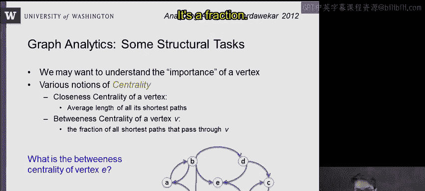

# 大规模数据科学（大数据操作，第1课／共3课） - P112：连通性与中心性 📊

在本节课中，我们将学习图结构分析中的两个核心概念：**连通性系数**与**中心性**。我们将探讨如何量化图的连接强度以及如何识别图中重要的顶点。

---

## 图的结构分析：连通性系数

上一节我们介绍了图的基本概念，本节中我们来看看如何衡量一个图的连接强度。我们可以将**连通性系数**作为图结构分析的一项任务进行测量。

连通性系数的定义是：使图变得不连通所需移除的**最少顶点数量**。直观上，这可以理解为对图**脆弱性**的一种度量，反映了图中内置了多少**冗余性**。

例如，如果你在设计一个网络，而该图的连通性系数为1，这意味着如果有一台机器宕机，网络就可能被分割，导致部分节点之间无法通信。对于广告商而言，如果希望信息能触达尽可能多的人，可能会关注图的连通性系数。因为如果少数人不关注广告，在病毒式营销或社交媒体广告中，可能导致一大批其他人也无法接收到信息。

此外，回想我们在NoSQL课程中讨论过的CAP定理，其中的**P**代表**分区容错性**。如果系统或网络被分割，系统是否仍能运行？连通性系数可以帮助你估算网络被分割的可能性。

那么，这个图的连通性系数是多少呢？这首先取决于我们对“连通”的定义。

以下是两种常见的连通性定义：
*   **强连通**：如果从顶点 **x** 可以到达 **y**，并且从 **y** 也可以到达 **x**，则称 **x** 和 **y** 是强连通的。
*   **连通**：如果从顶点 **x** 可以到达 **y**，**或者**从 **y** 可以到达 **x**，则称 **x** 和 **y** 是连通的。这相当于忽略了边的方向性。

让我们暂时采用第二种定义，即假设图是无向的。在这个前提下，如果我们移除顶点 **E**，图会变得不连通吗？不会。因为你仍然可以通过上方的另一条边到达所有节点。

图中唯一看起来不具备冗余性的节点是 **B**。如果移除 **B**，网络将被分割成两个部分：**A** 和 **F** 一组，其他所有节点为另一组。

因此，这个图的连通性系数是 **1**，因为我们可以找到一个顶点，移除它会导致网络被分割。我们已经讨论了为何需要计算这个系数。

---

## 衡量顶点重要性：中心性

连通性系数衡量的是图本身的属性，但并未提供理解单个顶点相对重要性的方法。为此，人们定义了各种**中心性**的概念。

### 接近中心性

一种中心性是顶点的**接近中心性**，其定义是**所有经过该顶点的最短路径的平均长度**。

直观上，你可以将其与图的**直径**（图中所有最短路径的最大长度）进行比较。如果图的直径很长，而经过某个特定顶点的最短路径平均长度很短，那么这个顶点就不在定义图直径的那些路径上。从某种意义上说，它可能就不那么中心或重要。

### 介数中心性

另一种更常见的中心性是顶点的**介数中心性**。其定义是**图中所有最短路径里，经过该顶点的路径所占的比例**。

这好比“条条大路通罗马”。在美国，如果你需要从西雅图前往亚特兰大，可能所有路径都要经过一两条主要高速公路，或一两个城市（比如北线或南线的枢纽）。那么，这些中间枢纽的介数中心性就很高。

再比如，在一个公共交通系统中，如果所有列车都先汇集到一个中央枢纽，然后再分散出去，那么这个中央枢纽将具有很高的介数中心性，因为从点A到点B的最短路径总是要经过这个顶点。

那么，在这个图中，顶点 **E** 的介数中心性是多少呢？

以下是经过 **E** 的最短路径示例：
*   从 **A** 到 **G** 的最短路径：**A -> B -> E -> G**。
*   此外，还有一些以 **E** 本身为起点的最短路径，例如 **E** 到 **C**，**E** 到 **G**。

因此，经过 **E** 的最短路径数量是 **3**。**E** 的介数中心性就是 **3** 除以图中**所有最短路径的总数**（它是一个分数）。

---

## 总结

本节课中，我们一起学习了图分析中的两个关键指标。**连通性系数**帮助我们评估图的整体连接强度和冗余度。而**中心性**（特别是接近中心性和介数中心性）则提供了量化图中单个顶点重要性的方法，帮助我们识别网络中的关键枢纽。理解这些概念对于设计稳健的网络系统或进行有效的社交媒体分析至关重要。