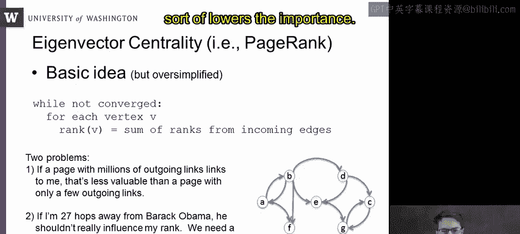

# 大规模数据科学（大数据操作，第1课／共3课）｜P113：PageRank算法详解 📊


在本节课中，我们将学习图数据中衡量节点重要性的核心算法——PageRank。我们将从简单的中心性概念开始，逐步深入到PageRank的原理、计算过程及其解决的问题。

---

## 概述：从度中心性到PageRank

上一节我们介绍了图的基本概念。本节中，我们来看看如何量化图中节点的重要性。一个直观的想法是使用**度中心性**，即一个节点的连接数。然而，度中心性存在局限：它无法区分连接质量。例如，连接了五个重要人物的节点，理应比连接了五个普通节点的节点更重要，但度中心性无法体现这一点。

为了克服这个局限，我们引入**特征向量中心性**，其核心实现就是**PageRank算法**。

---

## PageRank的基本思想 🧠

PageRank的基本思想是迭代计算。在未达到收敛条件前，对图中的每个节点，通过累加其**所有入边邻居节点的权重**来计算其自身权重。

这可以表述为：如果一个重要节点（例如拥有高权重的节点）连接了你，那么你的重要性就应该增加。同时，你的重要性也会分配给你所连接的所有节点。

以下是该思想的核心迭代公式：

```
R(v) = Σ (R(u) / OutDegree(u))
```
其中，`R(v)` 是节点v的PageRank值，求和是针对所有指向v的节点u进行的，`OutDegree(u)` 是节点u的出度。

这个过程可以理解为在网络中反复传递“重要性权重”，直到整个网络的重要性分布稳定下来。

---

## PageRank需要解决的问题 ⚙️

然而，上述简单方法存在两个主要问题。

### 问题一：出度稀释重要性

第一个问题是，一个拥有大量出边链接的节点，其每条出边传递的重要性会被稀释。例如，一个网络爬虫机器人关注了Twitter上的所有人，它关注你这件事并不显得你有多重要。同样，一个聚合了全网链接的网页，它链接到你也不能显著提升你的重要性。

**解决方案**：我们需要确保节点将其自身的权重**平均分配**给它所有的出边，而不是将全部权重赋予每一条边。上述公式中的除以出度 `OutDegree(u)` 正是为了解决这个问题。

### 问题二：距离衰减效应

第二个问题是，影响力的传递应随距离增加而衰减。如果我与一个重要人物（如奥巴马）相距27跳，这远不如与他直接相连来得重要。

**解决方案**：我们引入一个**阻尼因子**。它模拟了用户随机跳转的行为，并确保无论图的结构如何，重要性计算都能收敛，同时体现了“远处影响力减弱”的直觉。

引入阻尼因子d（通常取0.85）后的完整PageRank公式为：

```
R(v) = (1-d)/N + d * Σ (R(u) / OutDegree(u))
```
其中，`N` 是图中节点的总数，`(1-d)/N` 代表了随机跳转到图中任一节点的概率。

---

## 总结与回顾 ✅

本节课中，我们一起学习了PageRank算法。我们从简单的度中心性出发，指出了其不足，进而引出了基于邻居权重迭代计算的特征向量中心性思想，即PageRank的核心。

我们详细探讨了PageRank的基本计算过程，并针对其最初形式的两个缺陷——**出度稀释**和**缺乏距离衰减**——提出了解决方案：通过除以出度来分配权重，以及引入**阻尼因子**来模拟随机跳转并保证收敛。




最终，我们得到了完整、健壮的PageRank公式，该公式能够有效地衡量大规模图数据（如网页链接网络、社交网络）中节点的重要性。