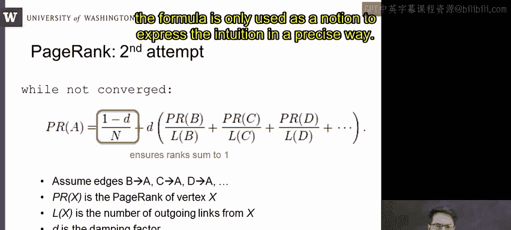

# 大规模数据科学（大数据操作，第1课／共3课） - P114：PageRank详解 🧮

在本节课中，我们将深入探讨PageRank算法的核心定义与计算过程。PageRank是衡量网页图中顶点（即网页）重要性的经典算法，其思想直观且公式简洁。

上一节我们介绍了衡量顶点重要性的几种朴素想法及其局限性，本节中我们来看看PageRank如何通过一个巧妙的公式来解决这些问题。

## PageRank的定义与公式

PageRank将“被高权重页面链接”和“传递的权重需按出链均分”这两个概念结合起来，形成了一个完整的定义。以下是其核心计算公式：

**PR(A) = (1-d) + d * ( PR(B)/L(B) + PR(C)/L(C) + PR(D)/L(D) + ... )**

在这个公式中：
*   **PR(A)** 代表页面A的PageRank值。
*   **B, C, D...** 代表所有链接到页面A的其他页面。
*   **L(x)** 代表页面x拥有的**出站链接**总数。
*   **d** 是一个阻尼因子，通常取值约为0.85。

让我们分解这个公式的含义。页面A的排名，是所有链接到A的页面的排名贡献之和。但每个贡献者（如页面B）的排名（PR(B)）需要被其自身的出链总数（L(B)）平分，这意味着一个页面将其影响力平均分配给它所链接的所有页面。

阻尼因子 **d** 确保了在随机游走模型中，权重会随着跳转距离的增加而衰减。公式中的 **(1-d)** 项则保证了所有页面的PageRank值总和为1，这使得PageRank值可以被直接解释为概率。

## PageRank的随机游走解释

事实上，PageRank有另一种非常直观的理解方式：**随机游走**。

想象一个用户在网页图中随机浏览：
1.  用户从随机一个页面开始。
2.  在当前页面，用户随机点击该页面上的一个链接，跳转到下一个页面。
3.  不断重复步骤2。

如果进行无数次这样的随机游走，统计用户停留在每个页面上的时间比例，那么这个比例恰好就等于该页面的PageRank值。这就好比在互联网上“随波逐流”，最终很可能会花大量时间停留在像维基百科或CNN这样被广泛链接的重要页面上。这种解释揭示了PageRank的本质：它衡量的是一个页面在网络中被随机访问到的可能性。

## 从直觉到公式

在继续之前，值得指出的是PageRank公式的**相对简洁性**。它源于一个直观的目标：如何量化图中顶点的重要性。

我们最初可能想到用“入链数量”来衡量重要性，但这存在明显问题（例如，一个被大量垃圾页面链接的页面并不重要）。接着我们可能考虑“经过该顶点的最短路径数量”，但这也有其缺陷。

PageRank的巧妙之处在于，它引入了“链接源的重要性也至关重要”这一概念。你的朋友如果很厉害，那么你的推荐也会更有分量。PageRank正是将这种“影响力的传递与均分”的直觉，用精确的数学公式表达了出来。许多伟大的算法都是这样从直观想法发展而来，公式只是用来精确表达这些直觉的工具。

本节课中我们一起学习了PageRank算法的标准定义、其核心计算公式，以及两种关键的理解视角：公式计算和随机游走模型。我们还回顾了PageRank如何从简单的直觉（如考虑链接源的重要性）一步步演化成最终的精炼公式。理解这个推导过程，比单纯记忆公式本身更为重要。