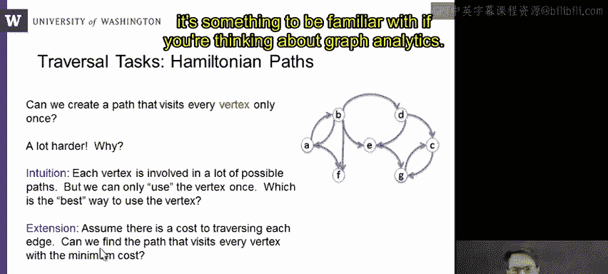
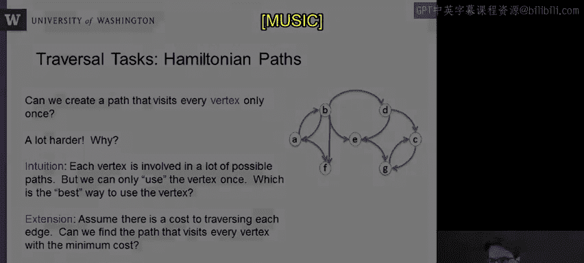

# 杜克大学《大规模数据科学》课程笔记 - 第1课：遍历任务：生成树与回路 🧭

在本节课中，我们将学习图分析中的遍历任务，重点介绍最小生成树和欧拉回路/路径这两个核心概念。我们将了解它们的定义、应用场景以及计算上的特点。

---

上一节我们介绍了结构分析任务的分类，本节中我们来看看具体的遍历任务示例。

## 最小生成树

最小生成树是指连接图中所有顶点的、总权重最小的边集。在无向图中，它构成了一个连通所有节点且无环的子图。

以下是一个寻找最小生成树的示例。考虑下图：

我们需要找到连接所有顶点的最小边集。忽略边的方向性，一种可能的生成树路径是：`A -> B`, `B -> F`, `B -> E`, `B -> D`, `D -> C`, `E -> G`。这使用了 **6** 条边。

另一种同样使用6条边的生成树是：`A -> B`, `A -> F`, `B -> D`, `B -> E`, `D -> C`, `E -> G`。

因此，该图的最小生成树包含 **6** 条边，并且可能存在多个不同的最小生成树方案。计算最小生成树有高效的算法（如Prim或Kruskal算法），但本课程作为任务概览，不深入讨论具体算法细节。

---

了解了寻找连接所有顶点的最经济方式后，我们接下来看看另一种经典的遍历问题：寻找访问所有边的路径。

## 路径与回路：欧拉问题

一个著名的遍历任务是欧拉的“柯尼斯堡七桥问题”，其目标是找到一条路径，**恰好经过图中每条边一次**。

这个问题的核心观察是：对于任何顶点，如果通过一条桥进入，则必须通过另一条桥离开（且不能是同一条）。这引出了以下结论：

以下是判断图中是否存在欧拉路径或回路的条件：

1.  **欧拉回路**：如果希望路径**起点和终点是同一个顶点**，形成一个闭环，那么**图中每个顶点的度数（相连的边数）必须均为偶数**。公式表示为：对于所有顶点 `v`，`degree(v) % 2 == 0`。
2.  **欧拉路径**：如果路径的起点和终点可以不同，那么条件可以放宽：**最多只能有两个顶点的度数为奇数**（分别作为起点和终点），其余顶点的度数必须为偶数。

这个结论非常有力，因为只需快速检查图中各顶点的度数，就能判断此类路径是否存在。

---

然而，图论问题的微妙之处在于，对问题描述稍作修改，其计算复杂度就会发生巨大变化。

## 问题变体：哈密顿路径与旅行商问题

如果我们把问题改为：寻找一条**访问每个顶点恰好一次**的路径（即哈密顿路径），那么问题就变得极其困难。

直观上理解，每个顶点都连接着多条边，涉及无数可能的路径。但你只能使用每个顶点一次，因此很难确定最优的访问顺序。这本质上是一个组合爆炸问题。

一个更复杂的扩展是**旅行商问题**：在访问每个顶点恰好一次的前提下，还要找到**总行程成本最低**的那条路径。对于这类问题，目前没有已知的高效精确算法，通常只能借助启发式或近似算法来求解。

---

## 总结

本节课中我们一起学习了图分析中的两类核心遍历任务：
1.  **最小生成树**：寻找连接所有顶点的最小成本边集，有高效算法。
2.  **欧拉路径/回路**：寻找遍历图中每条边恰好一次的路径，其存在性有简洁的判定条件（检查顶点度数）。

我们还看到，当问题变为寻找访问每个顶点恰好一次的路径（哈密顿路径）或寻求其最低成本解（旅行商问题）时，问题会变得非常困难，通常不属于大数据场景下的常见分析任务。在社交网络或网络分析等大数据语境中，更常关注的是连通性、社区发现等其它结构特性。