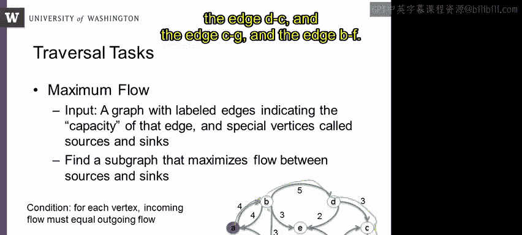

# 课程名称：大规模数据科学（大数据操作，第1课／共3课） - 最大流问题 🚀

在本节课中，我们将要学习图遍历任务中的另一个重要概念：**最大流问题**。我们将了解其基本定义、核心约束条件，并通过一个具体例子来理解如何寻找最大流子图。

---

## 概述 📋

最大流问题的输入是一个带有**边容量标签**的图，以及两个特殊顶点：**源点**和**汇点**。我们的目标是找到一个子图，使得从源点到汇点的**总流量**达到最大。

上一节我们介绍了图遍历的基本概念，本节中我们来看看一个更具体的优化问题——最大流。

---

## 核心概念与约束 ⚙️

该问题的一个核心观察是：对于图中除源点和汇点外的**任何一个顶点**，**流入的流量必须等于流出的流量**。

这个约束可以用以下方式理解：如果一个顶点不是源点或汇点，那么它不能“创造”或“消耗”流量，流经它的流量必须是守恒的。

---

## 示例解析 🔍

让我们通过一个具体例子来理解如何计算最大流。假设我们有一个图，其中：
*   **源点**是 **A**。
*   **汇点**是 **F** 和 **G**。
*   每条边上的数字代表其**容量**。

以下是分析最大流路径的步骤：

首先，考虑从源点A到汇点F的直接路径。这条路径只有一条边 `A -> F`，其容量为2。因此，沿这条路径的最大流量是 **2**。

然而，我们可以找到更优的路径。考虑路径 `A -> B -> F`。这条路径包含两条边：
*   `A -> B` 的容量是 **4**。
*   `B -> F` 的容量是 **3**。

一条路径的最大流量受限于其**容量最小的边**（即瓶颈）。因此，路径 `A -> B -> F` 的最大流量是 **min(4, 3) = 3**。虽然边 `A -> B` 有未使用的容量，但3已经比直接路径的流量2更大，所以我们应该在子图中包含这条路径。

接下来，我们分析从源点A到另一个汇点G的流量。以下是可能的路径及其最大流量分析：

*   **路径1**：`A -> B -> D -> E -> G`
    *   边容量分别为：5 (`B->D`)， 2 (`D->E`)， 2 (`E->G`)。
    *   该路径的瓶颈是容量为2的边，因此最大流量为 **2**。

*   **路径2**：`A -> B -> D -> C -> G`
    *   边容量分别为：5 (`B->D`)， 4 (`D->C`)， 3 (`C->G`)。
    *   该路径的瓶颈是容量为3的边 (`C->G`)，因此最大流量为 **3**。

比较两条路径，路径2能提供更大的流量（3 > 2）。

---

## 最大流子图构建 🧩

综合以上分析，为了最大化从源点A到两个汇点（F和G）的总流量，我们应选择能提供最大流量的路径组合。

因此，最终的最大流子图应包含以下关键边：
*   从A到F：选择路径 `A -> B -> F`（流量3）。
*   从A到G：选择路径 `A -> B -> D -> C -> G`（流量3）。

这个子图可以描述为包含边 `A->B`, `B->F`, `B->D`, `D->C`, `C->G`。它确保了在满足每个顶点流量平衡约束的前提下，实现了从源点到汇点的最大可能流量。

---

## 总结 🎯

本节课中我们一起学习了**最大流问题**。我们了解到：
1.  问题的目标是找到从**源点**到**汇点**流量最大的子图。
2.  核心约束是：对于任何中间顶点，**流入量等于流出量**。
3.  单条路径的最大流量由路径上**容量最小的边**决定。
4.  解决方法是识别并组合那些能提供最大流量的路径，同时确保整个网络的流量平衡。

理解最大流算法是处理网络优化、运输和通信等问题的重要基础。