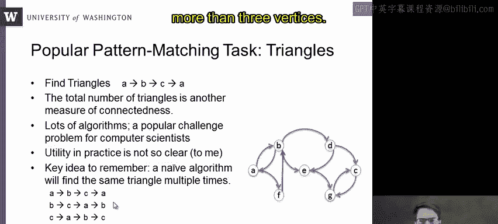
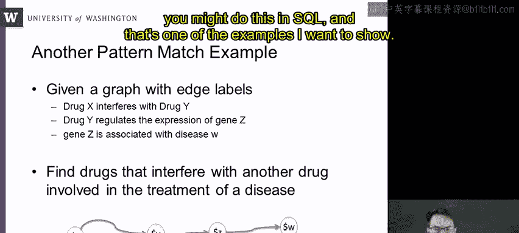

# 课程名称：大规模数据科学（大数据操作，第1课／共3课） - 第117讲：模式匹配 🧩

## 概述

在本节课中，我们将要学习图分析中的最后一类任务：模式匹配。模式匹配的目标是在图中寻找所有符合特定子图模式的实例。我们将通过简单的例子来理解其基本概念，并探讨其在现实数据分析中的应用，例如在药物相互作用网络中的查询。

---

## 模式匹配的基本概念

上一节我们介绍了图分析的不同任务类别，本节中我们来看看模式匹配。模式匹配的核心思想是，在给定的图中，找出所有与指定子图结构相匹配的实例。

一个非常简单的子图模式可以是：两个顶点（A和B）彼此相连。在匹配时，我们可以在顶点标签或边标签上附加条件，以更精确地定义我们寻找的模式。目标是找出图中所有符合该模式的实例。

例如，对于模式“两个顶点相互连接”，我们需要计算它在图中出现了多少次，或者找出所有能实例化该模式的顶点对。

---

## 模式匹配实例与重复计数

以下是匹配“两个顶点相互连接”模式时可能遇到的情况：

*   从A到B的连接是一个实例，我们可以将其标记为 `$x = A` 和 `$y = B`。
*   从G到C的连接是另一个实例，对应 `$x = C` 和 `$y = G`。

然而，如果不加注意，我们可能会重复计数。因为无向边A-B同时包含了A到B和B到A两个方向。因此，这个简单的模式在图中可能被计为四个实例，但其中只有两个在本质上是唯一的。

---

## 三角形计数：一个经典的匹配问题

一个非常流行的模式匹配问题是寻找图中的三角形。三角形是由三个顶点组成的序列，其中每对顶点都相互连接，即 A 连接 B，B 连接 C，C 连接 A。

三角形总数是衡量图连通性的一个指标。存在许多算法来计算这个数量，它也是计算机科学家用来比较不同系统和算法的经典基准问题。

不过，在与实际计算此指标的人交流时，它在社交网络分析中的实际信息价值似乎并不十分明确。它更多地被视为一个优秀的系统基准测试问题。因此，我们不会在此深入探讨具体算法。

但需要记住一个关键点：一个朴素的算法可能会将同一个三角形计数三次（例如，分别以A、B、C为起点）。这为设计更快的算法提供了优化空间。研究三角形计数的另一个原因是，它可能是最简单的一种模式，是进行更复杂模式分析的良好起点。

---

## 扩展到带标签的图与复杂模式

模式匹配问题本身是一个非常困难且计算代价高昂的问题，这催生了许多近似技术。即使是三角形计数，也有多种算法不计算精确数量，而是在一定误差范围内给出良好近似。

现在，让我们看另一个模式匹配的例子，这是一个来自我们合作者实际工作的简化版本。

在这个例子中，图上的边带有标签。我们不再只有源顶点和目标顶点，还假设边上有一个标签作为第三个属性。这个标签可以表示各种关系，例如“某人认识某人”，或者在本例中，“药物X干扰药物Y”，其标签就是“干扰”。

这比Twitter（所有关系都是“关注”）或Facebook（所有关系都是“好友”）的图更复杂，它在同一个图中编码了多种不同的关系。在进行真实数据分析时，这种情况更为现实。

假设我们有这样的关系：药物X干扰药物Y，药物Y调控基因Z的表达，而基因Z与疾病W相关。那么，我们可能想要寻找的模式是：找出所有干扰了其他某种药物的药物，并且该其他药物参与了某种疾病的治疗。

当然，我们还可以在这里添加其他限制条件，比如寻找特定疾病或特定药物。但目前，我们只是寻找所有此类模式。

---

## 用查询语言表达模式

从图形上看，我们的查询模式可能如下所示：我们想找到一条标记为“干扰”的边连接顶点X和Y；然后，顶点Y通过一条标记为“调控”的边连接到顶点Z；接着，顶点Z通过一条标记为“关联”的边连接到顶点W。我们希望找到这个模式的所有实例。

我暂时不讨论实现此功能的算法，而是想更多地谈谈表达这种模式的语言。有些具有数据库背景的学员可能已经在思考如何在SQL中实现这一点，这正是我想展示的例子之一。

---

## 总结

本节课中，我们一起学习了图分析中的模式匹配任务。我们从简单的“顶点互连”模式入手，理解了其基本概念和计数时的注意事项。接着，我们探讨了经典的三角形计数问题及其作为系统基准的意义。最后，我们将概念扩展到带有边标签的图，并介绍了一个来自药物网络的真实复杂模式匹配案例，为后续学习如何使用查询语言（如SQL）来表达这些模式打下了基础。模式匹配是一个计算上富有挑战性但应用广泛的领域，是图数据分析的重要组成部分。