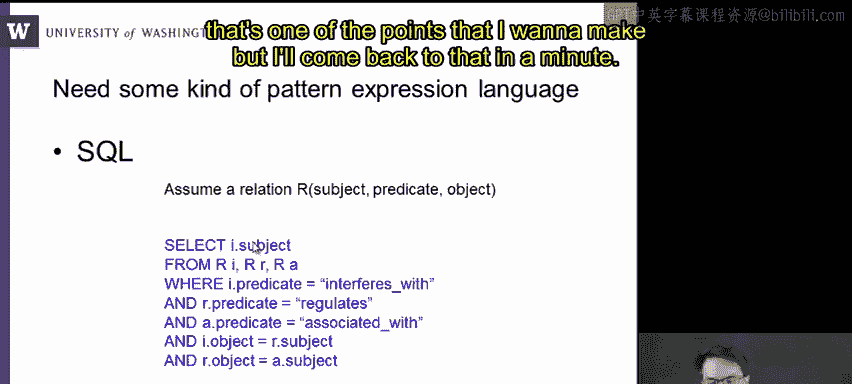

# 大规模数据科学（大数据操作，第1课／共3课） - P118：查询边表 🧩


在本节课中，我们将学习两种用于查询图结构数据（特别是边表或三元组数据）的查询语言：SPARQL 和 Datalog。我们将了解它们的基本语法、核心概念，并通过实例理解它们如何表达复杂的图模式查询。

---

## 概述：图数据与三元组

上一节我们介绍了图数据的基本概念。本节中，我们来看看如何查询以三元组形式存储的图数据。

资源描述框架（RDF）定义了一个围绕**三元组**概念的形式化数据模型。三元组本质上就是图中的带标签的边。
从逻辑上看，你可以将其视为一个包含三列的表：**主体（subject）**、**谓词（predicate）** 和 **客体（object）**。
*   **主体**列指向图中的顶点。
*   **客体**列也指向图中的顶点。
*   **谓词**则是边的标签。

因此，理解RDF最有用的方式就是将其看作一个**带标签的图**。

---

## SPARQL：一种类似SQL的RDF查询语言 🌐

首先，我们来考虑SPARQL。这是一种从SQL衍生而来的查询语言，与资源描述框架（RDF）相关联。如果你完成了Elastic Mare作业，就会接触到一些这类数据。

SPARQL查询语言的结构如下所示：

```sparql
SELECT ?x
WHERE {
    ?x interferesWith ?y .
    ?y regulates ?z .
    ?z associatedWith ?w .
}
```

在这个查询中，你可以定义**三元组模式**。以上例子中，所有三元组模式都使用实际的字面量（如“interferesWith”）来实例化谓词，而所有顶点都是变量（如 `?x`, `?y`）。但这并非固定模式，你也可以将变量放在谓词位置，或将字面量放在顶点位置。

这个查询的含义是：**找出所有满足条件的 `x`，使得 `x` 干扰 `y`，`y` 调控 `z`，并且 `z` 与 `w` 相关联**。

如果这是我们的数据集，查询结果可能返回一个名为“Terazine”的虚构药物。因为我们可以追踪一条路径：Terazine干扰Btamin，Btamin调控某个基因，而这个基因与某种疾病相关联。这样的三元组数据可能有数十亿条。

---

## Datalog：基于逻辑编程的查询语言 🔍

接下来，我们看另一个模式表达语言——Datalog。它在计算机科学的数据库课程中经常出现，虽然在工业界较少见，但正开始复兴，这也是我想向大家介绍它的原因之一。

Datalog基于逻辑编程范式，但比Prolog这样的通用逻辑编程语言更简单。

以下是使用Datalog表达相同查询的方式。我们假设存在一个关系 `R`，其结构与SPARQL中看到的三元组表相同。

```datalog
Answer(x) :- R(x, "interferesWith", y),
             R(y, "regulates", z),
             R(z, "associatedWith", w).
```

这个语法的外观与SPARQL差异不大。对于每个谓词，我们都有一个 `R` 关系的实例。查询目标是：**找出所有满足 `x` 干扰 `y`，`y` 调控 `z`，`z` 与 `w` 相关联的 `x`**。我们使用了三个 `R` 关系的实例。

这本质上可以解释为一个**连接（join）** 操作，大多数Datalog系统也正是这样实现的：在 `y` 上连接 `R`，再在 `z` 上连接 `R`，然后返回变量 `X` 的实例化结果。

---

## 在SQL中实现相同的查询 💡

既然 `R` 是一个具有三个属性的关系，你完全可以用SQL来查询它。你可以想象将这张表加载到数据库中，并将查询重写如下：

```sql
SELECT i.subject
FROM R AS i, R AS r, R AS a
WHERE i.predicate = 'interferesWith'
  AND r.predicate = 'regulates'
  AND a.predicate = 'associatedWith'
  AND i.object = r.subject
  AND r.object = a.subject;
```

在这个SQL查询中：
1.  我们对关系 `R` 进行了三次自连接，并分别赋予别名 `i`（干扰）、`r`（调控）、`a`（关联）。
2.  对每个关系实例，我们过滤出谓词等于我们感兴趣值的元组（例如，`i.predicate = 'interferesWith'`）。
3.  我们添加了连接条件：确保 `i` 关系的客体等于 `r` 关系的主体，并且 `r` 关系的客体等于 `a` 关系的主体。
4.  最后，返回 `interferesWith` 关系的主体。

---

## 总结与关联

本节课中，我们一起学习了两种查询图边表（三元组数据）的语言：**SPARQL** 和 **Datalog**，并了解了如何在 **SQL** 中表达相同的查询逻辑。

*   **SPARQL** 是专为RDF图数据设计的类SQL声明式查询语言。
*   **Datalog** 基于逻辑编程规则，提供了一种简洁的方式来表达递归和图模式查询。
*   **SQL** 通过自连接和过滤条件，也能实现相同的多跳路径查询。



我想强调的一点是，**这些查询在逻辑上是等价的**，它们都描述了相同的图模式匹配操作。理解不同查询语言如何表达相同语义，有助于我们根据系统和需求选择最合适的工具。在后续课程中，我们将看到这些模式如何应用于大规模数据处理。