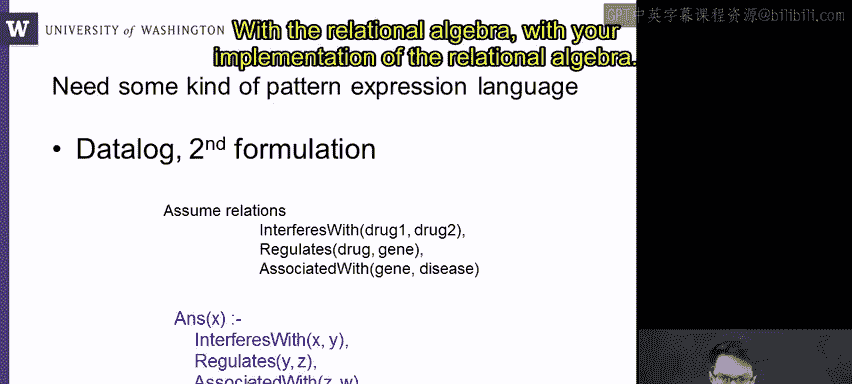

# 课程名称：大规模数据科学（大数据操作，第1课／共3课） - 图的关系代数和Datalog 🧮➡️🗂️

## 概述

在本节课中，我们将学习如何用不同的查询语言表达同一个图查询，并理解它们背后共同的核心——关系代数。我们将看到，尽管SQL、Datalog和特定图查询语言的语法不同，但它们都可以转化为关系代数表达式。我们还将探讨当数据源是分散的关系表而非单一图时，Datalog等语言的优势。

---

我们使用三种不同的模式语言实现了同一个查询。这个事实表明它们之间存在共同点。这个共同点就是关系代数。这也是我本季度课程中一直强调它的原因之一：当你戴上关系代数的“眼镜”看世界，整个世界都开始像关系代数，你会开始发现这些语言本质上并没有那么不同。你可以忽略语法的细节，看到背后实际运行的是一个关系代数表达式。

在这个特定案例中，该表达式可能如下所示。我说“可能”，是因为幻灯片上的表述不一定严谨。这里有两个连接操作，正如我们所见，涉及关系R的三个实例。这个符号 `σ` 表示一个选择条件，我们用它来选择谓词P等于“调节”的元组。这里选择谓词P等于“与…相关”，这里选择谓词P等于“干扰”。

这样，我们就得到了只包含“干扰”谓词的元组、只包含“调节”谓词的元组，以及只包含“与…相关”谓词的元组。然后我们进行连接操作，条件是第一个结果的对象等于第二个结果的主体，并且第二个结果的对象等于第三个结果的主体。

如果你回顾之前的课程，我们讨论过关系代数。希望你能确信，这个表达式将产生等效的结果。

正如我们在关系代数中所说，这实际上规定了操作应用的顺序。而其他语言则更像是声明式地表达结果应该是什么，但未必规定如何得到结果。这通常是代数与这些语言之间的主要区别。这些语言的一个好处是，它们试图抛开具体实现方式的任何规定，只指定结果必须满足的条件，这就是我们所说的声明式语言。

那么，也许这三种语言都是等价的？但我认为并非如此。SQL实现和Datalog实现实际上有其优势。我将尝试通过以略微不同的方式重写查询来阐明这一点。

现在想象一下，你拥有的不是一个包含图中所有边的大表（称为triples或R），而是拥有三个不同的表。这些表可能来自不同的数据源或不同的数据库，你将它们合并到一个数据库中。每个表代表了原始图的不同部分。

你有一个**药物相互作用数据库**，其中包含一个名为“干扰”的关系，它有两列。每个元组的语义是：第一列的药物会干扰第二列的药物。

从一个完全不同的数据库，你拥有关于**药物调节哪些基因**的事实。这些信息可能从科学文献中挖掘而来，或者来自跟踪此类信息的公共数据库。

第三，你可能有一个不同的数据库，记录**哪些基因与哪些疾病相关**。

这是一个非常可能出现的场景。事实上，这源自我们与合作伙伴合作中的一个真实案例。这些不同类型的关系确实来自不同的来源。因此，你更可能以这种形式拥有它们，而不是作为一个大图。你实际上需要进行一些预处理才能将它们合并成一个图。

但在你完成合并之前，你无法使用那种特定的图查询语言。事实上，你无法使用任何图语言，也无法真正使用任何图数据库，因为它们只处理图结构。

虽然图是捕获任意关系的非常通用的数据模型，但现实世界的数据在其原始表示中并不总是以图的形式存在。它通常以一堆表的形式存在，而这些表中恰好编码了图的边。因此，能够在原始格式下处理它们是一种优势。

你可以在Datalog中做到这一点。这里的查询实际上变得更简单一些，你只需在这三个独立的关系之间进行连接，而不再需要查询并指定定义每个关系的谓词。

如果你混合了图和关系，你可以用Datalog同时处理它们。事实上，你可以像处理关系代数实现中的任何其他查询一样处理它们。

---

## 总结

本节课中，我们一起学习了如何透过不同查询语言的表面语法，看到其底层共同的关系代数核心。我们比较了声明式语言与规定操作顺序的关系代数之间的区别。更重要的是，我们探讨了在实际数据工程场景中，原始数据常以分散的关系表形式存在，而非现成的单一图。在这种情况下，像Datalog这样能直接在关系上操作并表达图查询的语言，展现了其灵活性和优势，避免了强制进行数据合并的预处理步骤。理解这一点，有助于我们根据数据源的实际情况，选择最合适的查询与处理工具。