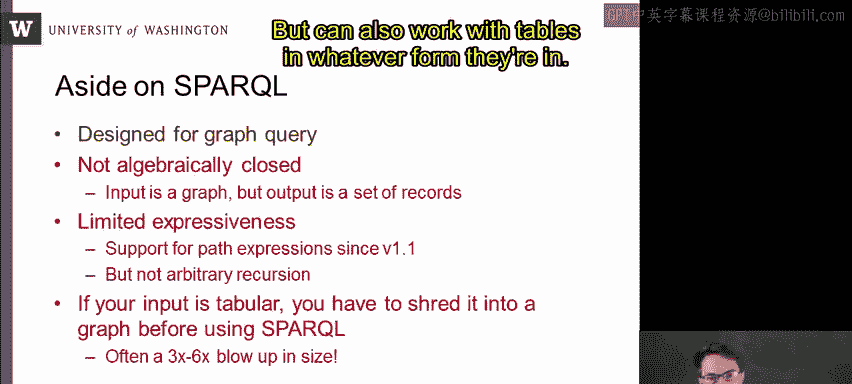

# 大规模数据科学（大数据操作，第1课／共3课） - P120：查询混合图关系数据 📊➡️🔗

在本节课中，我们将探讨一个核心问题：在现实应用中，数据模型往往是**关系型表格**与**图结构数据**的混合体。我们将分析专门用于图查询的系统（如SPARQL）在处理此类混合数据时的优势与局限性，并思考理想的数据处理系统应具备哪些能力。

---

## 混合数据模型的现实需求

上一节我们讨论了图查询语言。但在实际应用中，数据很少以纯粹的图结构孤立存在。

现实世界的应用往往是**混合型**的：它们同时包含一些表格、一些关系和一些图结构。能够统一地处理这两种数据模型，是一个重要的优势。

因此，虽然专门图系统的出现，暗示了传统关系模型在应对某些建模需求时可能存在性能问题（我们将在后续章节讨论），但将整个世界建模为一个巨大的、扁平的图，并不一定是正确的做法。

似乎我们需要一个能够同时处理关系和图，并能在两者之间灵活转换的模型。

---

## SPARQL的局限性分析

在进入更复杂的示例之前，让我们对SPARQL再做一个总结。虽然SPARQL是为图查询设计的，但我想指出几个问题。

以下是SPARQL面临的三个主要挑战：

1.  **缺乏代数封闭性**
    当我们讨论关系代数时，曾提出“代数封闭性”的概念。对于SPARQL，其输入是一个图，你可以查询一个图。但如果你回头看SPARQL的幻灯片并查看结果，输出实际上是一个记录列表，而不再是图，它不必是三元组了。因此，我无法将一个SPARQL查询的结果，再次作为图输入给SPARQL进行查询。更技术性的说法是：它不具备代数封闭性，它返回的类型与其输入的类型不同。这是一个很大的劣势，因为我们希望能够将查询链接在一起。这为诸如**逻辑数据独立性**等特性提供了基础，我们在关系型数据库课程中曾论证过，这是一个非常关键的特性。

2.  **表达能力有限**
    我们稍后会看到一些例子。之前讨论过的许多图遍历任务，在SPARQL中无法表达。从SPARQL 1.1版本开始，虽然支持了可以表达某些形式遍历的路径表达式，但尚不清楚是否支持通用的递归。而为了实现这些图遍历任务，你需要某种方式来整体遍历整个图，SPARQL不一定提供这种能力。

3.  **数据转换开销**
    正如上一张幻灯片所指出的，如果你的输入一开始是表格，那么在用SPARQL处理之前，你必须先将其“切碎”成三元组，并将整个世界建模为一堆图边。虽然图的好处在于你总可以找到某种方式将其切碎成图，但这个过程可能会使数据量膨胀三倍或六倍（实践中取决于你的建模方式和表结构）。为了恢复因切碎成图而损失的性能，这是一个需要克服的艰难障碍。

---

## 理想系统的愿景

综上所述，我认为这告诉我们，我们需要一个能够同时处理图和数据表的系统。

这个系统应该能够：
*   **处理图结构**，并能表达图遍历任务（SQL在这方面不擅长，SPARQL也不完全擅长）。
*   **处理表格数据**，无论它们以何种形式存在。

---

本节课中，我们一起学习了现实数据模型的混合性，分析了专门图查询语言SPARQL在应对这种混合性时的三大局限性，并由此引出了对能够统一、高效处理关系与图数据的理想系统的思考。理解这些优缺点，是选择合适工具和设计健壮数据架构的基础。