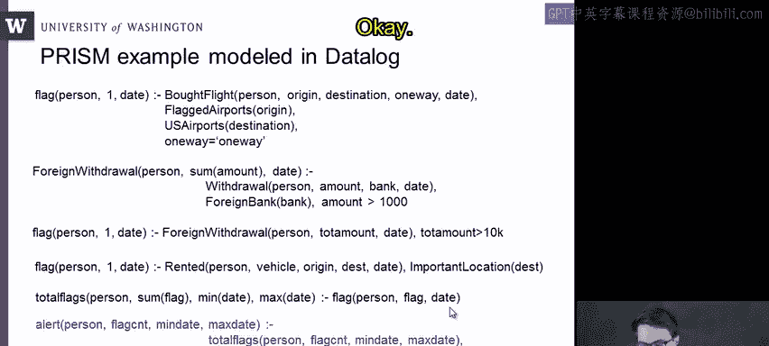

# 大规模数据科学（大数据操作，第1课／共3课） - 图查询示例：NSA 🕵️


在本节课中，我们将学习如何将现实世界中的复杂监控场景，转化为可在图数据库或逻辑编程语言中执行的查询模式。我们将以2013年新闻中提及的美国国家安全局（NSA）PRism系统为例，探讨如何使用类似Datalog的语言对多源数据进行关联分析，并生成预警信号。

---

## 背景：图模式搜索与新闻事件

上一节我们介绍了图模式搜索的基本概念，本节中我们来看看一个与之相关的现实案例。

2013年6月，图模式搜索问题因与NSA开发的PRism系统高度关联而成为新闻焦点。一篇《商业周刊》的文章描述了NSA感兴趣的任务类型，以及他们所使用的技术。

根据我们的理解，这些技术包括曾在NoSQL讲座中提到的Accumulo系统。该系统最初由NSA开发，随后开源并商业化，成为了其底层平台之一。NSA希望利用Accumulo及其他系统完成的应用类型，正是我们一直在讨论的模式搜索。

---

## 一个具体的监控场景示例

以下是《商业周刊》文章中描述的一个假设场景，它展示了如何从看似无关的独立事件中识别出潜在风险。

十月份，一位名叫某某的外国公民购买了一张从开罗到迈阿密的单程机票。他在迈阿密租了一间公寓。在此前的几周内，他从一个俄罗斯银行账户进行了多次大额取款，并多次致电叙利亚的几个人。最近，他租了一辆卡车，开车前往奥兰多，并独自游览了迪士尼世界。

文章想要说明的观点是：**这些活动单独来看都不会引发任何警报，但 collectively（集体来看）可能就值得进一步调查**。我们在此不评判这种做法是否正确，仅陈述该系统被用于处理此类事实。

---

## 将事实编码为数据

你可以使用Datalog这类语言来编码这些事实，当然也可以将其表示为RDF图（这更接近他们的实际做法）。

以下是他们可能访问到的数据库事实表示：

*   **航班记录**：某人于特定日期购买了从开罗到迈阿密的单程机票。
*   **取款记录**：多条记录显示某人于不同日期从俄罗斯某银行取款不同金额。
*   **通话记录**：可以表示为 `call_from_to(Person, OtherPerson)` 且 `location(OtherPerson, Syria)`。这是可能的最大警示信号。
*   **租车记录**：包含租车人、取车地、还车地和日期等属性。

这些是对他们所掌握事实的一种表示。关键在于，**将这些事实聚合成某种警报或“值得进一步检查”的判断，可以表达为这些语言中的一个查询**。接下来我们将重点讨论Datalog。

---

## 在Datalog中定义预警规则

以下是使用Datalog语言定义的一系列预警规则。每个规则都会向一个统一的`flag`关系中添加记录。

**规则一：可疑航班**
如果一个人从被监控的机场（`flagged_airport`）购买飞往美国机场的单程机票，则产生一条预警。
```prolog
flag(Person, 1, Date) :-
    flight(Person, Origin, Dest, Date, one_way),
    flagged_airport(Origin),
    us_airport(Dest).
```
其中，`1`是一个标识此特定规则的标记，`Date`是关联日期。

**规则二：大额境外取款**
计算每个人从境外银行的总取款额（仅统计单笔大于100的取款），如果总额超过阈值（如10,000），则产生预警。
```prolog
foreign_withdrawals(Person, SUM(Amount)) :-
    withdrawal(Person, Bank, Amount, Date),
    foreign_bank(Bank),
    Amount > 100.

flag(Person, 2, Date) :-
    foreign_withdrawals(Person, Total),
    Total > 10000.
```
注意，这里的`flag`关系与规则一中的相同。Datalog允许多条规则向同一关系添加结果，其语义是取所有结果的并集，类似于SQL中的`UNION`。

**规则三：前往重要地点的租车行为**
虽然这可能不是一个强预警信号，但可以作为查找模式。
```prolog
flag(Person, 3, Date) :-
    vehicle_rental(Person, _, Dest, Date),
    important_location(Dest).
```

---

## 聚合预警并生成最终警报

在定义了多条预警规则后，我们可以编写另一个查询来聚合结果，并识别出需要人工分析师进一步关注的目标。

以下查询对每个人的预警进行汇总，计算其预警总数和发生预警的日期范围。
```prolog
person_flags(Person, COUNT(FlagId), MIN(Date), MAX(Date)) :-
    flag(Person, FlagId, Date).
```
这类似于SQL中的：`SELECT person, COUNT(flag_id), MIN(date), MAX(date) FROM flag GROUP BY person`。

最后，定义“警报”：对于那些在短时间内（例如10天内）预警总数超过某个阈值（例如3条）的人，生成最终警报。
```prolog
alert(Person) :-
    person_flags(Person, TotalFlags, MinDate, MaxDate),
    MaxDate - MinDate <= 10,
    TotalFlags > 3.
```
需要指出的是，这个简单示例在时间分桶（如按周或月）上处理得比较粗糙，实际应用中可能需要更精细的时间窗口分析。

---

## 总结与核心要点

本节课中我们一起学习了如何将一个涉及多数据源、多事件类型的监控场景，通过逻辑规则（以Datalog为例）进行形式化表达。

其核心思想在于：
1.  **将孤立事实编码**为基本关系（如`flight`, `withdrawal`）。
2.  **使用逻辑规则定义预警模式**，每条规则对应一种可疑行为模式。
3.  **通过规则组合与聚合**，从分散的低级预警中提炼出高级别警报。



这个例子表明，**基于规则的逻辑语言能够处理大型图数据和多关系数据，表达相当复杂的条件**。从某种意义上说，如果你拥有大规模高效实现这类语言的方法，这就是进行高级分析所需的全部工具。它用不多的代码量，就能将针对海量图数据的自然语言问题，转化为可执行的逻辑查询。