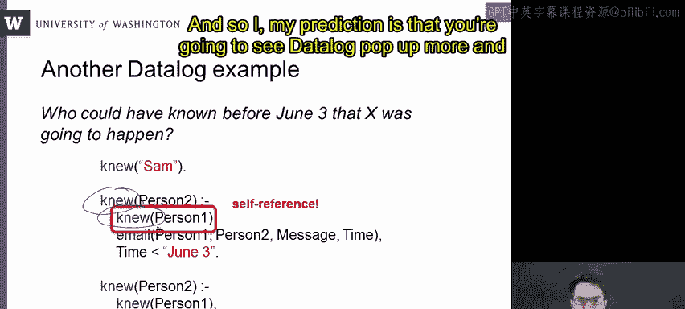

# 大规模数据科学（大数据操作，第1课／共3课） - 图查询示例：递归 📊


在本节课中，我们将学习如何使用Datalog语言进行递归查询，以探索数据中的关联关系。我们将通过一个具体的例子，了解如何从多个数据源整合信息，并利用递归规则来推断潜在的关联网络。

---

## 递归查询示例：谁可能提前知晓事件？ 🔍

上一节我们介绍了如何从不同数据源（如邮件、通话、短信）构建一个统一的“联系”关系。本节中，我们来看看如何利用递归查询，从一个已知起点（例如，一个名叫Sam的人）出发，找出所有可能提前知晓某个事件的人。

假设我们想知道在6月3日之前，谁可能已经知道某个事件即将发生。我们从已知事实开始：一个名叫Sam的人知道这件事。那么，还有谁可能知道呢？我们可以使用与构建“联系”关系时相同的技巧，但这次我们将引入递归。

以下是构建“知晓”关系的递归规则：

1.  **基础情况**：Sam是已知的知晓者。
    ```
    knew("Sam", "事件X").
    ```
2.  **递归规则**：如果一个人（person1）知道，并且此人在6月3日之前通过邮件联系了另一个人（person2），那么person2也可能知道。
    ```
    knew(Person2, Event) :- knew(Person1, Event),
                            emailed(Person1, Person2, Time),
                            Time < "2023-06-03".
    ```
3.  **扩展规则**：同理，如果知晓者与另一个人在6月3日之前会面，那么另一个人也可能知道。
    ```
    knew(Person2, Event) :- knew(Person1, Event),
                            met(Person1, Person2, Time),
                            Time < "2023-06-03".
    ```

**核心机制**：请注意，在这些规则中，我们正在定义的 `knew` 关系同时出现在了规则头部（我们要推导的结果）和规则体（推导的条件）中。这种**自我引用**就构成了递归。查询执行时，会从Sam开始，找到所有Sam在截止日期前联系过的人，然后将这些人作为新的起点，继续查找他们联系过的人，如此反复，直到找不到新的关联为止。

---

## Datalog递归 vs. SQL递归 ⚖️

这种递归自引用的能力，是Datalog与标准SQL的一个关键区别。虽然在SQL中也可以通过**公共表表达式（CTE）** 和 **`WITH RECURSIVE`** 子句实现类似功能，但在实践中存在一些限制。

以下是SQL递归实现常见的局限性：

*   **递归深度限制**：许多数据库系统会设置递归步数的上限（例如100层），这对于许多图遍历应用来说可能太小。
*   **性能差异大**：不同数据库系统对递归查询的优化程度不一，性能可能不理想。
*   **功能支持不均**：这表明关系数据库的用户过去对此类功能需求不强。

然而，随着图数据变得越来越重要（例如Neo4j等图数据库的流行、基于MapReduce的图处理系统、RDF三元组存储等），这种递归遍历图的能力也日益关键。这或许预示着从SQL关系代数语言向Datalog这类语言的迁移。因此，可以预见Datalog在工业界的应用将会越来越广泛。

---

## 总结 📝



本节课中，我们一起学习了Datalog中递归查询的强大功能。我们通过一个“找出潜在事件知晓者”的示例，看到了如何从多源数据定义规则，并利用递归来探索数据中隐含的链式关联。同时，我们也对比了Datalog递归与SQL递归在表达能力和实践限制上的不同，并理解了递归图查询在现代数据科学中日益增长的重要性。