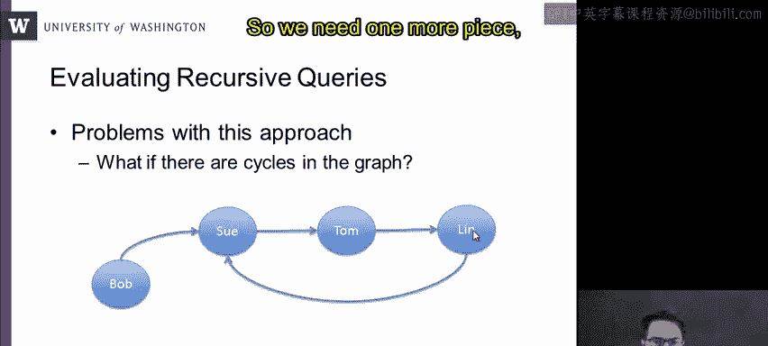

# 大规模数据科学（大数据操作，第1课／共3课） - P123：递归程序评估 🧠

在本节课中，我们将学习如何在大规模数据处理框架（如MapReduce）中实现递归查询，特别是针对图遍历任务。我们将以DataLog语言中的递归程序为例，探讨其直观评估方法以及处理循环图时面临的挑战。

---

上一节我们介绍了图任务、结构遍历、模式任务以及DataLog等模式语言。然而，我们尚未讨论如何大规模地实现这些操作，尤其是涉及递归的部分。本节中，我们来看看如何评估一个递归的DataLog程序。

假设我们有一个递归的DataLog程序，其目标是找出从特定顶点 `W` 出发，通过边关系 `edge(X, Y)` 可到达的所有顶点。程序定义如下：

1.  初始规则：`A(W) :- edge(W, Y).`
    *   此规则找出所有直接与顶点 `W` 相连的顶点，并将它们放入关系 `A` 中。我们称这第一批顶点为 `A0`。
2.  递归规则：`A(Y) :- A(X), edge(X, Y).`
    *   此规则指出：对于已在关系 `A` 中的每个顶点 `X`，找出所有从 `X` 出发通过一条边可达的顶点 `Y`，并将这些 `Y` 也加入关系 `A`。

直观上，这个程序以广度优先的方式遍历图。首先应用规则1得到 `A0`，然后反复应用规则2，每一轮都找到距离 `W` 更远一层的邻居顶点。

以下是评估此递归程序的步骤概述：

1.  计算 `A0`：找出所有满足 `edge(W, Y)` 的 `Y`。
2.  迭代计算：对于当前已发现的 `A` 集合中的每个顶点，通过连接 `A(X)` 和 `edge(X, Y)` 来寻找新的顶点 `Y`。
3.  持续迭代：重复步骤2，直到没有新的顶点可以被加入关系 `A` 为止。

然而，这种方法存在一个问题：如果图中存在循环，评估过程可能永远不会终止。例如，顶点可能被重复发现，导致无限循环。

为了确保程序能够终止并给出正确结果，我们需要增加一个关键步骤：在每一轮迭代中，**移除所有之前已经发现过的顶点**。这意味着我们只保留新发现的、尚未在关系 `A` 中的顶点。通过这种方式，即使图中存在循环，当没有新顶点可加入时，迭代过程也会自然停止。

---

本节课中我们一起学习了递归DataLog程序的基本评估逻辑。我们了解到，其核心是通过迭代的连接操作进行图遍历，但同时必须引入**去重**机制来处理图中的循环，从而保证评估过程能够正确终止。下一节，我们将探讨如何将这种递归评估逻辑具体实现在MapReduce等大规模计算框架中。