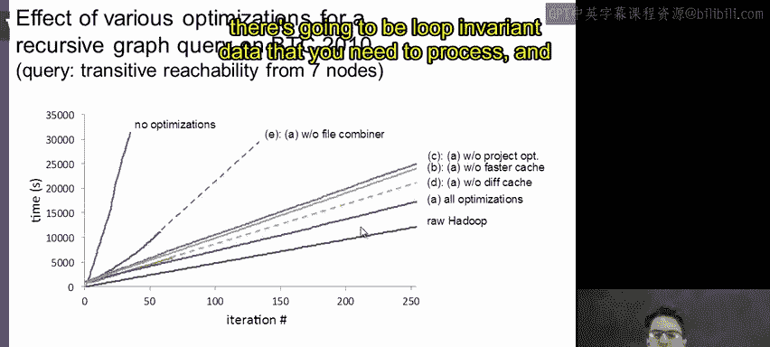
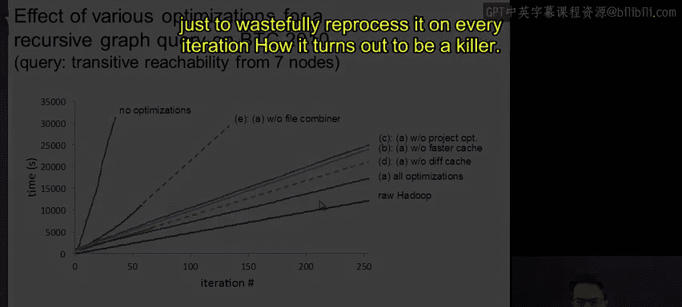

# 大规模数据科学（大数据操作，第1课／共3课） - P124：MapReduce中的递归查询 🧠

在本节课中，我们将要学习如何在MapReduce框架中实现递归查询。我们将探讨一个基础实现模式，分析其存在的性能问题，并介绍一种通过缓存优化来显著提升迭代计算效率的关键技巧。

---

## 基础实现模式

上一节我们介绍了递归查询的概念，本节中我们来看看其在MapReduce中的基础实现模式。

其核心思想是，在每次迭代中，MapReduce作业会处理整个图的所有边，并通过连接操作来发现新的可达节点。这个过程会反复进行，直到没有新的节点被发现为止。迭代的次数取决于图的直径。

以下是该模式的关键步骤：
*   **Map阶段**：读取图中的所有边。
*   **Shuffle阶段**：根据连接键（例如，目标节点ID）对数据进行网络传输和排序。
*   **Reduce阶段**：执行连接操作，生成新的可达节点对，并消除重复项。

## 基础模式的问题

虽然上述模式在逻辑上是正确的，但它存在两个主要的性能瓶颈。

首先，在每次迭代中，Map阶段都需要从磁盘读取所有的边（例如，十亿条边），经过Shuffle阶段通过网络传输到Reduce端，仅仅是为了执行一个连接操作。如果只执行一次，这尚可接受。但对于需要多次迭代的递归查询，Map阶段没有进行实质性的计算工作，只是重复地进行数据读取和传输，这**极其浪费**。

其次，更微妙的一点是，答案集 `A` 在每次迭代中都在增长。虽然当不再发现新答案时迭代会停止，但已经发现过的“旧”值在后续每次迭代中，为了去重，仍然会被从磁盘读取并同样经过网络传输。这造成了**不必要的重复处理**。

## 优化方案：Reducer端缓存

针对上述问题，解决方案是在MapReduce程序的Reducer端引入一种缓存机制。

其核心优化思想是：与其在每次迭代中都通过网络Shuffle庞大的、不变的数据（如图的边集），不如只在第一次迭代时传输一次，并将其缓存在Reducer本地。在后续的迭代中，Reducer可以直接从本地磁盘读取这份缓存数据。同时，通过一个变体技巧，我们还可以将新产生的数据增量式地追加回同一个缓存中。

通过扩展MapReduce框架（同时保持其编程接口），我们可以实现这种优化。例如，在名为**HaLoop**的研究系统中，我们就为Hadoop添加了此类迭代处理能力，并用其实现了Datalog查询。

## 优化效果对比

这种缓存优化带来了显著的性能提升。下图展示了运行时间随迭代次数的变化：

*   **未使用缓存**：每次迭代耗时大致相同，因为每次都需要重新处理和Shuffle整个边关系。
*   **使用缓存**：第一次迭代由于需要准备缓存，耗时稍长。但后续迭代的耗时**急剧下降**，因为不再需要映射和Shuffle那个庞大的边关系数据。迭代次数越多，总体运行时间的优化效果就越明显。

通过结合此缓存技巧来优化去重步骤，并智能地利用MapReduce框架进行其他优化，我们能够将原始MapReduce处理迭代程序的糟糕性能，大幅降低到接近运行一个“空”Hadoop作业的原始开销水平（即仅在集群中启动任务而不做实际工作）。

事实证明，不进行优化的重复处理是性能的“杀手”。

---

## 总结

本节课中我们一起学习了MapReduce中递归查询的实现与优化。关键要点是：
1.  需要**理解并掌握**所介绍的缓存优化技巧，这是处理迭代计算的核心。
2.  认识到如果直接使用“开箱即用”的标准MapReduce，由于其会**浪费性地在每次迭代中重复处理不变的数据**，因此对迭代计算并不高效。在实际应用中，应考虑使用支持迭代优化的框架或自行实现类似机制。