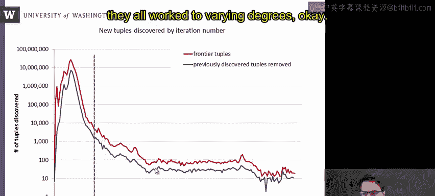

# 大规模数据科学（大数据操作，第1课／共3课） - P125：终局问题 🎯

在本节课中，我们将探讨在大规模图遍历算法（如广度优先搜索）中遇到的一个关键挑战——“终局问题”。我们将分析其产生原因、对MapReduce等框架的影响，并讨论几种可能的应对策略。

---

上一节我们讨论了图遍历算法在迭代过程中的行为模式。本节中，我们来看看这种模式带来的具体问题及其解决方案。

迭代过程中新发现的结果数量，往往遵循一个相当标准的模式。这是由实践中常见图的度分布特性所导致的，我们在之前的直方图分析部分略有提及。

以下图表展示了这一模式：
*   **Y轴**：每次迭代新发现的结果数量。
*   **X轴**：迭代次数。

从图中可以看出，在最开始的几次迭代中，算法会迅速发现海量的新结果。请注意，这是一个对数坐标轴，因此实际的数量差异极其巨大。

然而，很快这个数字就会急剧下降并趋于平缓。算法仍在持续发现新的结果，但每次发现的新结果集越来越小，增量非常有限。

---

这种模式对MapReduce框架来说非常棘手。因为在这个长尾阶段——正如Friday和Oleman在一篇论文中所称的“终局”阶段——即使每次迭代只发现极少的新结果，你仍然需要支付启动大规模Hadoop集群、进行数据处理和结果检查的巨大开销。而此时，大部分结果其实早已被发现。

这种现象的产生是合理的。因为在最初的几次迭代中，算法会迅速触及图中连接广泛的“核心”部分，这些高度连接的顶点会带来巨大的扩散效应，使你发现大量结果。一旦越过这个阶段，基本上就探索了绝大部分可达区域，新结果的发现速度自然会骤降。

---

我们需要思考的是，如何应对这两种不同的工作状态：一种是进行大量有效工作的阶段，另一种是“终局”阶段，此时工作的效率很低。

以下是几种可以考虑的应对策略：

1.  **提前终止**：当新产生的结果数量不再显著时，直接停止处理可能是合理的。虽然这会导致程序输出非精确答案，但在许多寻求近似解的案例中，前几次迭代后已能获得相当好的近似结果，额外的计算带来的收益很小。
2.  **更换计算框架**：放弃MapReduce，寻找每次迭代开销更低的系统。例如，我们正在研究的一个系统就没有这个问题，其运行时间与发现的新元组数量成正比，而不是像Hadoop那样存在启动作业的固定高额成本。
3.  **切换处理策略**：在“终局”阶段改变算法策略。例如，由于每次迭代只发现少量新结果，可以尝试不做重复检查以节省开销；或者合并多次迭代的逻辑，减少需要启动的MapReduce作业数量，从而提升效率。我们已探索过这些选项，它们在不同程度上都是有效的。

---

本节课中，我们一起学习了大规模图遍历中的“终局问题”。我们分析了其表现为新结果发现数量先急剧增长后快速衰减的模式，并理解了这对基于作业的框架（如Hadoop MapReduce）造成的效率瓶颈。最后，我们探讨了包括提前终止、更换框架和动态切换策略在内的多种解决方案，以应对这一挑战。