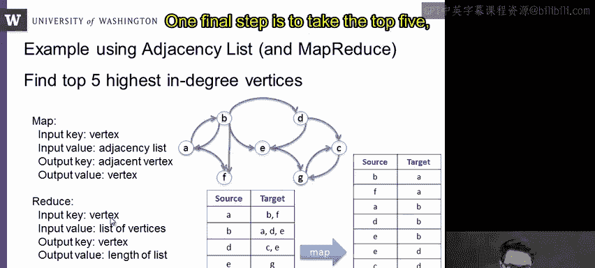

# 大规模数据科学（大数据操作，第1课／共3课） - P126：图的表示：边表与邻接表 📊


在本节课中，我们将学习图的两种核心表示方法：边表和邻接表。理解这些表示方式对于高效处理大规模图数据至关重要。

---

## 图的表示方法概述

我们之前一直隐含地假设使用一种特定的方式来表示图，即一个包含两列的表。一列是源节点，另一列是目标节点，可能还有其他列来表示边的标签等信息。每条边都会被明确地表示出来。

这种表示方式很有意义，因为它易于使用关系型语言进行操作，这也与我们之前讨论的模式匹配等任务相符。

---

## 边表表示法

这种表示法被称为图的**边表**表示。例如，一个包含边A->B和B->A的图可以表示为：

| 源节点 | 目标节点 |
| :----- | :------- |
| A      | B        |
| B      | A        |
| ...    | ...      |

你可以处理这个表。正如我们所见，我们可以进行模式匹配，也可以相当简单地完成结构性任务。

例如，要找出入度最高的五个顶点，我们可以使用一个分组查询。

以下是使用SQL标准语法的示例代码：

```sql
SELECT target, COUNT(*) AS in_degree
FROM edge_table
GROUP BY target
ORDER BY in_degree DESC
LIMIT 5;
```

这个表为我们处理数据提供了很大的灵活性，但我们也需要为此承担一些性能成本。

---

## 邻接表表示法

在实际用于处理图的编程语言库中，更常见的是**邻接表**表示法。

在这种表示法中，每个源节点都与一个包含所有相邻顶点的列表相关联。例如：
*   节点A关联列表 `[B, F]`
*   节点B关联列表 `[A, D, E, F]`

这种表示法所需的总体空间更少，这在性能上可能带来显著差异。

在关系型数据库中，很难直接自然地表达这种列表结构，因为它本质上违反了第一范式。然而，在MapReduce编程模型中，这完全可行。在MapReduce中，一个键对应一个值，而这个值可以是任何东西，比如一个词袋，或者在这里，是一个相邻顶点的列表。

事实上，在处理图的MapReduce库中，这是最常见的表示方式。早期使用MapReduce表达PageRank算法的工作也采用了这种邻接表表示。

---

## 两种表示法的任务对比

现在，让我们看看如何使用邻接表表示法来完成同样的任务：找出入度最高的五个顶点。

你可以设想一个Map程序，它接收一个顶点及其邻接列表作为输入，然后输出以相邻顶点为键、原顶点为值的键值对。这实际上是将边的方向反转。

例如，对于节点A的邻接列表 `[B, F]`，Map阶段会输出：
*   `(B, A)`
*   `(F, A)`

在Reduce阶段，程序会接收一个顶点及其所有入边（即指向它的源节点）列表，然后可以统计数量并输出结果。最后，还需要第二个MapReduce作业来选出前五名。

---

## 总结



本节课中，我们一起学习了图的两种基本表示方法：**边表**和**邻接表**。边表易于在关系型数据库中使用SQL进行操作，而邻接表则更节省空间，是许多图处理库和MapReduce算法中的首选。理解它们的区别和适用场景，是进行大规模图数据处理的重要基础。