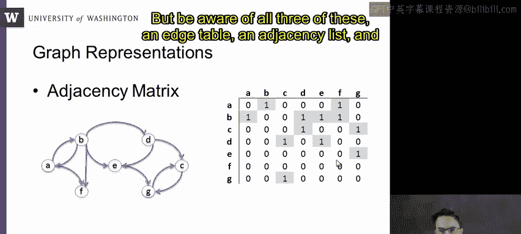

# 大规模数据科学（第1课）📊：图的表示——邻接矩阵

在本节课中，我们将学习图的第三种常见表示方法：邻接矩阵。我们将了解其结构、适用场景以及它与其他表示法的内在联系。

---

## 🧮 什么是邻接矩阵？

上一节我们介绍了边表和邻接表，本节中我们来看看邻接矩阵。邻接矩阵是一种仅当您拥有高效矩阵表示法，并希望将图作为矩阵进行操作时才真正有用的表示方法。

它的存在揭示了一个重要等价关系：**图与方阵是等价的**。一个方阵具有相同数量的行和列。

## 📐 如何构建邻接矩阵？

将图表示为方阵的规则如下：
*   矩阵的每一行对应一个顶点。
*   矩阵的每一列也对应一个顶点。
*   如果在矩阵的某个单元格中填入 **1**，则表示“行顶点”与“列顶点”是相邻的（即存在一条边）。

对于无向图，邻接矩阵将是对称的。对于有向图，则不一定对称。例如，A 与 B 相邻，所以 `A行B列` 的位置是 1；B 与 A 相邻，所以 `B行A列` 的位置也是 1。但 B 与 D 相邻，而 D 不与 B 相邻，因此 `B行D列` 是 1，而 `D行B列` 是 0。

## 💾 邻接矩阵的稀疏性与存储

您会发现，邻接矩阵几乎总是一个**稀疏矩阵**。矩阵中存在大量零值，因为现实中很少有顶点会与几乎所有其他顶点相连。

如果您还记得我们在关系数据库方面的一些工作，以及我们展示的如何在数据库中表示矩阵，那么您就会明白：一旦将数据表示为矩阵，您就可以使用线性代数进行处理，并可能利用已有的、擅长处理矩阵和线性代数运算的快速库。

然而，许多这类库在底层所做的，正是采用一种稀疏矩阵的表示方式，从而避免实际存储所有这些零值。这些稀疏表示看起来会非常像我们之前看到的两种表示法：邻接表或边关系表。

## 🔄 总结与关联

因此，从某种意义上说，将图转换为矩阵是为了获得使用快速矩阵运算库的便利，但这些库在底层处理时，采用的稀疏表示方式又使其本质上更接近于关系型表示。

请注意这三种表示法：**边表**、**邻接表**和**邻接矩阵**。它们各有优劣，适用于不同的场景和计算需求。

---

本节课中，我们一起学习了邻接矩阵的表示方法，理解了其构建规则、稀疏特性，以及它如何通过底层优化与邻接表、边表等表示法产生关联，从而在利用高效矩阵运算库的同时，保持存储和计算上的效率。