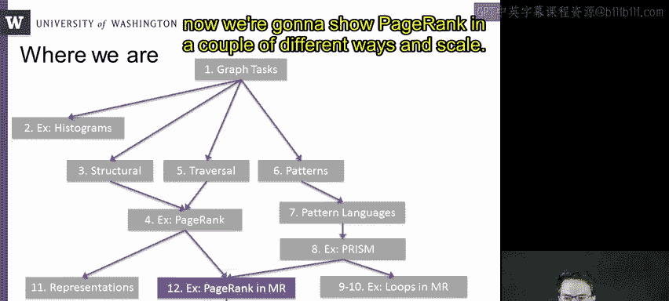
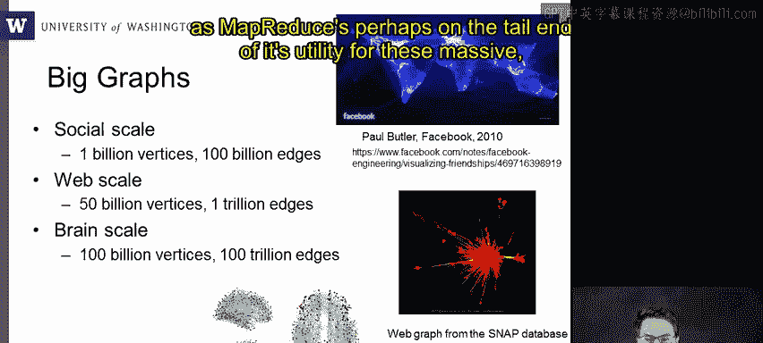
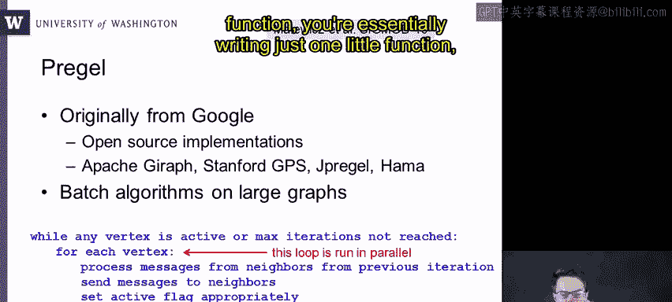

# 大规模数据科学（大数据操作，第1课／共3课） - P128：MapReduce中的PageRank 🧮


在本节课中，我们将学习如何在大规模图数据上实现PageRank算法。我们将首先回顾MapReduce框架，然后展示如何在MapReduce中实现PageRank，并讨论其局限性。最后，我们将介绍一种更高效的图处理模型——Pregel。

---

## 大规模图处理的背景

上一节我们介绍了图的不同表示方法以及如何在MapReduce中实现循环和递归程序。本节中，我们来看看如何在大规模图上实现PageRank算法。

图数据正变得越来越大。例如：
*   社交网络规模的图可能拥有约10亿个顶点（每人一个）和约1000亿条边。
*   网络规模的图更大，因为网页数量多于人口数量，可能拥有约500亿个顶点和1万亿条边。
*   人脑连接组（神经网络）可能拥有约1000亿个顶点和100万亿条边。

我们需要大规模系统来处理此类数据，MapReduce就是这样一个系统。尽管对于超大规模数据处理，MapReduce可能已接近其效用极限，但我们目前仍将以其为例进行讲解。



---

## MapReduce中的PageRank实现



以下是PageRank在MapReduce中的一种实现方式。

### Map函数

在Map函数中，我们接收一个节点ID和一个顶点对象。该顶点对象包含几个我们可以使用的方法：
*   `vertex.page_rank` 获取其当前的PageRank值。
*   `vertex.adjacency_list` 获取其邻接列表。

`vertex.page_rank` 除以邻接列表的长度，得到我们将通过每条出边分配给每个邻居的PageRank比例。

以下是Map函数的核心逻辑：

```python
# P 是分配给每个邻居的PageRank值
P = vertex.page_rank / len(vertex.adjacency_list)

# 发射一个特殊的键值对，将顶点对象本身传递到Reduce端
emit(node_id, vertex)

# 为每个出边邻居发送其应得的PageRank份额
for neighbor in vertex.adjacency_list:
    emit(neighbor, P)
```

我们发射一个以节点ID为键、顶点对象为值的特殊键值对，稍后会解释其作用。然后，为每个出边邻居发送计算得到的PageRank份额 `P`。

### Reduce函数

在Reduce端，我们接收一个节点ID和一系列值的列表。

我们初始化两个变量：`m` 对象（用于存储顶点）和 `new_rank`（新PageRank值，初始为0）。

以下是处理逻辑：

```python
new_rank = 0
m = None

for value in values_list:
    if isinstance(value, Vertex):
        # 如果值是顶点对象，则保存它
        m = value
    else:
        # 否则，它是一个PageRank贡献值，将其累加
        new_rank += value

# 应用阻尼因子公式计算最终的新PageRank
# d 是阻尼因子，通常为0.85
d = 0.85
m.page_rank = (1 - d) + d * new_rank

# 发射更新后的顶点对象，以便进行下一轮迭代
emit(node_id, m)
```

我们需要判断列表中的每个值 `P` 是顶点对象还是一个PageRank数值。如果是顶点对象，则将其赋值给 `m`。这样做的原因是：我们需要一种方式将这个结构复杂的顶点对象（包含邻接列表等信息）传递到Reduce端，因为MapReduce的键只是节点ID。

如果值不是顶点对象，那么它就是来自其他节点的PageRank贡献值，我们将其累加到 `new_rank` 中。

最后，使用我们之前提到的公式（包含阻尼因子）计算该顶点 `m` 的新PageRank值，并发射一个键值对（节点ID和更新后的顶点对象）。这个输出的键值类型与Map函数所需的输入类型一致，因此我们可以多次运行此过程，进行多次迭代。

---

## MapReduce实现的局限性及Pregel模型

上述实现存在一些问题，最主要的是**整个图的状态在每次迭代中都需要被洗牌**。那个包含邻接列表的复杂顶点对象在每次迭代中都需要通过网络发送到Reduce端。实际上，如果顶点状态能“驻留”在本地，我们只需要发送新的PageRank贡献值给邻居节点，这将节省大量网络通信开销。

此外，迭代控制（包括终止条件）必须在MapReduce框架外部进行管理。

基于这些原因，同时也是为了探索另一种并行计算模型，Google在2010年提出了 **Pregel** 模型。此后出现了开源实现，如Apache Giraph、斯坦福大学的GPS系统以及GraphLab等。Pregel专为大规模图上的批量算法设计。

Pregel的基本逻辑如下：

```
while (有顶点仍处于活跃状态) 且 (未达到最大迭代次数):
    for 每个顶点:
        处理从邻居收到的所有消息
        更新自身的内部状态
        向邻居发送消息
        （可选）根据条件设置自身的活跃标志
```

如果顶点没有收到消息，或者其内部状态变化不大，则可以设置为非活跃状态以节省计算。关键在于，现在你编写的不是一个Map函数和一个Reduce函数，而是一个在每个时间步、在每个顶点上运行的**单一函数**。

---

## 总结



本节课中，我们一起学习了：
1.  回顾了处理大规模图数据的挑战。
2.  详细分析了在MapReduce框架中实现PageRank算法的具体步骤，包括Map阶段分配PageRank、Reduce阶段汇总计算并应用阻尼公式。
3.  指出了该MapReduce实现的主要缺点：每次迭代都需要传输整个图结构，通信开销大。
4.  引入了**Pregel图处理模型**作为更高效的替代方案，其以顶点为中心的计算方式更适合迭代式图算法。