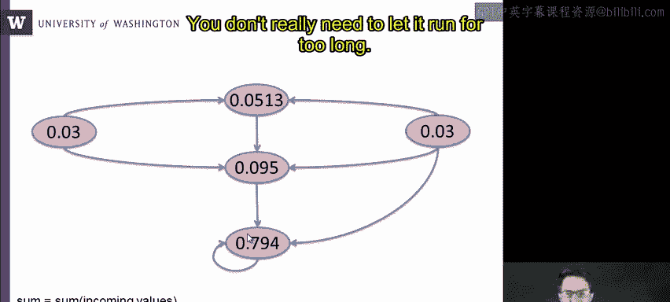

# 大规模数据科学（第1课）📊：Pregel中的PageRank算法详解


在本节课中，我们将学习如何使用Pregel模型实现PageRank算法。PageRank是谷歌搜索引擎的核心算法之一，用于衡量网页的重要性。我们将通过一个具体的代码示例和分步计算过程，理解其在Pregel并行计算框架中的工作原理。

---

## 代码解析

以下是Pregel论文中给出的PageRank计算代码，使用C语言风格编写。代码的核心是一个`compute`方法，它在每个超步（super step）中在每个顶点上并行执行。

```c
if (superstep >= 1) {
    double sum = 0;
    for each message in incoming_messages {
        sum += message.value;
    }
    rank = 0.15 / numVertices + 0.85 * sum;
}

if (superstep < 30) {
    for each neighbor in outgoing_edges {
        send_message(neighbor, rank / numNeighbors);
    }
} else {
    voteToHalt();
}
```

**代码逻辑说明：**
1.  从第一个超步开始，每个顶点汇总所有来自邻居顶点的消息值（即PageRank贡献值）。
2.  使用公式 **`新Rank = 0.15/总顶点数 + 0.85 * 所有入链贡献值之和`** 更新自身的Rank值。
3.  如果超步数小于30，则将自身当前Rank值均分给所有出链邻居。
4.  如果超步数达到30，则顶点投票暂停（`voteToHalt`），进入非活跃状态。

**补充说明：**
实际实现中通常会增加一个收敛判断条件：如果顶点的Rank值前后两次迭代变化很小，该顶点也会投票暂停，从而提前结束计算，提高效率。

---

## 分步计算示例

上一节我们解析了代码，本节我们通过一个具体的图例来看看PageRank在Pregel中是如何一步步迭代计算的。

假设我们有一个包含5个顶点的简单有向图。

**初始化：**
每个顶点的初始Rank值为 `1 / 顶点总数 = 1 / 5 = 0.2`。


**超步 1：**
每个顶点同时执行`compute`方法。
*   每个顶点将自身的Rank值（0.2）均分，通过出链发送给邻居。
*   例如，顶点A有2个出链，每个邻居收到 `0.2 / 2 = 0.1`。
*   顶点B有3个出链，每个邻居收到 `0.2 / 3 ≈ 0.066`。

**超步 2：**
每个顶点汇总在上一步中收到的所有消息（即贡献值），并应用PageRank公式计算新值。
*   对于顶点C：它从A收到0.1，从B收到0.066。总和为0.166。
*   应用公式：`新Rank = 0.15/5 + 0.85 * 0.166 = 0.03 + 0.1411 = 0.1711 ≈ 0.172`。
*   对于顶点D和E：它们没有入链，因此贡献值总和为0。其新Rank值为 `0.15/5 + 0.85 * 0 = 0.03`。

此时，顶点D和E的Rank值在本次迭代中没有发生变化（从0.2变为0.03是第一次变化，但本次迭代前后值未变）。在实际优化中，它们可以被标记为“非活跃”（图中标红），在后续超步中不再参与计算，除非收到新的消息。

**后续超步：**
过程持续进行。在超步3中，活跃顶点（A， B， C）重新计算并发送消息。
*   一个优化是：对于指向非活跃顶点的边，其贡献值可以复用上一轮的值，无需重新发送网络消息。例如，如果D是非活跃的，那么指向它的边在计算时直接使用旧的贡献值即可。
*   计算后，如果顶点A的Rank值也不再变化，则它也会变为非活跃状态。
*   最终，当所有顶点都变为非活跃状态，或达到最大超步数（如30）时，计算停止。

通常，PageRank在经过一定次数的迭代后会接近收敛值，无需运行过长时间。



---

## 总结


本节课中，我们一起学习了PageRank算法在Pregel模型中的实现。
*   我们分析了Pregel `compute`函数的核心逻辑，包括Rank值更新公式 **`新Rank = 0.15/N + 0.85 * sum(入链贡献)`** 和消息传递机制。
*   我们通过一个分步示例，详细演示了Rank值如何初始化、如何在顶点间传播、如何迭代更新，以及如何通过“投票暂停”机制来优化计算过程。
*   关键点在于理解Pregel“以顶点为中心”的并行计算思想和“超步”同步迭代模式，这非常适用于像PageRank这样的图迭代算法。