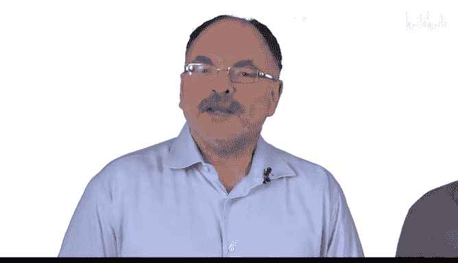
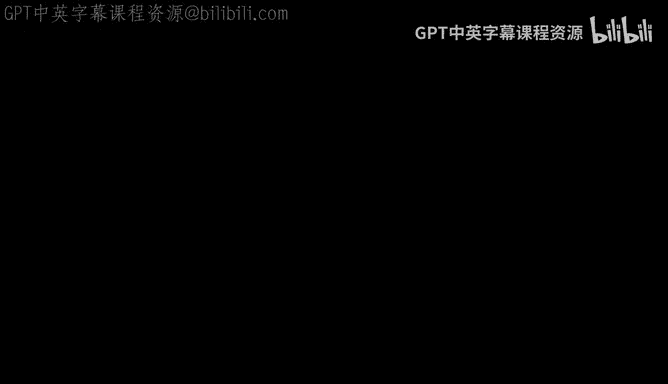

# 📘 课程01：欢迎来到《数据科学数学技能》

在本节课中，我们将了解《数据科学数学技能》这门课程的设计背景、目标以及两位主讲教授的介绍。这门课程旨在帮助学习者填补数学基础知识的空白，为数据科学学习打下坚实的数学基础。

---

大家好，我是Daniel Eger。我是杜克大学工程学院的教授。我在杜克大学和在线平台上教授与数据科学相关的课程。

在2015年秋季于Coursera推出一门新的数据科学课程后，我注意到许多受过良好教育且学习动机强烈的学生，会因为一些基础的数学概念或未曾见过的数学符号而遇到困难。

因此，我仔细梳理了那门课程，列出了所有对非数学专业人士来说不明显的概念，并邀请Paul帮助我创建一门新的在线课程，以温和的方式介绍所有这些内容。

感谢你的邀请，Daniel。大家好，我是Paul Benitch。我是杜克大学的数学教授。在过去的四年里，我运营着一个名为DataPlus的创新暑期项目。在这个项目中，学生们以小组形式，面对跨学科的、面向客户的数据科学挑战。

在这些暑期项目中，我注意到，许多团队成员拥有非常有价值的领域专业知识和丰富的现实世界经验。但由于他们之前数学学习中的一些相对较小的知识缺口，他们无法充分发挥自己的潜力。因此，Daniel和我有一个共同的热情，那就是尽可能高效且轻松地填补这些知识缺口。

数学有助于形成数据科学的语言。完成这门课程后，你将理解这门语言的基本词汇，并能在工作场所和数据科学团队中更好地进行沟通。

如果你渴望自己成为一名数据科学家，学习这门课程是一个很好的第一步。

---

上一节我们了解了课程的设计初衷和目标，本节中我们来看看课程的具体安排和适用人群。

我们为以下人群设计了这门课程：从未学习过代数直至微积分预备水平的人，或者很久以前上过相关课程但坦白说，大部分内容都已遗忘的人。因此，我们假设学习者对这些内容没有任何先验知识。

在本课程中，你们会看到我们两位教授。我将引导大家学习前四个半星期的内容。我们将涵盖集合论的基本概念、代数符号、实数轴上的函数以及笛卡尔平面中的一些曲线。

然后，我将以一个非技术性的解释来结束我的部分，介绍一个基础的微积分概念：如何计算函数的瞬时变化率。在最后的一个半星期里，我将介绍指数和对数，并提供一个关于概率论的迷你课程，内容涵盖著名的贝叶斯定理及其使用方法。

我们祝愿大家在本课程中一切顺利，并感谢你们的加入。

---

**本节课总结**

在本节课中，我们一起学习了《数据科学数学技能》课程的背景、目标、适用人群以及两位主讲教授的介绍。我们了解到，这门课程旨在填补数学基础知识的空白，帮助学习者掌握数据科学所需的数学语言，无论是为了提升职场沟通能力，还是为成为数据科学家迈出第一步。课程内容从集合论、代数基础到微积分和概率论，设计循序渐进，适合初学者。