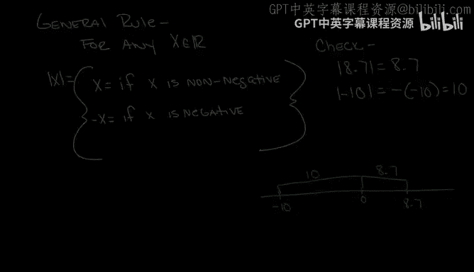

# 课程05：数轴与实数线 📏

在本节课中，我们将学习一个贯穿数据科学始终的核心概念：**实数线**。我们将介绍什么是实数线，并学习正数、负数、非负数、非正数以及**绝对值**等基本概念。

---

## 什么是实数线？🔢

上一节我们介绍了有限集的概念。本节中，我们将看到第一个无限集的例子，即**实数线**。

实数线是一条直线，它向两端无限延伸。最右端是**正无穷大**，最左端是**负无穷大**。这条直线上的每一个点都代表一个**实数**。这个无限集合通常用符号 **R** 表示。

我们通常在直线的中间位置标记 **0**，然后在两侧等距地标记整数：1， 2， 3， 4， 5…… 以及 -1， -2， -3…… 这些整数构成了实数集的一个子集，称为**整数集**，用符号 **Z** 表示。

**Z = {…, -3, -2, -1, 0, 1, 2, 3, …}**

---

## 实数线上的其他数字

并非实数线上的所有数字都是整数。例如，在1和2之间，就存在着无穷多个实数。

为了更清楚地理解，我们可以放大1和2之间的线段。在这段区间内，任何数字都是实数。例如：
*   **1.1** 大约在十分之一的位置。
*   **1.4** 大约在十分之四的位置。
*   **1.1538** 大约在某个位置。

实际上，任何由整数部分和小数部分（可以是有限位，也可以是无限位）组成的数字都是实数。这个规律适用于数轴上的任何子区间。例如，在-3和-2之间，存在像 **-2.5** 这样的数字。

因此，一个实数可以是任何整数加上任意你想要的数字串。有些数字串会终止（如1.5），有些则不会终止且不重复（如圆周率π），后者被称为**无理数**。本节课的核心要点是：**实数就是这条线上的任何一个数字，它们的数量是无穷的。**

---

## 正数、负数与非正非负数

数学家们常常将大集合划分成更小的类别。对实数进行的第一个重要划分就是**正数**和**负数**。

再次画出我们的实数线，中间是**0**。
*   在**0右侧**的所有数字称为**正实数**。
*   在**0左侧**的所有数字称为**负实数**。

以下是具体例子：
*   正实数的例子：**5.3**， **0.001**。
*   负实数的例子：**-11.7**。

如果我们把**0也包括进去**，那么：
*   正实数加上0，就构成了**非负实数**。
*   负实数加上0，就构成了**非正实数**。

---

## 绝对值 📏

观察数轴可以发现，数字常常成对出现：一个正数和一个对应的负数。例如，**7.1** 和 **-7.1**。虽然它们不相等，但它们有一个重要的共同点：**它们到0的距离相同**。

从7.1到0的距离是7.1，从-7.1到0的距离也是7.1。这个“距离”的概念就是**绝对值**。

### 绝对值的定义

对于任意一个实数 **x**，其绝对值（记作 **|x|**）定义为 **x 到 0 的距离**。

根据上面的例子：
*   |7.1| = 7.1
*   |-7.1| = 7.1

注意，|-7.1| 也等于 **-(-7.1)**。这引出了一个通用的定义方法，称为**分段定义**。

### 绝对值的分段定义

对于任意实数 **x ∈ R**，其绝对值定义如下：

**|x| = x， 如果 x ≥ 0 （即x是非负数）**
**|x| = -x， 如果 x < 0 （即x是负数）**

让我们通过例子来理解这个定义：
1.  **计算 |8.7|**
    *   x = 8.7，它是非负数。
    *   因此，我们使用第一个公式：|8.7| = 8.7。
    *   在数轴上，8.7到0的距离确实是8.7。

2.  **计算 |-10|**
    *   x = -10，它是负数。
    *   因此，我们使用第二个公式：|-10| = -(-10) = 10。
    *   在数轴上，-10到0的距离确实是10。

---

## 总结 🎯

本节课我们一起学习了：
1.  **实数线（R）**：一条代表所有实数的无限延伸的直线。
2.  **数的分类**：正数、负数、非负数、非正数。
3.  **绝对值（|x|）**：一个数在数轴上到原点的距离，并通过**分段定义**给出了其计算方法。

在下一节课中，我们将深入探讨**不等式**的概念，学习如何比较数的大小（大于、小于、大于等于、小于等于），并将这些概念与绝对值联系起来。