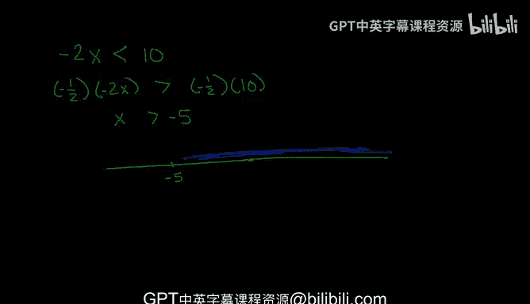

# 📘 课程07：不等式代数运算


在本节课中，我们将学习如何对不等式进行代数运算。我们将从回顾等式的代数运算开始，然后介绍不等式运算的规则，并重点强调一个关键区别：当不等式两边乘以负数时，必须翻转不等号的方向。


---

上一节我们介绍了不等式的基本概念及其在数轴上的表示。本节中，我们来看看如何对不等式进行代数运算。


首先，让我们回顾一下等式的代数运算。我们这样做是为了求解未知数 `X`。


以下是等式运算的两个基本规则：


1.  **等式两边加上或减去同一个数**：如果 `A = B`，那么 `A + C = B + C`。
2.  **等式两边乘以或除以同一个非零数**：如果 `A = B` 且 `C ≠ 0`，那么 `C × A = C × B`。


这些规则使我们能够解方程。例如，对于方程 `x + 3 = 10`，我们可以在两边减去 `3` 来求解 `x`：
```
x + 3 - 3 = 10 - 3
x = 7
```


---


现在，让我们转向不等式。对于不等式，加减法规则与等式类似。


**不等式两边加上或减去同一个数**：如果 `A < B`，那么对于任意数 `C`，都有 `A + C < B + C`。


这个规则允许我们像处理等式一样处理不等式。例如，对于不等式 `x + 3 < 10`，我们可以在两边减去 `3`：
```
x + 3 - 3 < 10 - 3
x < 7
```
这意味着 `x` 可以是任何小于 `7` 的数。


---


然而，当涉及到乘法时，不等式有一个非常重要的注意事项。

以下是乘法规则：


*   如果 `A < B`，且 `C > 0`（正数），那么 `A × C < B × C`。
*   如果 `A < B`，且 `C < 0`（负数），那么 `A × C > B × C`。**此时必须翻转不等号的方向。**


让我们看一个例子。假设我们有不等式 `-2x < 10`。为了求解 `x`，我们需要在两边乘以 `-1/2`。因为乘的是负数，我们必须翻转不等号：
```
(-1/2) × (-2x) > (-1/2) × 10
x > -5
```
这意味着 `x` 可以是任何大于 `-5` 的数。


---




本节课中我们一起学习了不等式的代数运算。关键要点是：对不等式进行加减运算时，规则与等式相同；但当不等式两边乘以或除以一个**负数**时，**必须记得翻转不等号的方向**。这是处理不等式时唯一但非常重要的区别。